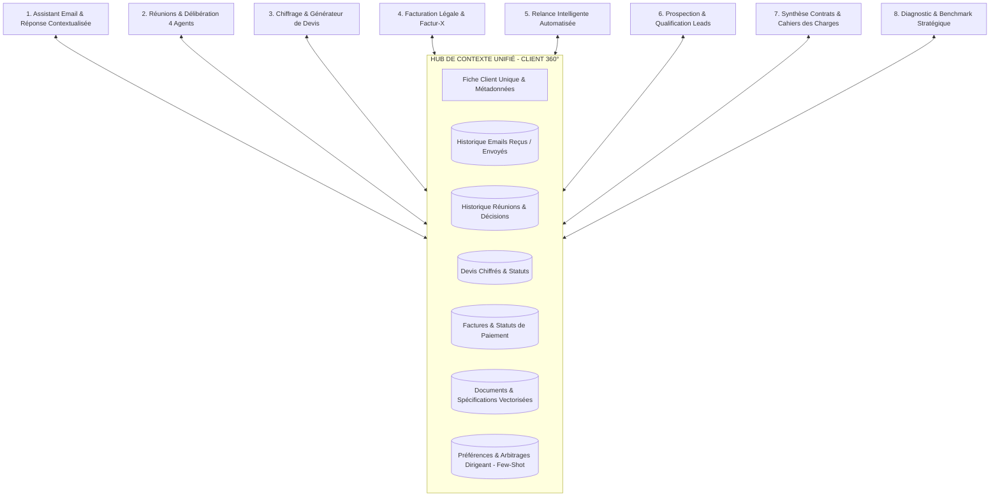

# 🌐 AUDIT COMPLET : ÉCOSYSTÈME UNIFIÉ & INTERCONNEXION TOTALE DES APPLICATIONS MDIV BUSINESS

> **Statut :** Spécification d'Architecture Transversale & Plan Directeur  
> **Auteur :** Antigravity Multi-Agent Architecture Team  
> **Système cible :** MDIV Business Platform (SaaS B2B Multi-Tenant)  
> **Objectif :** Transformer les modules IA isolés en un **Système d'Exploitation d'Entreprise Unifié**, où chaque action dans une application (Email, Réunions, Devis, Facturation, Relance, Prospection, Synthèse) alimente et consomme le contexte 360° du client et des autres briques en temps réel.

---

## 📑 TABLE DES MATIÈRES

1. [Diagnostic de l'Existant & Ruptures de Contexte](#1-diagnostic-de-lexistant--ruptures-de-contexte)
2. [Vision & Modèle Mental de l'Écosystème Transversal](#2-vision--modèle-mental-de-lécosystème-transversal)
3. [L'Exemple Pilote Approfondi : Préparation & Réponse de Mail Unifiée](#3-lexemple-pilote-approfondi--préparation--réponse-de-mail-unifiée)
4. [Matrice d'Interconnexion Totale des 8 Applications](#4-matrice-dinterconnexion-totale-des-8-applications)
5. [Architecture de Données Unifiée (Schéma BDD & Relations)](#5-architecture-de-données-unifiée-schéma-bdd--relations)
6. [Couche de Service & Bus d'Événements Transversal](#6-couche-de-service--bus-dévénements-transversal)
7. [Flux Applicatifs de Bout en Bout (Workflows Croisés)](#7-flux-applicatifs-de-bout-en-bout-workflows-croisés)
8. [Matrice des Tests d'Intégration & Protocole de Validation](#8-matrice-des-tests-dintégration--protocole-de-validation)
9. [LE PROMPT MAÎTRE EXHAUSTIF D'IMPLÉMENTATION](#9-le-prompt-maître-exhaustif-dimplémentation)

---

## 1. DIAGNOSTIC DE L'EXISTANT & RUPTURES DE CONTEXTE

### 1.1 Constat Actuel
La plateforme MDIV Business dispose de modules IA individuels de haute performance :
- **Préparation de mail** (`ServicesIAEmail.tsx`) : assiste la formulation, le ton et l'analyse de qualité.
- **Réunions & Délibération** (`ServicesIAMeetings.tsx` / `ServicesIAMeetingPrep.tsx`) : analyse de verbatims et comité délibératif à 4 agents.
- **Devis intelligent** (`ServicesIAQuote.tsx`) : chiffrage automatique, calcul de marge, génération PDF.
- **Facturation & Audit légal** (`ServicesIAInvoice.tsx`) : contrôle Factur-X / PDP 2026, vérification Article L. 441-10.
- **Suivi & Relance** (`ServicesIAFollowup.tsx`) : relances de factures et devis.
- **Prospection B2B** (`ServicesIAProspecting.tsx`) : génération de leads et séquences commerciales.
- **Synthèse de documents** (`ServicesIASummarizer.tsx`) : compression et extraction contractuelle.

### 1.2 Le Problème du "Silo Applicatif"
Bien que chaque module soit performant, ils fonctionnent encore trop souvent en **silos étanches** :
1. Lorsqu'un utilisateur prépare un devis pour "Client X", le module Devis ne sait pas ce qui a été négocié la veille dans le module Réunion.
2. Lorsqu'un email client arrive par copier-coller dans l'Assistant Email, l'IA ne connaît ni les devis en cours du client, ni les factures impayées, ni l'historique de ses préférences.
3. Si un client conteste un tarif par email, l'utilisateur doit quitter le module Email, ouvrir le module Devis, chercher la référence, recalculer manuellement et revenir à l'email.
4. Aucun pont direct n'existe entre la décision actée dans un compte-rendu de réunion et la création instantanée du devis ou de la relance.

---

## 2. VISION & MODÈLE MENTAL DE L'ÉCOSYSTÈME TRANSVERSAL

Le système repose désormais sur une architecture centrée sur le **Dossier Client 360° Actif (Context Hub)**.



### Le Principe Clé
> **"Tout élément produit ou reçu dans n'importe quel module devient instantanément accessible et actionnable dans tous les autres modules pour le même client."**

---

## 3. L'EXEMPLE PILOTE APPROFONDI : PRÉPARATION & RÉPONSE DE MAIL UNIFIÉE

Le besoin décrit par l'utilisateur illustre parfaitement le paradigme de l'écosystème :

### 3.1 Scénario Utilisateur dans l'Assistant Email (`ServicesIAEmail`)
1. **Sélection du Client** :
   - En haut de l'écran, un sélecteur dynamique `ClientSelectWithCreate` permet de choisir le client (ex: *Clinique Vétérinaire des Alpages*).
   - Dès la sélection, une barre latérale ou un accordéon rétractable **"Fil d'échange Client 360°"** s'ouvre, montrant :
     - Les 5 derniers emails échangés (avec tag *Reçu* ou *Envoyé*).
     - Le dernier devis émis (ex: *Devis DEV-2026-089 : 4 500 € - En attente de signature*).
     - La dernière facture (ex: *Facture FAC-2026-042 : 1 200 € - Payée*).
     - Les décisions de la dernière réunion du 28/09.

2. **Deux Méthodes de Prise en Compte d'un Mail Entrant** :
   - **Méthode A (Sélection dans le fil)** : L'utilisateur clique sur un email reçu affiché dans l'historique -> bouton immédiat **"Répondre à ce message"**.
   - **Méthode B (Copier-Coller Libre)** : Un volet dédié **"Email reçu à traiter"** permet de coller n'importe quel texte de message reçu. À côté se trouve le bouton d'action **"Générer la réponse IA"**.

3. **Génération Contextualisée & Ultra-Personnalisée** :
   - L'IA combine automatiquement :
     - **Le contenu du mail collé ou sélectionné** (détection des questions clés, objections, demandes de rendez-vous).
     - **Le ton choisi** (Professionnel, Commercial, Diplomatique, Ferme, Empathique).
     - **L'historique financier et contractuel du client** (si le devis est en attente, l'IA rappelle délicatement l'échéance ; si une facture est en retard, elle adapte la posture).
     - **Les directives Few-Shot de l'entreprise** (acompte requis de 40%, conditions de paiement, formule de politesse validée).
   - L'utilisateur obtient une réponse prête à l'envoi avec les boutons : **"Copier"**, **"Envoyer via Outlook/Gmail"**, **"Créer une tâche de suivi"**, ou **"Créer un devis lié"**.

---

## 4. MATRICE D'INTERCONNEXION TOTALE DES 8 APPLICATIONS

| Application Source | Éléments Déclencheurs | Interconnexion avec les Autres Modules |
| :--- | :--- | :--- |
| **1. Assistant Email** | Mail reçu contenant une demande de chiffrage ou une réclamation. | ➔ **Vers Devis** : Bouton *"Créer un devis à partir de cette demande"* (pré-remplit les lignes).<br>➔ **Vers Réunion** : Bouton *"Planifier une réunion sur ce sujet"*.<br>➔ **Vers Relance** : Enregistre le mail comme dernière interaction, ce qui suspend la relance automatique. |
| **2. Module Réunions** | Compte-rendu validé avec décisions d'achat et budget convenu. | ➔ **Vers Devis** : Bouton *"Générer le devis conforme aux arbitrages"*.<br>➔ **Vers Email** : Bouton *"Envoyer la synthèse par email aux participants"* (charge le template officiel et les adresses).<br>➔ **Vers Synthèse** : Rapprochement avec les specs techniques. |
| **3. Module Devis** | Devis chiffré créé, validé ou refusé. | ➔ **Vers Email** : Bouton *"Préparer l'email d'envoi du devis"* (synthèse attractive et call-to-action).<br>➔ **Vers Relance** : Programmation automatique d'une relance J+7 si non signé.<br>➔ **Vers Facturation** : Dès validation, bouton *"Générer la facture d'acompte (ex: 40%)"*. |
| **4. Module Facturation** | Facture émise, payée ou en retard d'échéance. | ➔ **Vers Relance** : Dès J+1 après `due_date`, bascule dans le cockpit d'impayés.<br>➔ **Vers Email** : Bouton *"Relancer par email avec historique"*.<br>➔ **Vers Client 360°** : Mise à jour du score de solvabilité client. |
| **5. Module Relance** | Relance effectuée avec succès ou échec. | ➔ **Vers Email** : Injection du texte de relance dans l'éditeur d'email.<br>➔ **Vers Réunions** : Suggestion d'un point d'arbitrage hiérarchique si impayé persistant. |
| **6. Module Prospection** | Lead qualifié ayant répondu favorablement. | ➔ **Vers Clients** : Bouton *"Convertir en fiche Client CRM"*.<br>➔ **Vers Email** : Préparation de l'email de cadrage personnalisé.<br>➔ **Vers Réunion** : Création d'un slot de cadrage commercial. |
| **7. Synthèse Contrats** | Extraction des clauses et obligations d'un PDF client. | ➔ **Vers Réunion** : Éléments critiques injectés dans l'ordre du jour.<br>➔ **Vers Devis** : Prise en compte des pénalités de retard ou spécifications imposées.<br>➔ **Vers Email** : Réponse argumentée sur les réserves juridiques. |
| **8. Diagnostic & Benchmark** | Recommandations de transformation digitale ou financière. | ➔ **Vers Devis** : Création du devis de prestation d'accompagnement.<br>➔ **Vers Email** : Envoi du rapport exécutif sous forme de synthèse percutante. |

---

## 5. ARCHITECTURE DE DONNÉES UNIFIÉE (SCHÉMA BDD & RELATIONS)

Pour supporter cette interconnexion fluide, la base de données relationnelle MySQL (et le vector store) est enrichie du modèle **Interaction & Context Hub** :

```sql
-- 1. Table des interactions omnicanales liées aux clients
CREATE TABLE IF NOT EXISTS `client_interactions` (
  `id` INT AUTO_INCREMENT PRIMARY KEY,
  `company_id` INT NOT NULL,
  `client_id` INT NOT NULL,
  `direction` ENUM('inbound', 'outbound', 'internal') NOT NULL,
  `channel` ENUM('email', 'meeting', 'quote', 'invoice', 'phone', 'note') NOT NULL,
  `subject` VARCHAR(255) NOT NULL,
  `body_text` LONGTEXT NOT NULL,
  `summary` TEXT DEFAULT NULL,
  `sentiment` ENUM('positive', 'neutral', 'negative', 'critical') DEFAULT 'neutral',
  `metadata_json` JSON DEFAULT NULL,
  `reference_id` VARCHAR(100) DEFAULT NULL, -- ID devis, ID facture, ID réunion lié
  `created_by_user_id` INT DEFAULT NULL,
  `created_at` TIMESTAMP DEFAULT CURRENT_TIMESTAMP,
  INDEX `idx_company_client` (`company_id`, `client_id`),
  INDEX `idx_channel_date` (`channel`, `created_at`),
  CONSTRAINT `fk_client_interaction` FOREIGN KEY (`client_id`) REFERENCES `clients`(`id`) ON DELETE CASCADE
) ENGINE=InnoDB DEFAULT CHARSET=utf8mb4 COLLATE=utf8mb4_unicode_ci;

-- 2. Liens transversaux entre objets métier (Devis <-> Facture <-> Réunion <-> Email)
CREATE TABLE IF NOT EXISTS `cross_module_bindings` (
  `id` INT AUTO_INCREMENT PRIMARY KEY,
  `company_id` INT NOT NULL,
  `client_id` INT NOT NULL,
  `source_module` ENUM('email', 'meeting', 'quote', 'invoice', 'followup', 'summarizer', 'prospecting') NOT NULL,
  `source_id` VARCHAR(100) NOT NULL,
  `target_module` ENUM('email', 'meeting', 'quote', 'invoice', 'followup', 'summarizer', 'prospecting') NOT NULL,
  `target_id` VARCHAR(100) NOT NULL,
  `link_type` ENUM('converted_to', 'referenced_by', 'replied_to', 'settled_by', 'audit_context') NOT NULL,
  `created_at` TIMESTAMP DEFAULT CURRENT_TIMESTAMP,
  INDEX `idx_source` (`source_module`, `source_id`),
  INDEX `idx_target` (`target_module`, `target_id`),
  INDEX `idx_client` (`client_id`)
) ENGINE=InnoDB DEFAULT CHARSET=utf8mb4 COLLATE=utf8mb4_unicode_ci;

-- 3. Vue Matérialisée / Table Cache 360° par Client
CREATE TABLE IF NOT EXISTS `client_context_snapshots` (
  `client_id` INT PRIMARY KEY,
  `company_id` INT NOT NULL,
  `total_quotes_count` INT DEFAULT 0,
  `pending_quotes_amount` DECIMAL(12,2) DEFAULT 0.00,
  `unpaid_invoices_amount` DECIMAL(12,2) DEFAULT 0.00,
  `last_interaction_date` DATETIME DEFAULT NULL,
  `last_interaction_channel` VARCHAR(50) DEFAULT NULL,
  `preferred_tone` VARCHAR(50) DEFAULT 'Professionnel',
  `executive_summary_context` TEXT DEFAULT NULL,
  `updated_at` TIMESTAMP DEFAULT CURRENT_TIMESTAMP ON UPDATE CURRENT_TIMESTAMP
) ENGINE=InnoDB DEFAULT CHARSET=utf8mb4 COLLATE=utf8mb4_unicode_ci;
```

---

## 6. COUCHE DE SERVICE & BUS D'ÉVÉNEMENTS TRANSVERSAL

### 6.1 Nouveau Service TypeScript Centralisé : `clientContextHubService.ts`
Ce service fournit à tous les composants front-end une interface unifiée :

```typescript
export interface Client360Context {
  client: Client;
  recentInteractions: ClientInteraction[];
  financials: {
    pendingQuotes: Quote[];
    overdueInvoices: Invoice[];
    totalRevenueHT: number;
  };
  lastMeetingDecisions?: {
    date: string;
    decisions: string[];
    agreedBudget?: number;
  };
  executiveContextSummary: string;
}

// Méthodes exportées :
// 1. fetchClient360(clientId: number): Promise<Client360Context>
// 2. recordInteraction(data: NewInteractionPayload): Promise<void>
// 3. generateContextualReply(params: ReplyGenerationParams): Promise<string>
// 4. linkEntities(sourceModule, sourceId, targetModule, targetId, linkType): Promise<void>
```

### 6.2 Endpoint PHP Universel : `public/api/client_context_hub.php`
- `GET ?action=get_360&client_id=123` : Récupère la totalité de l'historique consolidé (emails, devis, factures, comptes-rendus).
- `POST ?action=reply_to_email` : Prend en entrée (`client_id`, `incoming_email_text`, `tone`, `objective`), injecte l'historique consolidé dans le prompt système OpenAI, et renvoie la réponse rédigée avec traçabilité complète.
- `POST ?action=sync_cross_module` : Associe une action (ex: création de devis depuis réunion) et historise le lien dans `cross_module_bindings`.

---

## 7. FLUX APPLICATIFS DE BOUT EN BOUT (WORKFLOWS CROISÉS)

### Workflow 1 : Du Mail Reçu à la Facture d'Acompte (Zéro Saisie Redondante)
1. **Étape 1 (Mail)** : Le client envoie un email demandant une intervention urgente pour remplacer un automate PLC.
2. **Étape 2 (Email Assistant)** : L'utilisateur sélectionne le client, colle le mail. L'IA génère la réponse confirmant la prise en charge et active le bouton **"Générer un devis d'intervention"**.
3. **Étape 3 (Devis)** : Le module Devis s'ouvre avec le client sélectionné, les articles automates pré-remplis d'après le texte du mail et la main-d'œuvre calculée. Le devis DEV-091 est généré.
4. **Étape 4 (Validation & Facture)** : Le devis est accepté en 1 clic ➔ Le système propose **"Générer la facture d'acompte de 40% (directive DG)"** ➔ La facture FAC-112 est créée dans `ServicesIAInvoice` avec conformité Factur-X.
5. **Étape 5 (Email de confirmation)** : L'utilisateur est redirigé vers l'assistant email avec le mail de remerciement et la facture attachée.

---

## 8. MATRICE DES TESTS D'INTÉGRATION & PROTOCOLE DE VALIDATION

Pour certifier que l'interconnexion fonctionne "très, très, très bien" sans aucune régression :

1. **Test 1 - Réponse Contextualisée par Copier-Coller** :
   - Injection d'un mail agressif d'un client ayant une facture en retard de 15 jours.
   - Validation que l'IA détecte l'arriéré dans la base financière et formule une réponse diplomatique mais ferme rappelant la facture en suspens.
2. **Test 2 - Sélection Directe d'un Message dans l'Historique** :
   - Sélection d'un mail reçu dans l'interface, clic sur *"Répondre à ce mail"*.
   - Validation que le contenu est instantanément chargé dans le champ d'analyse et que la réponse s'aligne sur le ton sélectionné.
3. **Test 3 - Passage Réunion ➔ Devis ➔ Email** :
   - Enregistrement d'une réunion actant un budget de 12 000 €.
   - Clic sur *"Créer Devis"*, vérification du montant HT 12 000 € pré-rempli.
   - Envoi vers le module Email avec proposition commerciale formatée.
4. **Test 4 - Isolation Hermétique Multi-Tenant** :
   - Validation absolue qu'aucune donnée de l'entreprise A (clients, emails, devis) ne peut être lue ou injectée dans les requêtes de l'entreprise B.

---

## 9. LE PROMPT MAÎTRE EXHAUSTIF D'IMPLÉMENTATION

Voici le prompt intégral, prêt pour exécution, à transmettre pour déployer la totalité de cette architecture transversale :

```markdown
================================================================================
PROMPT MAÎTRE : IMPLÉMENTATION DE L'INTERCONNEXION TOTALE DE TOUTES LES APPLICATIONS
================================================================================

RÔLE ET MISSION :
Tu es l'Architecte Logiciel Principal et Lead Développeur Full-Stack de MDIV Business.
Ta mission est d'implémenter l'interconnexion TOTALE, en temps réel et bidirectionnelle,
entre toutes les applications de la plateforme :
1. Préparation & Réponse de Mail (`ServicesIAEmail`)
2. Réunions & Délibération Multi-Agents (`ServicesIAMeetings` / `ServicesIAMeetingPrep`)
3. Devis Chiffrés Intelligents (`ServicesIAQuote`)
4. Facturation & Conformité PDP 2026 (`ServicesIAInvoice`)
5. Suivi & Relance Automatique (`ServicesIAFollowup`)
6. Prospection & Qualification B2B (`ServicesIAProspecting` / `ServicesIALeads`)
7. Synthèse Documentaire Intelligente (`ServicesIASummarizer`)
8. Diagnostic & Benchmark Stratégique (`ServicesIADiagnostic` / `ServicesIABenchmark`)

EXIGENCE QUALITÉ CRITIQUE :
Chaque étape doit être codée de manière chirurgicale, sans raccourci, sans code tronqué,
avec typage TypeScript rigoureux, gestion d'erreurs robuste, respect strict du cloisonnement
multi-tenant (WHERE company_id = ?), et validation par test avant de passer à l'étape suivante.

════════════════════════════════════════════════════════════════════════════════
PHASE 1 : SOCLE DE DONNÉES UNIFIÉ & API DU HUB DE CONTEXTE CLIENT
════════════════════════════════════════════════════════════════════════════════
1. Créer les migrations DDL dans `public/api/config.php` :
   - `client_interactions` (id, company_id, client_id, direction, channel, subject, body_text, summary, sentiment, metadata_json, reference_id, created_at).
   - `cross_module_bindings` (id, company_id, client_id, source_module, source_id, target_module, target_id, link_type, created_at).
   - `client_context_snapshots` (table de synthèse pour performances < 50ms).
2. Développer l'API PHP unifiée `public/api/client_context_hub.php` :
   - Action `get_client_360` : renvoie les infos client, les 10 dernières interactions omnicanales, les devis en cours, les factures impayées, et la synthèse exécutive.
   - Action `save_interaction` : enregistre tout email envoyé/reçu, note de réunion ou chiffrage.
   - Action `contextual_email_reply` : prend en charge le texte de l'email entrant (sélectionné ou collé), le ton, l'objectif, injecte l'historique complet et génère la réponse optimale via le modèle IA.
   - Action `bind_modules` : matérialise les liens de conversion (ex: réunion -> devis -> facture).
3. Connecter le proxy local dans `vite-dev-api.ts` pour supporter `client_context_hub.php`.

════════════════════════════════════════════════════════════════════════════════
PHASE 2 : SERVICE FRONTEND UNIFIÉ & COMPOSANTS TRANSVERSAUX
════════════════════════════════════════════════════════════════════════════════
1. Créer `src/lib/clientContextHubService.ts` avec toutes les interfaces TypeScript et fonctions d'appel API.
2. Créer le composant UI universel `ClientContextPanel.tsx` :
   - Affiche un tiroir latéral ou volet repliable avec les métriques clés du client sélectionné.
   - Liste chronologique des interactions avec badges de canaux (Email, Réunion, Devis, Facture).
   - Indicateur de statut financier (Acomptes reçus, Devis en attente, Factures dues).
3. Créer le composant `IncomingEmailHandler.tsx` :
   - Zone de texte ergonomique pour coller un email reçu ("Collez ici l'email reçu").
   - Détection automatique de l'expéditeur et des points clés.
   - Bouton d'action directe "⚡ Répondre à ce mail avec l'IA".

════════════════════════════════════════════════════════════════════════════════
PHASE 3 : EXPÉRIENCE UTILISATEUR COMPLÈTE DANS L'ASSISTANT EMAIL
════════════════════════════════════════════════════════════════════════════════
Mettre à jour `src/pages/ServicesIAEmail.tsx` :
1. Intégrer en en-tête `ClientSelectWithCreate` avec label explicite "Client destinataire ou interlocuteur".
2. Intégrer deux modes d'entrée pour la réponse :
   - Mode 1 : Sélection d'un email reçu dans l'historique du client -> Clic sur "Répondre".
   - Mode 2 : Onglet "Traiter un email reçu" avec champ textarea dédié au copier-coller.
3. Lors du clic sur "Répondre à ce mail" :
   - Injecter le texte dans le contexte de génération.
   - Appeler `contextual_email_reply` avec le ton sélectionné (Professionnel, Commercial, etc.).
   - Afficher la réponse générée avec surbrillance des arguments clés.
   - Ajouter les actions rapides : "Transférer dans Devis", "Créer une relance", "Enregistrer dans l'historique client".

════════════════════════════════════════════════════════════════════════════════
PHASE 4 : GÉNÉRALISATION DE LA LOGIQUE AUX 7 AUTRES APPLICATIONS
════════════════════════════════════════════════════════════════════════════════
1. **Module Réunions (`ServicesIAMeetings` / `ServicesIAMeetingPrep`)** :
   - Lier chaque compte-rendu à un client.
   - Ajouter le bouton "Créer un devis depuis ce compte-rendu" qui extrait prestations et budget.
   - Ajouter le bouton "Envoyer le compte-rendu par email" qui bascule vers le module Email avec le texte formaté.
2. **Module Devis (`ServicesIAQuote`)** :
   - Bouton "Importer le besoin depuis les échanges client récents" (emails et réunions).
   - Bouton "Envoyer ce devis par email avec lettre d'accompagnement IA".
   - Bouton "Convertir en facture d'acompte" (dès signature).
3. **Module Facturation (`ServicesIAInvoice`)** :
   - Bouton "Facturer le devis n° X".
   - Bouton "Envoyer la facture par email avec message poli".
   - Alerte automatique transmise au module Relance si facture en retard.
4. **Module Suivi & Relance (`ServicesIAFollowup`)** :
   - Charge les factures et devis non soldés du client.
   - Génère le texte de relance adapté à l'ancienneté de la dette et au ton habituel.
   - Bouton "Envoyer via l'Assistant Email".
5. **Module Prospection (`ServicesIAProspecting`)** :
   - Bouton "Convertir le lead en client" et basculer vers le premier email d'approche.
6. **Module Synthèse (`ServicesIASummarizer`)** :
   - Bouton "Rattacher la synthèse au client X" et "Préparer un email récapitulatif".

════════════════════════════════════════════════════════════════════════════════
PHASE 5 : TESTS UNITAIRES, D'INTÉGRATION ET GRAND TEST TRANSVERSAL
════════════════════════════════════════════════════════════════════════════════
1. Créer un script de test automatisé `tests/cross_app_interconnection_test.mjs` testant :
   - La création d'un client de test.
   - L'enregistrement d'une interaction email reçu collé.
   - La génération d'une réponse contextualisée avec prise en compte du passif client.
   - Le passage des décisions de réunion vers la création automatique du devis.
   - La transformation du devis en facture et le déclenchement de la relance.
2. Exécuter le test, vérifier 100% de réussite.
3. Lancer `npm run build` et valider zéro erreur TypeScript.
4. Livrer un rapport d'exécution complet.
================================================================================
```
