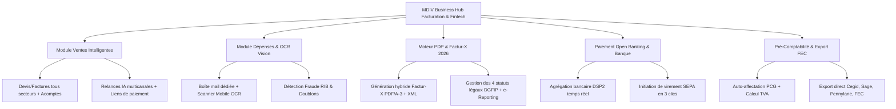

# KOLECTO (https://www.kolecto.fr/) — EXTRACTION EXHAUSTIVE ET ULTRA-DÉTAILLÉE DES FONCTIONNALITÉS
> **Document de Référence & Benchmark Produit pour la Refonte Complète du Module Facturation & Fintech MDIV Business**  
> **Source analysée :** Kolecto (Fintech filiale du groupe Crédit Agricole & LCL, Plateforme de Dématérialisation Partenaire immatriculée PDP n° 0039 par la DGFIP).  
> **Date d'extraction :** Septembre 2026.

---

## SOMMAIRE EXÉCUTIF

1. [Identité, Positionnement & Écosystème Technique de Kolecto](#1-identité-positionnement--écosystème-technique-de-kolecto)
2. [Module 1 : Gestion des Ventes & Facturation Clients](#module-1--gestion-des-ventes--facturation-clients)
3. [Module 2 : Gestion des Achats, Dépenses & OCR Fournisseurs](#module-2--gestion-des-achats-dépenses--ocr-fournisseurs)
4. [Module 3 : Réforme Facturation Électronique 2026 & Conformité PDP](#module-3--réforme-facturation-électronique-2026--conformité-pdp)
5. [Module 4 : Gestion Bancaire, Paiements en 3 Clics & Rapprochement](#module-4--gestion-bancaire-paiements-en-3-clics--rapprochement)
6. [Module 5 : Moteur de Sécurité, Anti-Fraude IBAN & Contrôle Interne](#module-5--moteur-de-sécurité-anti-fraude-iban--contrôle-interne)
7. [Module 6 : Pré-Comptabilité, FEC & Écosystème Experts-Comptables](#module-6--pré-comptabilité-fec--écosystème-experts-comptables)
8. [Module 7 : Connecteurs, Intégrations API & Écosystème Logiciel](#module-7--connecteurs-intégrations-api--écosystème-logiciel)
9. [Module 8 : Modèle Économique & Matrice Tarifaire Kolecto](#module-8--modèle-économique--matrice-tarifaire-kolecto)
10. [Plan de Transposition & Feuille de Route pour MDIV Business](#plan-de-transposition--feuille-de-route-pour-mdiv-business)

---

## 1. IDENTITÉ, POSITIONNEMENT & ÉCOSYSTÈME TECHNIQUE DE KOLECTO

* **Statut réglementaire :** PDP immatriculée sous le **numéro 0039** auprès de la Direction Générale des Finances Publiques (DGFIP).
* **Adossement bancaire :** Filiale technologique et stratégique de **Crédit Agricole S.A.** et **LCL**, développée pour équiper les TPE, PME, artisans, commerçants, indépendants et professions libérales.
* **Cœur de proposition de valeur :** « La plateforme tout-en-un qui unifie la facturation électronique, la gestion des achats, le paiement fournisseur en direct, la synchronisation bancaire multi-banques et la pré-comptabilité connectée aux experts-comptables. »
* **Slogan & mission :** Gagner jusqu'à 3 jours de gestion administrative par mois, réduire à 0 le risque de fraude au faux RIB et garantir 100 % de conformité avec la réforme fiscale 2026.

---

## MODULE 1 : GESTION DES VENTES & FACTURATION CLIENTS

### 1.1 Moteur de Création de Devis & Factures
* **Éditeur dynamique sans rechargement de page :**
  * Saisie rapide au fil de l'eau avec auto-complétion intelligente des articles/prestations.
  * Personnalisation visuelle : logo d'entreprise, code couleur de marque, typographie, en-tête, pied de page personnalisé.
  * Mentions obligatoires légales automatisées selon la forme juridique (SIREN, RCS/RM, capital social, TVA intracommunautaire, assurance décennale pour les artisans, etc.).
  * Gestion multidevise et calculs automatiques HT, taux de TVA multiples par ligne (2,1%, 5,5%, 10%, 20%, exonéré art. 293 B du CGI) et TTC.
* **Catalogue d'articles & prestations :**
  * Gestion centralisée des produits et services (référence SKU, désignation détaillée, unité de mesure, prix unitaire HT/TTC, compte comptable associé).
  * Prise en compte de remises en pourcentage ou en montant fixe par ligne ou globale sur le document.

### 1.2 Typologies de Documents Commerciaux Pris en Charge
* **Devis / Pro forma :** Envoi avec signature électronique intégrée et traçabilité de lecture client.
* **Factures d'acompte :** Génération automatique en pourcentage du devis signé (ex: 30%, 40%) avec imputation sur la facture finale.
* **Factures de situation / Avancement :** Pour les projets longs, BTP, agences ou prestations récurrentes (pourcentage d'avancement par lot).
* **Bons de commande & Bons de livraison (BL) :** Conversion en 1 clic en facture de vente.
* **Factures d'avoir (Notes de crédit) :** Émission partielle ou totale liée à une facture mère, avec réajustement comptable et fiscal.
* **Factures récurrentes / Abonnements :** Fréquence programmable (hebdomadaire, mensuelle, trimestrielle, annuelle) avec envoi automatique au client par email ou circuit PDP.

### 1.3 Suivi en Temps Réel & Traçabilité (Timeline Document)
* Statuts de document visibles en temps réel :
  * *Brouillon* $\rightarrow$ *Émise* $\rightarrow$ *Envoyée* $\rightarrow$ *Ouverte/Consultée par le client* $\rightarrow$ *Partiellement réglée* $\rightarrow$ *Payée* $\rightarrow$ *En retard / Litige*.
* Journal d'audit complet (horodatage précis, adresse IP de consultation du client, accusé de réception).

### 1.4 Encaissement en Ligne & Liens de Paiement
* **Lien de paiement intégré directement sur la facture :** Le client clique et règle instantanément par Carte Bancaire ou virement instantané Open Banking (Pay by Bank).
* **Rapprochement d'encaissement automatique :** Dès réception des fonds sur le compte bancaire connecté, la facture passe au statut « Payée » sans action manuelle.

### 1.5 Moteur de Relances Clients Automatiques & Multi-Niveaux
* Définition de scénarios de relance personnalisables :
  * Pré-échéance (J-3) : Rappel courtois d'échéance à venir avec lien de paiement.
  * J+1 à J+7 après échéance : Première relance aimable avec PDF de la facture rattaché.
  * J+15 : Deuxième relance plus formelle.
  * J+30 : Mise en demeure avec calcul automatique des pénalités de retard légales et de l'indemnité forfaitaire de recouvrement (40 €).
* Envoi multicanal : Email dynamique avec variables de fusion (`{{nom_client}}`, `{{montant}}`, `{{lien_paiement}}`).
* Liste noire / Pause de relance : Exclusion temporaire de clients en cours de litige ou sous accord spécifique.

---

## MODULE 2 : GESTION DES ACHATS, DÉPENSES & OCR FOURNISSEURS

### 2.1 Canaux Multiples de Capture & Collecte des Factures Fournisseurs
* **Boîte de dépôt email dédiée :** Chaque entreprise dispose d'une adresse email unique (ex: `achats-monentreprise@kolecto.fr`) vers laquelle rediriger ou transférer les factures reçues.
* **Téléversement par glisser-déposer (Drag & Drop) :** Support des formats PDF natifs, PDF scannés, JPEG, PNG, TIFF.
* **Application Mobile & Scanner Intelligent :** Prise de photo instantanée des tickets de caisse, notes de frais et factures papier avec correction automatique de perspective, contraste et rognage.
* **Collecteurs automatiques de factures (Scraping de portails marchands) :** Connexion directe et téléchargement automatique des factures depuis les portails récurrents (EDF, Engie, Orange, Bouygues, SFR, Amazon, Uber, TotalEnergies, etc.).

### 2.2 Moteur OCR & Extraction Automatique des Métadonnées (IA Vision)
* Extraction automatique sans intervention humaine des données clés :
  * Nom et raison sociale du fournisseur.
  * Numéro SIREN / SIRET et numéro de TVA intracommunautaire.
  * Numéro unique de facture.
  * Date d'émission et date d'échéance limite de paiement.
  * Ventilation multi-taux de TVA (HT, taux 5,5%, 10%, 20%, montant de TVA, Total TTC).
  * Détail des lignes d'articles et désignations.
  * Coordonnées bancaires (IBAN / BIC du fournisseur).
* **Détection des doublons :** Alerte immédiate si une facture ayant le même numéro, le même fournisseur ou le même montant a déjà été injectée.

### 2.3 Circuit d'Approbation & Workflow de Validation Interne
* Définition de règles de validation selon la hiérarchie de l'entreprise :
  * Validation simple par le gestionnaire.
  * Double validation au-delà d'un seuil financier (ex: supérieur à 1 000 €).
  * Validation par centre de coût ou par département.
* Statuts de cycle de vie achat :
  * *À valider* $\rightarrow$ *Validée* $\rightarrow$ *Prête pour paiement* $\rightarrow$ *En cours de virement* $\rightarrow$ *Payée & Rapprochée*.

---

## MODULE 3 : RÉFORME FACTURATION ÉLECTRONIQUE 2026 & CONFORMITÉ PDP

### 3.1 Statut PDP Agréée DGFIP (Immatriculation n° 0039)
* Kolecto est homologuée par l'administration fiscale française en tant que Plateforme de Dématérialisation Partenaire officielle.
* Elle assure l'interopérabilité totale avec le Portail Public de Facturation (PPF) et le réseau des autres PDP du marché (réseau Peppol et protocoles sécurisés DGFIP).

### 3.2 Formats Structurés & Hybrides Réglementaires
* **Factur-X :** Format hybride associant un fichier PDF lisible par l'humain (PDF/A-3) et un fichier XML structuré (profils Minimum, Basic, Basic WL, Extended).
* **UBL 2.1 (Universal Business Language) :** Format XML standardisé européen.
* **CII (Cross Industry Invoice) :** Standard international UN/CEFACT.
* Conversion automatique de tout document émis ou reçu dans le bon format sans compétence technique requise de l'utilisateur.

### 3.3 Annuaire Central & Routage Automatisé des Factures
* Interrogation en temps réel de l'annuaire national officiel de la DGFIP via le SIREN client/fournisseur.
* Routage automatique : si le client utilise une autre PDP ou le PPF, la facture est acheminée de manière sécurisée de machine à machine.
* Fin définitive des factures perdues dans les boîtes spams ou courriers papier non distribués.

### 3.4 Gestion Complète des Statuts de Cycle de Vie Obligatoires
* Gestion et transmission obligatoire à l'État des 4 statuts réglementaires socles :
  1. **Déposée :** La facture est transmise sur la plateforme.
  2. **Rejetée :** Rejet technique (format invalide, SIREN inconnu, anomalie de mentions).
  3. **Refusée :** Refus métier par l'acheteur (contestation de prix ou de prestation).
  4. **Encaissée :** Déclaration de paiement effectif pour l'exigibilité de la TVA sur les encaissements.
* Statuts métiers complémentaires pris en charge : *Mise à disposition, Prise en charge, Approuvée, Suspendue, Paiement transmis*.

### 3.5 Déclaration du e-Reporting
* Transmission automatisée des données de transaction hors B2B domestique :
  * Ventes aux particuliers (B2C).
  * Ventes et acquisitions intracommunautaires et internationales (Export / Import).
  * Déclaration des données de paiement pour le calcul en temps réel de la TVA collectée par l'administration fiscale.

---

## MODULE 4 : GESTION BANCAIRE, PAIEMENTS EN 3 CLICS & RAPPROCHEMENT

### 4.1 Agrégation Bancaire Multi-Comptes (Open Banking / DSP2)
* Connexion sécurisée avec plus de 300 établissements bancaires français et européens (Crédit Agricole, LCL, BNP Paribas, Société Générale, BoursoBank, Qonto, Shine, Revolut, etc.).
* Synchronisation automatique quotidienne ou temps réel des flux bancaires (soldes, débits, crédits, libellés).
* Vue consolidée de la trésorerie globale multi-banques sur un tableau de bord unique.

### 4.2 Exécution de Paiement Fournisseur en 3 Clics (Sans Quitter l'App)
* **Technologie embarquée d'initiation de virement (PISP / Open Banking) :**
  * Sélection d'une ou plusieurs factures fournisseurs validées.
  * Choix du compte bancaire émetteur parmi les comptes connectés.
  * Génération automatique de l'ordre de virement pré-rempli (IBAN bénéficiaire extrait par l'OCR, montant exact, référence de facture en motif).
  * Authentification forte (SCA) sur le smartphone de l'utilisateur via sa propre banque.
  * **Zéro saisie manuelle de RIB sur le portail de la banque**, suppression totale des risques d'erreur de frappe.
* **Paiements groupés (Batch SEPA) :** Règlement de dizaines de factures fournisseurs en une seule opération de validation bancaire.
* **Planification des paiements à la date d'échéance :** Ordres programmés pour optimiser le besoin en fonds de roulement (BFR) sans jamais encourir de pénalités de retard.

### 4.3 Rapprochement Bancaire Automatisé par Intelligence Artificielle
* Détection automatique de la correspondance entre chaque ligne de relevé bancaire et le justificatif (facture client ou facture fournisseur).
* Algorithme de scoring multicritère : concordance du montant au centime près, libellé bancaire, nom du tiers, date de transaction.
* Rapprochement automatique à 95 % sans action manuelle.
* Interface d'appariement manuel ergonomique pour les cas particuliers (règlements partiels, paiements groupés d'un client pour plusieurs factures).

---

## MODULE 5 : MOTEUR DE SÉCURITÉ, ANTI-FRAUDE IBAN & CONTRÔLE INTERNE

### 5.1 Vérification de Conformité & Fraude au Faux RIB
* **Contrôle croisé de l'IBAN :** Analyse systématique de l'IBAN figurant sur la facture fournisseur face à :
  * L'historique des paiements légitimes déjà effectués.
  * L'annuaire officiel des entreprises et bases de solvabilité.
  * Les listes de RIB frauduleux ou suspects identifiés par les réseaux bancaires Crédit Agricole / LCL.
* **Détection du changement soudain de RIB :** Alerte rouge immédiate si un fournisseur historique présente un nouveau RIB sur sa facture, invitant à une procédure de double vérification avant tout paiement.

### 5.2 Intégrité des Fichiers & Piste d'Audit Fiable (PAF)
* Horodatage certifié de chaque action (téléchargement, modification, approbation, paiement).
* Archivage légal à valeur probante garantissant la non-altération des documents comptables pendant la durée légale de 10 ans.
* Traçabilité documentaire complète pour répondre aux contrôles fiscaux sans stress.

### 5.3 Gestion des Droits & Rôles Collaboratifs
* Définition fine des permissions selon les profils d'utilisateurs :
  * *Administrateur / Dirigeant :* Accès complet, signature et validation finale des paiements.
  * *Comptable interne / DAF :* Rapprochement, export comptable, paramétrage du plan de comptes.
  * *Collaborateur opérationnel :* Dépôt des factures, saisie des devis, consultation limitée sans droit de paiement.
  * *Expert-Comptable invité :* Accès en lecture et téléchargement des écritures et pièces justificatives.

---

## MODULE 6 : PRÉ-COMPTABILITÉ, FEC & ÉCOSYSTÈME EXPERTS-COMPTABLES

### 6.1 Moteur d'Auto-Catégorisation Comptable (Plan Comptable Général)
* Association automatique de chaque dépense et recette à une classe de compte du PCG français :
  * Comptes 60 / 61 / 62 pour les achats de matières premières, fournitures, sous-traitance et services extérieurs.
  * Comptes 70 pour le chiffre d'affaires et prestations de services.
  * Comptes 401 (Fournisseurs) et 411 (Clients).
  * Comptes 44566 (TVA déductible) et 44571 (TVA collectée).
* Moteur d'apprentissage : Kolecto mémorise les affectations personnalisées de l'utilisateur pour appliquer les mêmes imputations aux factures futures du même tiers.

### 6.2 Suivi de la TVA en Temps Réel
* Tableau de bord synthétique de la TVA :
  * Montant de TVA collectée sur les ventes.
  * Montant de TVA déductible sur les achats.
  * Solde prévisionnel de TVA nette à payer ou crédit de TVA à reporter.
  * Gestion de la TVA sur les débits vs TVA sur les encaissements.

### 6.3 Génération du FEC & Exports Comptables Universels
* **Génération conforme du Fichier des Écritures Comptables (FEC) :** Format normalisé obligatoire en cas de vérification de comptabilité par l'administration fiscale (article L. 47 A I du LPF).
* **Exports logiciels natifs compatibles avec 100 % des outils de production comptable :**
  * Cegid (Quadra, Loop, Expert).
  * Sage (Sage 50, Sage 100).
  * Pennylane.
  * ACD Conseil.
  * Agiris / E-connect.
  * Ibiza Software.
  * MyUnisoft.
* Export synchrone des écritures comptables jointes aux pièces justificatives scannées et renommées de manière standardisée (ex: `2026-09_FAC-4920_FOURNISSEUR.pdf`).

---

## MODULE 7 : CONNECTEURS, INTÉGRATIONS API & ÉCOSYSTÈME LOGICIEL

### 7.1 Intégrations Bancaires Négociées
* Accès privilégié et sécurisé aux APIs institutionnelles de **Crédit Agricole**, **LCL**, et de l'ensemble des réseaux bancaires français via protocoles DSP2 certifiés (STET / Berlin Group).

### 7.2 Connecteurs E-Commerce, CRM & ERP
* Synchronisation bidirectionnelle des commandes et factures avec :
  * CMS E-commerce : WooCommerce, Shopify, PrestaShop.
  * CRM & Gestion commerciale : HubSpot, Salesforce, Pipedrive, Sellsy.
  * Passerelles de paiement : Stripe, PayPal, GoCardless.

### 7.3 API Publique & Webhooks pour Développeurs
* API RESTful pour automatiser :
  * La création programmatique de devis et factures.
  * La récupération des statuts de paiement en temps réel via Webhooks (`invoice.paid`, `payment.failed`, `pdp.invoice_rejected`).
  * L'injection automatisée de pièces comptables depuis des applications tierces.

---

## MODULE 8 : MODÈLE ÉCONOMIQUE & MATRICE TARIFAIRE KOLECTO

| Formule / Offre | Cible visée | Tarification Publique | Tarification Partenaire (LCL / Crédit Agricole) | Principales fonctionnalités incluses |
| :--- | :--- | :--- | :--- | :--- |
| **Offre Créateur** | Entreprises de moins d'1 an | **0 € / mois** pendant 12 mois | **0 € / mois** pendant 12 mois | Devis/facturation illimités, 1 compte bancaire, collecte achats de base. |
| **Offre Micro-Entreprise** | Auto-entrepreneurs non assujettis à la TVA | **Gratuit** | **Gratuit** | Émission de factures conformes sans TVA, suivi des recettes. |
| **Offre Indépendant & Artisan** | 0 à 3 salariés | **12 € HT / mois** | Réduction bancaire (~9 € HT/mois) | Factures électroniques Factur-X, 2 comptes bancaires, relances auto, paiement en 3 clics. |
| **Offre TPE & Équipes** | 4 à 9 salariés | **39 € HT / mois** | Réduction bancaire (~29 € HT/mois) | Multi-utilisateurs, validation des dépenses, OCR illimité, rapprochement bancaire IA. |
| **Offre PME** | 10 salariés et plus | **99 € HT / mois** | Réduction bancaire (~79 € HT/mois) | Multi-sociétés, workflows d'approbation avancés, intégration ERP/compta dédiée, support prioritaire. |

---

## PLAN DE TRANSPOSITION & FEUILLE DE ROUTE POUR MDIV BUSINESS
*(Comment MDIV Business doit intégrer et surpasser les fonctionnalités de Kolecto)*

### Matrice Comparée d'Amélioration MDIV Business vs Kolecto

| Fonctionnalité | Présente chez Kolecto | Valeur Ajoutée Supérieure MDIV Business |
| :--- | :---: | :--- |
| **Génération Devis & Factures** | ✅ Oui (Standard) | ✅ **+ IA Génératrice de Devis :** Rédaction assistée par IA de descriptifs techniques, chiffrage automatique selon base de prix sectorielle. |
| **Génération Factur-X 2026** | ✅ Oui (PDP 0039) | ✅ **Conformité native Factur-X & connecteur direct PPF / PDP partenaires** avec validation syntaxique XML en temps réel. |
| **OCR & Détection Fraude RIB** | ✅ Oui | ✅ **+ Vision IA Multimodale :** Détection de falsifications graphiques, altérations de pixels sur PDF et vérification immédiate du SIREN/TVA sur l'API Insee. |
| **Relances Clients** | ✅ Modèles email | ✅ **+ Relances Prédictives IA :** Analyse du comportement payeur du client, modulation du ton (diplomatique $\rightarrow$ juridique) et relance SMS/WhatsApp. |
| **Initiation de Paiement** | ✅ Open Banking | ✅ **Paiement unifié en 3 clics :** Virement SEPA instantané ou lien de paiement intégré (CB/Stripe) pour les acomptes. |
| **Rapprochement Bancaire** | ✅ Règles & Montants | ✅ **Moteur d'IA probabiliste :** Rapprochement multi-factures, gestion intelligente des écarts de change et frais bancaires déduits. |
| **Export Expert-Comptable** | ✅ Fichiers FEC & CSV | ✅ **Espace Collaboratif Partagé :** Accès sécurisé en 1 clic pour l'expert-comptable avec validation des écritures en temps réel. |

---
*Ce document sert de base contractuelle et de spécification fonctionnelle pour le développement des modules de facturation, d'achats et de conformité 2026 sur MDIV Business.*
