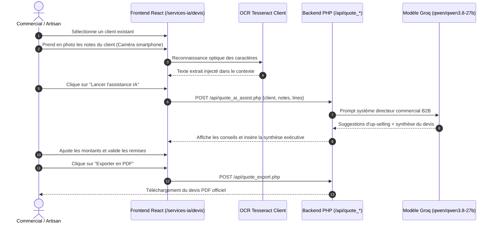

# Assistant Devis IA & Chiffrage Commercial

## 1. Résumé de l'application

- **Nom de l'application :** Assistant Devis IA (MDIV Business)
- **Objectif principal :** Accélérer la création de devis professionnels conformes, suggérer des opportunités d'up-selling à forte marge et convertir automatiquement des cahiers des charges scannés en propositions tarifaires complètes.
- **Problème résolu :** La rédaction de devis est chronophage (30 à 45 minutes par devis), source d'erreurs de calcul de TVA ou d'oublis de prestations, et les commerciaux peinent souvent à trouver les bons arguments de valeur pour justifier leurs prix.
- **Utilisateurs concernés :** Artisans, consultants, prestataires de services, agences, commerciaux de PME, professions libérales.
- **Cas d'utilisation :** Réponse rapide à une demande de tarif, chiffrage d'un projet complexe, numérisation d'un bon de commande papier pris en photo, optimisation de la marge d'une proposition commerciale.
- **Valeur ajoutée :** Calculs automatisés temps réel (HT, remises, TVA, TTC), scanner OCR mobile intégré pour capturer les besoins papier, suggestions d'up-selling par IA générative, et export PDF haute définition prêt à signer.
- **Type d'application :** Application de facturation commerciale assistée par IA et vision OCR.
- **Niveau d'automatisation :** Semi-automatisé (l'IA analyse le besoin et pré-remplit les prestations ou suggestions de marge, l'utilisateur valide et exporte).
- **Rôle de l'IA :** Analyse de cahier des charges, recommandation de packages complémentaires, argumentation commerciale et conformité tarifaire.

> **Description courte (Pitch commercial) :**  
> L'Assistant Devis IA divise par 3 le temps de chiffrage de vos propositions commerciales. Photographiez un besoin client ou décrivez votre prestation, l'IA génère les lignes de devis, optimise vos marges avec des suggestions d'up-selling et exporte un PDF impeccable.

---

## 2. À quoi sert l'application ?

L'application permet de sécuriser et d'accélérer le cycle de vente :
1. **Éliminer les erreurs arithmétiques :** Calcul instantané des totaux HT, de la TVA par ligne et des remises commerciales.
2. **Scanner directement sur le terrain :** Prendre en photo un cahier des charges manuscrit sur un chantier ou chez un client pour en extraire le texte par OCR sans rien ressaisir.
3. **Augmenter le panier moyen :** L'IA propose des options et services additionnels pertinents qui augmentent la rentabilité de chaque contrat.
4. **Générer un PDF professionnel :** Télécharger en un clic un document légal et élégant aux couleurs de l'entreprise.

---

## 3. Fonctionnalités complètes

### 1. Éditeur de devis interactif multi-lignes
- **Objectif :** Composer un devis modulaire ligne par ligne en quelques secondes.
- **Ce que fait l'utilisateur :** Ajoute une ligne, choisit un produit du catalogue ou tape une description libre, ajuste la quantité, le prix unitaire, le taux de TVA et une éventuelle remise en %.
- **Ce que fait l'application :** Recalcule en direct les sous-totaux, la TVA collectée et le total TTC.
- **Technologies utilisées :** React state, Tailwind CSS, TypeScript.

### 2. Catalogue de produits et carnet de clients intégrés
- **Objectif :** Pré-remplir les données récurrentes sans saisie manuelle.
- **Ce que fait l'utilisateur :** Sélectionne un client dans la liste déroulante (ou un produit prédéfini).
- **Ce que fait l'application :** Renseigne automatiquement l'adresse, l'email, le tarif unitaire par défaut et le taux de TVA associé.
- **Technologies utilisées :** Endpoints `/api/clients.php` et `/api/products.php`.

### 3. Module Photo & OCR pour cahiers des charges
- **Objectif :** Numériser instantanément un document papier ou une note manuscrite.
- **Ce que fait l'utilisateur :** Clique sur "Prendre une photo du document" sur son smartphone ou dépose un scan.
- **Ce que fait l'application :** Traite l'image via le moteur Tesseract.js client.
- **Ce que fait l'IA :** Injecte le texte extrait directement dans la zone de contexte du projet.
- **Technologies utilisées :** `DocumentUploadCapture.tsx`, `tesseract.js`.

### 4. Copilote IA de chiffrage & Up-selling
- **Objectif :** Conseiller le commercial sur la stratégie tarifaire et les prestations à ajouter.
- **Ce que fait l'utilisateur :** Clique sur "Optimiser mon devis avec l'IA".
- **Ce que fait l'application :** Transmet les lignes actuelles et la description du projet à `/api/quote_ai_assist.php`.
- **Ce que fait l'IA :** Analyse la cohérence du devis et retourne :
  - Des suggestions d'options additionnelles valorisables.
  - Un argumentaire commercial pour justifier le tarif auprès du client.
  - Une synthèse exécutive prête à être insérée dans l'en-tête du devis.
- **Technologies utilisées :** Modèle Groq `qwen/qwen3.8-27b` en mode JSON strict.

### 5. Export PDF Haute Définition
- **Objectif :** Produire le document contractuel officiel prêt pour signature.
- **Ce que fait l'utilisateur :** Clique sur "Télécharger le devis PDF".
- **Ce que fait l'application :** Transmet les données à `/api/quote_export.php`.
- **Résultat obtenu :** Fichier PDF paginé, mis en page selon la charte MDIV Business avec mentions légales et conditions de règlement.

---

## 4. Parcours utilisateur complet



---

## 5. Comment fonctionne l'IA ?

- **Modèle :** `qwen/qwen3.8-27b` (Groq API).
- **Entrées du modèle :** Liste des prestations sélectionnées, profil du client, texte scanné du besoin et conditions de paiement.
- **Sorties structurées :** Un objet JSON contenant :
  - `executiveSummary` : Paragraphe d'introduction rassurant pour le client.
  - `upsellSuggestions` : Liste de services complémentaires à forte valeur ajoutée.
  - `closingTips` : Conseils de closing pour sécuriser la signature rapide.

---

## 6. Architecture technique

- **Frontend :** [`ServicesIAQuote.tsx`](file:///c:/Users/mezat/Desktop/Famillle/Eric/Projet%20MDIV%20Business/Mdiv%20Business/Site%20web/MDIV_Business/src/pages/ServicesIAQuote.tsx), [`quoteService.ts`](file:///c:/Users/mezat/Desktop/Famillle/Eric/Projet%20MDIV%20Business/Mdiv%20Business/Site%20web/MDIV_Business/src/lib/quoteService.ts).
- **Backend :** [`quote_ai_assist.php`](file:///c:/Users/mezat/Desktop/Famillle/Eric/Projet%20MDIV%20Business/Mdiv%20Business/Site%20web/MDIV_Business/public/api/quote_ai_assist.php), [`quote_export.php`](file:///c:/Users/mezat/Desktop/Famillle/Eric/Projet%20MDIV%20Business/Mdiv%20Business/Site%20web/MDIV_Business/public/api/quote_export.php), [`clients.php`](file:///c:/Users/mezat/Desktop/Famillle/Eric/Projet%20MDIV%20Business/Mdiv%20Business/Site%20web/MDIV_Business/public/api/clients.php), [`products.php`](file:///c:/Users/mezat/Desktop/Famillle/Eric/Projet%20MDIV%20Business/Mdiv%20Business/Site%20web/MDIV_Business/public/api/products.php).
- **Base de données :** Tables MySQL `quotes`, `clients`, `products` avec clés étrangères `company_id`.

---

## 7. Architecture fonctionnelle

```text
Assistant Devis IA
├── 1. Entête & Coordonnées Client
│   ├── Sélection client catalogue
│   └── Saisie manuelle nouvelle entreprise
├── 2. Grille Tarifaire Dynamique
│   ├── Lignes de prestations (Description, Quantité, Prix HT, TVA, Remise)
│   └── Calculs automatiques des totaux en temps réel
├── 3. Module d'Acquisition & IA
│   ├── Scanner photo OCR smartphone
│   ├── Suggestions d'up-selling par IA
│   └── Génération de la synthèse commerciale
└── 4. Finalisation & Export
    ├── Définition des conditions de règlement
    └── Génération PDF professionnel immédiat
```

---

## 8. Données entrantes et sortantes

### Données entrantes :
- Coordonnées client (nom, email, adresse).
- Photos ou scans de cahiers des charges.
- Lignes d'articles (produits, prix unitaires, remises).
- Conditions de règlement (ex: 30 jours, 30% d'acompte).

### Données sortantes :
- Lignes de devis calculées au centime près.
- Texte d'accroche commerciale généré par l'IA.
- Fichier PDF formel prêt à l'envoi.

---

## 9. Exemples concrets d'utilisation

### Exemple 1 : Agence de communication digitale
- **Projet :** Création d'un site vitrine facturé 3 500 € HT.
- **Action de l'IA :** Analyse le devis et suggère d'ajouter une option *Pack Maintenance Annuelle & Sécurité* (+90 €/mois) et un *Pack Référencement Local Google* (+450 €).
- **Résultat :** Le devis passe de 3 500 € à 5 030 € de valeur globale sans effort de prospection supplémentaire.

### Exemple 2 : Artisan électricien en déplacement
- **Action :** Prend en photo la liste des fournitures et tableaux électriques notés sur un carnet.
- **Traitement :** L'OCR extrait les références d'équipements, l'application applique la TVA à 10% ou 20% selon la rénovation.
- **Résultat :** Le devis PDF est envoyé par email au client avant même que l'artisan n'ait quitté le chantier.

---

## 10. Valeur ajoutée

- **Gain de temps :** Temps moyen d'édition d'un devis réduit de 40 à 10 minutes.
- **Croissance du chiffre d'affaires :** Hausse estimée du panier moyen de 15 à 25% grâce aux suggestions d'options complémentaires.
- **Image de marque :** Devis au rendu graphique irréprochable avec des textes clairs.

---

## 11. Limites actuelles

- **Signature électronique intégrée :** Le PDF généré doit actuellement être signé manuellement ou via un outil tiers (DocuSign, Yousign). L'intégration API de signature native est prévue.
- **Synchronisation automatique des stocks :** Les quantités ne décrémentent pas un stock physique en temps réel.

---

## 12. Évolutions possibles

- **Déjà implémenté :** Grille de calcul temps réel, OCR photo mobile, suggestions d'up-selling par IA, catalogue produits/clients, export PDF.
- **Prévu mais non implémenté :** Transformation automatique d'un devis accepté en facture en 1 clic (via la table `quotes_to_invoice.php`).
- **Proposition d'évolution :** Envoi d'un lien de signature électronique certifiée par SMS directement au client.

---

## 13. Présentation marketing de l'application

### Pitch en 1 phrase :
« Créez des devis professionnels en 3 minutes, augmentez votre panier moyen grâce aux suggestions de l'IA et exportez vos PDF prêts à signer. »

### Pitch en 30 secondes :
« Pourquoi passer vos soirées à rédiger des devis sur Excel avec le risque d'oublier des prestations ? L'Assistant Devis IA de MDIV Business calcule vos totaux en direct, vous suggère des options à forte marge que vos clients adorent, et vous permet même de photographier vos notes papier pour les transformer en devis PDF. Moins de paperasse, plus de signatures. »

---

## 14. Script pour vidéo CapCut (45 secondes)

- **Scène 1 — Hook (00:00 - 00:06)**
  - *Visuel :* Un artisan ou entrepreneur le soir tard, la tête dans les mains devant un tableau Excel plein d'erreurs.
  - *Texte écran :* « Encore tes soirées passées sur des devis ? 🛑 »
  - *Voix off :* « Tu passes encore tes soirées à rédiger des devis sur Excel au lieu de profiter de ta famille ? »

- **Scène 2 — Le problème (00:06 - 00:12)**
  - *Visuel :* Calculatrice, feuille de papier froissée, devis refusé.
  - *Texte écran :* « Devis trop lents = Ventes perdues »
  - *Voix off :* « Un devis envoyé avec 3 jours de retard, c'est un client qui part chez ton concurrent. »

- **Scène 3 — La solution & Démo (00:12 - 00:28)**
  - *Visuel :* Utilisation de l'Assistant Devis IA sur smartphone. L'utilisateur prend en photo un bout de papier, les lignes s'ajoutent, clic sur "Assistance IA", l'IA suggère une option rentabilité.
  - *Texte écran :* « Photo du besoin ➔ Devis IA généré en 3 minutes 📱 »
  - *Voix off :* « Prends en photo tes notes de chantier, l'Assistant Devis IA extrait le texte, calcule ta TVA et te suggère même des options pour augmenter ta marge. »

- **Scène 4 — Résultat (00:28 - 00:36)**
  - *Visuel :* Affichage du PDF terminé, élégant et soigné, prêt à être signé.
  - *Texte écran :* « Export PDF pro prêt à signer 📄✨ »
  - *Voix off :* « En un clic, ton devis PDF professionnel est généré, prêt à être signé par ton client. »

- **Scène 5 — Call To Action (00:36 - 00:45)**
  - *Visuel :* Logo MDIV Business avec bouton "Tester Devis IA".
  - *Texte écran :* « Essaye gratuitement sur mdiv-business.fr 🚀 »
  - *Voix off :* « Divise ton temps de devis par 3 dès aujourd'hui. Rendez-vous sur MDIV Business ! »

---

## 15. Plan de capture d'écran pour la vidéo

1. **Capture 1 :** Vue d'ensemble du formulaire Devis IA avec sélection d'un client.
2. **Capture 2 :** Prise de photo mobile avec le bouton doré "Scanner le cahier des charges".
3. **Capture 3 :** Clic sur "Assistance IA", chargement de l'inférence et affichage de la suggestion d'up-selling.
4. **Capture 4 :** Ajustement des totaux en temps réel (changement de quantité avec mise à jour du TTC).
5. **Capture 5 :** Téléchargement du devis PDF officiel.

---

## 16. Guide de montage CapCut

- **Format :** 9:16 vertical.
- **Durée :** 42 à 45 secondes.
- **Musique :** Beat rythmé et inspirant.
- **Transitions :** Balayage rapide vers le bas entre les étapes.
- **Sous-titres :** Jaune et blanc, mots clés en gras ("Excel", "3 minutes", "PDF pro").

---

## 17. Textes pour campagnes publicitaires

### LinkedIn :
« 💼 **La rapidité d'envoi d'un devis est le premier facteur de closing en B2B.**  
Pourtant, la plupart des dirigeants attendent le week-end pour chiffrer leurs projets.  
Avec **Devis IA MDIV Business** :  
📸 Photographiez vos notes manuscrites pour extraction OCR  
💡 Laissez l'IA suggérer des prestations complémentaires pour doper votre panier moyen  
📑 Exportez un PDF contractuel irréprochable en 3 minutes chrono  
👉 Testez l'application gratuitement : [Lien] »

---

## 18. Foire Aux Questions (FAQ)

- **Q : Les taux de TVA français sont-ils pris en compte ?**  
  *R :* Oui, vous pouvez choisir 20%, 10%, 5.5% ou 0% (exonération de TVA / auto-entrepreneur) ligne par ligne.
- **Q : Puis-je exporter le devis pour le modifier ensuite ?**  
  *R :* Le devis est exporté en format PDF vectoriel prêt pour l'envoi au client. Vous pouvez également enregistrer votre projet sur la plateforme.

---

## 19. Fiche Commerciale Synthétique

- **Nom :** Assistant Devis IA
- **Catégorie :** Vente & Facturation Commerciale
- **Public cible :** PME, artisans, consultants, agences, indépendants
- **Problème :** Chiffrage long, risque d'erreurs, absence de stratégie d'up-selling
- **Solution :** Devis dynamique temps réel, OCR photo mobile, copilote d'up-selling et export PDF
- **Technologies IA :** Groq `qwen/qwen3.8-27b`, Vision OCR `tesseract.js`
- **Statut :** ✅ Opérationnel et testé en ligne
- **URL :** `/services-ia/devis`

---

## 20. Checklist de Présentation

- [x] Saisie dynamique des lignes de devis testée
- [x] Calcul des remises et totaux TTC vérifié
- [x] Assistant d'up-selling IA testé avec Groq
- [x] Module OCR photo mobile vérifié
- [ ] Enregistrement des captures d'écran de l'application
- [ ] Montage du scénario vidéo CapCut
- [ ] Diffusion de l'offre commerciale sur les réseaux
