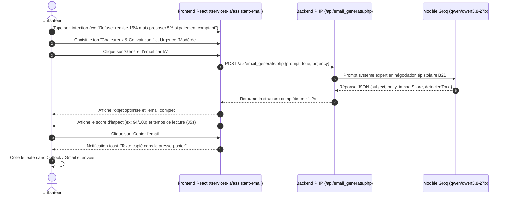

# Assistant Email IA Professionnel

## 1. Résumé de l'application

- **Nom de l'application :** Assistant Email IA (MDIV Business)
- **Objectif principal :** Transformer des consignes brutes ou des brouillons informels en emails professionnels parfaitement calibrés, percutants et adaptés au contexte commercial en un seul clic.
- **Problème résolu :** La rédaction et la gestion des emails représentent entre 2 et 3 heures par jour pour un dirigeant ou collaborateur. La peur de la mauvaise tournure, les hésitations sur le ton à adopter (ferme mais poli, commercial sans être agressif) et la répétitivité des réponses font perdre un temps précieux et coûtent des ventes.
- **Utilisateurs concernés :** Dirigeants de TPE/PME, commerciaux, managers, assistants de direction, chargés de relation client.
- **Cas d'utilisation :** Réponse à un client mécontent, négociation tarifaire serrée, demande de partenariat stratégique, relance d'un prospect tiède, transmission d'un ordre de mission.
- **Valeur ajoutée :** Rédaction instantanée en moins de 1,5 seconde, modulation du ton (4 profils psychologiques), analyse prédictive de sentiment, calcul d'un score d'impact commercial sur 100 et copie instantanée en un clic.
- **Type d'application :** Assistant d'écriture contextuel augmenté par IA générative.
- **Niveau d'automatisation :** Assisté par l'humain (l'utilisateur fournit quelques mots-clés d'intention ou un message reçu à traiter, l'IA rédige l'intégralité du message prêt à l'envoi).
- **Rôle de l'IA :** Traitement du langage naturel (NLP), adaptation sémantique du registre de langue, détection d'objections implicites et optimisation de la délivrabilité/clarté.

> **Description courte (Pitch commercial) :**  
> L'Assistant Email IA MDIV Business rédige vos emails professionnels à votre place en moins de 2 secondes. Indiquez simplement votre idée en quelques mots, choisissez votre tonalité, et obtenez un email percutant, poli et persuasif avec son objet optimisé.

---

## 2. À quoi sert l'application ?

L'Assistant Email IA élimine le syndrome de la page blanche et le temps perdu sur la boîte de réception. Il permet de :
1. **Écrire 5 fois plus vite :** Transformer une phrase rapide tapée sur un smartphone (ex: *"dire à Marc que le prix est non négociable mais qu'on offre la livraison sous 48h s'il signe avant vendredi"*) en un email diplomatique et formel.
2. **Désamorcer les situations délicates :** Rédiger des refus courtois, des relances sans froisser, ou des excuses professionnelles suite à un retard de livraison.
3. **Maximiser le taux de réponse :** Structurer automatiquement le message selon les règles de la communication persuasive (accroche, valeur, appel à l'action explicite).
4. **Garantir un français irréprochable :** Éliminer les fautes d'orthographe, les lourdeurs de style et les maladresses syntaxiques.

---

## 3. Fonctionnalités complètes

### 1. Formulateur contextuel intelligent
- **Objectif :** Générer l'objet et le corps du mail à partir de n'importe quel niveau d'instruction.
- **Ce que fait l'utilisateur :** Tape quelques mots bruts, colle un email reçu pour y répondre, ou saisit des consignes télégraphiques.
- **Ce que fait l'application :** Prépare la charge utile JSON avec les métadonnées de style.
- **Ce que fait l'IA :** Rédige un objet incitatif (open-rate optimisé) et un corps de texte structuré avec salutations et signature.
- **Résultat obtenu :** Un email prêt à l'emploi en moins de 1,5 seconde.
- **Technologies utilisées :** React, `emailAssistantService.ts`, endpoint `/api/email_generate.php`.

### 2. Sélecteur de profil et registre de tonalité
- **Objectif :** Adapter le style rédactionnel à la relation réelle avec le destinataire.
- **Ce que fait l'utilisateur :** Sélectionne l'une des 4 tonalités proposées :
  - *Professionnel & Formel* : Pour institutions, grands comptes, litiges et contrats.
  - *Chaleureux & Convaincant* : Pour clients fidèles, networking et partenariats.
  - *Direct & Assertif* : Pour arbitrages rapides, consignes d'équipe et recadrages.
  - *Empathique & Diplomatique* : Pour réclamations clients et retards imprévus.
- **Ce que fait l'IA :** Module le champ lexical, les connecteurs logiques et les formules de politesse selon le profil sélectionné.
- **Résultat obtenu :** Un message au ton parfaitement dosé qui préserve la relation d'affaires.

### 3. Gestionnaire du niveau d'urgence
- **Objectif :** Indiquer la criticité temporelle dans la formulation du message.
- **Ce que fait l'utilisateur :** Coche le curseur d'urgence : *Standard*, *Urgent (24-48h)*, ou *Critique (immédiat)*.
- **Ce que fait l'IA :** Ajuste l'accroche et l'appel à l'action pour inciter à une réaction rapide sans paraître agressif.

### 4. Analyseur d'impact commercial & Métriques IA
- **Objectif :** Mesurer l'efficacité prévisionnelle de l'email avant son envoi.
- **Ce que fait l'application :** Analyse en temps réel la sortie générée par l'IA.
- **Ce que fait l'IA :** Calcule :
  - Un *Score d'impact commercial* /100.
  - La *Tonalité dominante* perçue par le destinataire.
  - Le *Décompte de mots* et le *Temps de lecture estimé* (ex: 45 secondes).
- **Résultat obtenu :** Un encart d'audit qualité rassurant pour l'expéditeur.

### 5. Copie presse-papier & Liaison messagerie native
- **Objectif :** Envoyer le message sans aucune friction.
- **Ce que fait l'utilisateur :** Clique sur "Copier le texte" ou "Ouvrir dans ma messagerie".
- **Ce que fait l'application :** Copie le texte formaté dans le presse-papier avec feedback visuel, ou génère un lien `mailto:` pré-rempli.
- **Technologies utilisées :** Clipboard API, `sonner` toasts.

### 6. Historique des emails générés et modèles réutilisables
- **Objectif :** Retrouver les messages performants pour les réutiliser.
- **Ce que fait l'utilisateur :** Consulte l'onglet "Historique & Modèles" pour recharger un précédent email.
- **Ce que fait l'application :** Interroge `/api/email_history.php` et réinjecte le contenu dans l'éditeur.

---

## 4. Parcours utilisateur complet



---

## 5. Comment fonctionne l'IA ?

- **Modèle de langage :** `qwen/qwen3.8-27b` via l'API Groq Cloud.
- **Mécanisme d'inférence :** Génération sous contrainte de schéma JSON (`subject`, `body`, `tone_analysis`, `score`).
- **Prompt Système :** L'IA est paramétrée comme un secrétaire général et négociateur d'affaires chevronné. Elle respecte les règles suivantes :
  - Bannir les formules plates du type *"J'espère que vous allez bien"*.
  - Aller droit au but dès la première phrase.
  - Terminer systématiquement par un appel à l'action sans ambiguïté (ex: proposition de deux créneaux d'appel précis).

---

## 6. Architecture technique

- **Frontend :** [`ServicesIAEmail.tsx`](file:///c:/Users/mezat/Desktop/Famillle/Eric/Projet%20MDIV%20Business/Mdiv%20Business/Site%20web/MDIV_Business/src/pages/ServicesIAEmail.tsx), [`emailAssistantService.ts`](file:///c:/Users/mezat/Desktop/Famillle/Eric/Projet%20MDIV%20Business/Mdiv%20Business/Site%20web/MDIV_Business/src/lib/emailAssistantService.ts).
- **Backend :** [`email_generate.php`](file:///c:/Users/mezat/Desktop/Famillle/Eric/Projet%20MDIV%20Business/Mdiv%20Business/Site%20web/MDIV_Business/public/api/email_generate.php), [`email_analyze.php`](file:///c:/Users/mezat/Desktop/Famillle/Eric/Projet%20MDIV%20Business/Mdiv%20Business/Site%20web/MDIV_Business/public/api/email_analyze.php), [`email_history.php`](file:///c:/Users/mezat/Desktop/Famillle/Eric/Projet%20MDIV%20Business/Mdiv%20Business/Site%20web/MDIV_Business/public/api/email_history.php).
- **Sécurité :** Zéro clé exposée côté navigateur, isolation multi-tenant via `company_id`.

---

## 7. Architecture fonctionnelle

```text
Assistant Email IA
├── 1. Module d'Entrée
│   ├── Champ d'intention ou brouillon brut
│   ├── Sélecteur de tonalité (Formel, Chaleureux, Direct, Empathique)
│   └── Curseur de criticité temporelle (Urgence)
├── 2. Moteur de Génération & NLP
│   ├── Inférence Groq Cloud (qwen/qwen3.8-27b)
│   ├── Formatage automatique (Objet + Corps structuré)
│   └── Audit qualité (Score d'impact, analyse du ton)
├── 3. Module d'Action & Restitution
│   ├── Copie presse-papier en 1 clic
│   ├── Bouton de régénération avec variantes
│   └── Lien mailto interactif
└── 4. Historique & Persistance
    └── Archivage des modèles réutilisables
```

---

## 8. Données entrantes et sortantes

### Données entrantes :
- Consignes utilisateur en langage naturel ou texte d'un email reçu.
- Tonalité souhaitée (`formal`, `warm`, `direct`, `empathic`).
- Degré d'urgence (`normal`, `urgent`, `critical`).

### Données sortantes :
- Objet d'email percutant.
- Corps de l'email complet, mis en page et signé.
- Score d'impact commercial (0 à 100).
- Métriques de lecture (nombre de mots, durée estimée).

---

## 9. Exemples concrets d'utilisation

### Exemple 1 : Relance cordiale d'une proposition sans réponse depuis 10 jours
- **Intention saisie :** *"Relancer Sophie pour le devis de refonte envoyé le 12, lui rappeler que l'équipe est réservée pour démarrer le 1er du mois."*
- **Tonalité :** *Chaleureux & Convaincant*.
- **Objet généré :** `Point sur votre projet de refonte — Disponibilité équipe au 1er octobre`
- **Résultat :** Un email bienveillant mais créant un sentiment d'urgence positif sans paraître insistant.

### Exemple 2 : Refus diplomatique d'une demande de remise abusive
- **Intention saisie :** *"Le client demande 20% de remise sur la formation. Refuser car nos tarifs sont calibrés, mais proposer le paiement en 3 fois sans frais."*
- **Tonalité :** *Professionnel & Formel*.
- **Résultat :** Un message qui valorise la qualité de l'accompagnement, réaffirme la valeur du tarif et apporte une solution facilitatrice de trésorerie.

---

## 10. Valeur ajoutée

- **Gain de temps :** Environ 1h30 économisée par jour sur la gestion des emails professionnels.
- **Réduction du stress :** Fini l'angoisse de la formulation maladroite ou de l'oubli de courtoisie.
- **Augmentation du taux d'ouverture et de réponse :** Des objets testés et optimisés pour capter l'attention.

---

## 11. Limites actuelles

- **Envoi automatique direct :** L'application ne clique pas sur le bouton "Envoyer" de votre boîte sans votre relecture (garde-fou humain obligatoire).
- **Intégration API Gmail/Outlook OAuth :** Prévue pour synchronisation automatique des brouillons, actuellement assurée par le bouton de copie et le protocole `mailto:`.

---

## 12. Évolutions possibles

- **Déjà implémenté :** Rédaction complète, 4 tonalités, curseur d'urgence, score d'impact, copie presse-papier, historique local.
- **Prévu mais non implémenté :** Connexion OAuth2 directe pour insérer le message généré directement dans le dossier "Brouillons" d'Outlook 365 ou de Google Workspace.
- **Proposition d'évolution :** Extension navigateur Chrome / Edge pour utiliser l'Assistant Email directement dans l'interface de Gmail ou d'Outlook Web sans changer d'onglet.

---

## 13. Présentation marketing de l'application

### Pitch en 1 phrase :
« Ne perdez plus 2 heures par jour sur vos emails : dictez vos idées brutes et laissez l'IA rédiger des messages parfaits en 2 secondes. »

### Pitch en 30 secondes :
« Combien de fois avez-vous hésité 15 minutes sur la tournure d'un email délicat à un client ou un partenaire ? L'Assistant Email IA MDIV Business prend vos notes rapides et les transforme instantanément en emails impeccables, diplomates et persuasifs. Choisissez votre ton, cliquez sur générer, et copiez un texte professionnel prêt à l'envoi. »

---

## 14. Script pour vidéo CapCut (40 secondes)

- **Scène 1 — Hook (00:00 - 00:05)**
  - *Visuel :* Curseur qui clignote sur une page blanche avec un chronomètre qui défile rapidement.
  - *Texte écran :* « 20 minutes pour écrire UN email ? Stop ! ⏱️ »
  - *Voix off :* « Tu passes encore 20 minutes à chercher la bonne formule pour chaque email ? »

- **Scène 2 — Le problème (00:05 - 00:11)**
  - *Visuel :* Un utilisateur qui tape, efface, re-tape avec agacement.
  - *Texte écran :* « Syndrome de la page blanche + Peur de la faute »
  - *Voix off :* « Entre la peur de paraître trop agressif ou le temps perdu à reformuler, ta boîte mail te vole 2h par jour. »

- **Scène 3 — La solution & Démo (00:11 - 00:26)**
  - *Visuel :* Capture de l'application. Saisie de 3 lignes brutes : *"refus remise 15%, proposer paiement 3x"*. Clic sur "Générer". L'email complet apparaît en 1 seconde.
  - *Texte écran :* « 3 mots saisis ➔ 1 email pro rédigé en 1.2s ⚡ »
  - *Voix off :* « Tape juste ton idée en quelques mots, choisis ton ton, et l'Assistant Email IA te rédige un message impeccable avec son objet percutant. »

- **Scène 4 — Le résultat (00:26 - 00:33)**
  - *Visuel :* Clic sur "Copier le texte", collage dans Outlook, le score d'impact 95/100 s'anime en vert.
  - *Texte écran :* « Score d'impact commercial : 95/100 🎯 »
  - *Voix off :* « Ton email est prêt, sans faute, diplomatique et calibré pour convertir. »

- **Scène 5 — Call To Action (00:33 - 00:40)**
  - *Visuel :* Logo MDIV Business et URL du site.
  - *Texte écran :* « Teste gratuitement sur mdiv-business.fr 🚀 »
  - *Voix off :* « Gagne 1h30 dès aujourd'hui. Le lien est disponible juste en dessous ! »

---

## 15. Plan de capture d'écran pour la vidéo

1. **Capture 1 :** Interface de l'Assistant Email avec champ de saisie vide (Zoom 1.05x).
2. **Capture 2 :** Saisie rapide au clavier d'une consigne brute en 3 lignes.
3. **Capture 3 :** Clic sur le badge de tonalité "Chaleureux & Convaincant".
4. **Capture 4 :** Clic sur "Générer", affichage de l'animation de chargement puis apparition instantanée du texte.
5. **Capture 5 :** Gros plan sur le score d'impact commercial et le bouton "Copier".

---

## 16. Guide de montage CapCut

- **Format :** 9:16 vertical (Reels / TikTok).
- **Durée :** 38 à 40 secondes.
- **Musique :** Piste lofi/tech dynamique à tempo moyen.
- **Sous-titres :** Style bold bicolore (blanc et jaune) avec surlignage des mots clés ("20 minutes", "1.2s", "95/100").
- **Effets :** Zoom avant rapide sur le résultat au moment où l'email apparaît.

---

## 17. Textes pour campagnes publicitaires

### LinkedIn :
« 📧 **Savez-vous combien vous coûte la rédaction de vos emails ?**  
Un dirigeant de PME passe en moyenne 11 heures par semaine sur sa boîte de réception.  
Avec notre **Assistant Email IA**, il vous suffit d'écrire votre intention en une phrase pour obtenir un email professionnel, poli et orienté résultat.  
Essayez-le gratuitement sur la plateforme MDIV Business : [Lien] »

---

## 18. Foire Aux Questions (FAQ)

- **Q : L'IA peut-elle envoyer l'email sans mon accord ?**  
  *R :* Non, vous avez toujours le contrôle total. Vous relisez le message généré, pouvez le modifier et le copiez dans votre boîte de messagerie habituelle.
- **Q : L'outil gère-t-il les emails en anglais ?**  
  *R :* Oui, le modèle comprend et génère des emails multilingues avec un niveau d'anglais professionnel natif.

---

## 19. Fiche Commerciale Synthétique

- **Nom :** Assistant Email IA
- **Catégorie :** Productivité & Communication B2B
- **Public cible :** Dirigeants, commerciaux, managers, assistants
- **Problème :** Temps excessif passé à rédiger et reformuler des emails professionnels
- **Solution :** Génération instantanée d'emails diplomatiques et persuasifs selon 4 tonalités
- **Technologies IA :** Groq Cloud, modèle `qwen/qwen3.8-27b`, mode JSON
- **Statut :** ✅ Opérationnel et testé en ligne
- **URL :** `/services-ia/assistant-email`

---

## 20. Checklist de Présentation

- [x] Application testée et fonctionnelle sur la plateforme
- [x] Génération testée en moins de 1.5s avec score d'impact
- [x] Bouton de copie vérifié
- [ ] Enregistrement des captures d'écran de démonstration
- [ ] Montage du clip vidéo CapCut 40 secondes
- [ ] Publication du post LinkedIn avec lien direct
