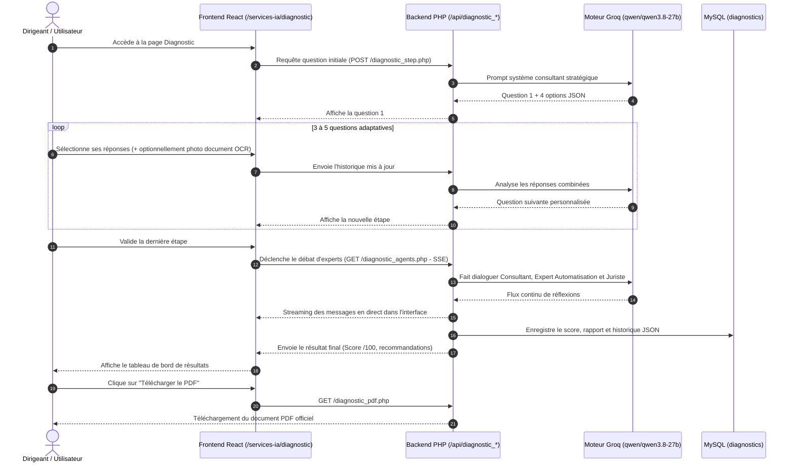

# Diagnostic IA Express & Conseil Stratégique

## 1. Résumé de l'application

- **Nom de l'application :** Diagnostic IA Express (MDIV Business)
- **Objectif principal :** Évaluer en temps réel la maturité numérique, organisationnelle et commerciale d'une entreprise pour dresser un plan d'action d'intégration de l'IA à fort retour sur investissement.
- **Problème résolu :** Les dirigeants de TPE/PME et indépendants savent qu'ils doivent adopter l'IA, mais ignorent par quoi commencer, quels outils choisir et quel budget allouer. Les cabinets de conseil traditionnels facturent plusieurs milliers d'euros pour un audit préalable long et théorique.
- **Utilisateurs concernés :** Dirigeants de TPE/PME, directeurs des opérations, consultants, indépendants, responsables de transformation digitale.
- **Cas d'utilisation :** Audit initial d'entrée chez MDIV Business, cadrage de projet d'automatisation, évaluation avant investissement technologique.
- **Valeur ajoutée :** Diagnostic interactif adaptatif en moins de 5 minutes, simulation d'un débat contradictoire entre 3 agents experts (stratégie, automatisation, conformité), calcul d'un score de maturité /100 et génération d'un rapport PDF exécutif personnalisé.
- **Type d'application :** Application web décisionnelle, consultative et conversationnelle multi-agents.
- **Niveau d'automatisation :** Semi-autonome (l'humain répond à des questions à choix multiples contextuelles, puis les agents IA débattent et rédigent le rapport sans intervention humaine).
- **Rôle de l'IA :** Génération dynamique des questions adaptées au profil de l'entreprise, simulation d'agents consultants spécialisés, scoring algorithmique et synthèse stratégique.

> **Description courte (Pitch commercial) :**  
> Diagnostic IA Express est le premier auditeur virtuel pour TPE/PME capable d'analyser vos processus d'affaires en 5 minutes. Grâce à un débat interactif entre agents IA spécialisés, il identifie immédiatement vos tâches les plus chronophages et vous remet une feuille de route sur mesure avec calcul de gains horaires.

---

## 2. À quoi sert l'application ?

Le Diagnostic IA Express sert de porte d'entrée à l'ensemble de l'écosystème MDIV Business. Il permet de :
1. **Comprendre l'existant sans jargon technique :** Poser des questions directes sur la facturation, la prospection, la gestion documentaire et les outils déjà utilisés.
2. **Identifier les goulots d'étranglement :** Détecter précisément où l'entreprise perd du temps (relances clients manuelles, rédaction d'emails répétitifs, classement papier).
3. **Prioriser les chantiers :** Ne pas tout automatiser d'un coup, mais cibler les 2 ou 3 outils qui apporteront un retour sur investissement immédiat.
4. **Fournir un livrable concret :** Produire un document de synthèse professionnel téléchargeable en PDF, utilisable en interne ou pour solliciter des financements.

---

## 3. Fonctionnalités complètes

### 1. Analyse préliminaire par URL de site web
- **Objectif :** Personnaliser l'audit avant même la première question en analysant l'activité publique de l'entreprise.
- **Ce que fait l'utilisateur :** Renseigne l'URL de son site internet (facultatif).
- **Ce que fait l'application :** Transmet l'URL au backend PHP (`website_scraper.php`).
- **Ce que fait l'IA :** Intègre les mots-clés du site et le secteur d'activité détecté pour orienter les questions de l'audit.
- **Résultat obtenu :** Questions sur mesure mentionnant le métier réel du client.
- **Technologies utilisées :** PHP cURL, DOMParser, API Groq (`qwen/qwen3.8-27b`).

### 2. Moteur de questionnement adaptatif multi-étapes
- **Objectif :** Ne pas dérouler un questionnaire statique rigide, mais adapter chaque question aux réponses précédentes.
- **Ce que fait l'utilisateur :** Coche une ou plusieurs options pré-remplies, ou tape une précision dans le champ "Autre".
- **Ce que fait l'application :** Envoie l'historique complet de la conversation à l'API.
- **Ce que fait l'IA :** Analyse les choix combinés et génère la question suivante la plus pertinente avec 3 à 5 choix concrets.
- **Résultat obtenu :** Parcours fluide de 3 à 5 questions ciblées avec jauge de progression dynamique.
- **Technologies utilisées :** React, `diagnosticService.ts`, endpoint `/api/diagnostic_step.php`.

### 3. Module OCR et injection documentaire
- **Objectif :** Permettre au dirigeant d'injecter des documents d'entreprise (organigramme, plaquette, facture exemple) dans l'audit.
- **Ce que fait l'utilisateur :** Dépose un fichier ou clique sur "Prendre une photo du document" depuis son smartphone.
- **Ce que fait l'application :** Lance le moteur Tesseract.js client pour extraire le texte de l'image.
- **Ce que fait l'IA :** Utilise le texte extrait comme contexte supplémentaire pour l'audit.
- **Résultat obtenu :** Prise en compte immédiate de documents physiques dans l'analyse.
- **Technologies utilisées :** `tesseract.js`, `DocumentUploadCapture.tsx`.

### 4. Débat contradictoire multi-agents en direct (Streaming SSE)
- **Objectif :** Offrir à l'utilisateur une expérience vivante et transparente du raisonnement de l'IA.
- **Ce que fait l'utilisateur :** Observe la discussion entre les 3 agents IA après la fin du questionnaire.
- **Ce que fait l'application :** Ouvre un flux Server-Sent Events (SSE) vers `/api/diagnostic_agents.php`.
- **Ce que fait l'IA :** Fait intervenir :
  - *Agent 1 (Directeur Stratégie)* : Évalue le modèle économique et le positionnement marché.
  - *Agent 2 (Ingénieur Automatisation)* : Détecte les gains d'heures et les cas d'usage techniques.
  - *Agent 3 (Expert Conformité & Risques)* : Valide la faisabilité, le RGPD et l'adoption par l'équipe.
- **Résultat obtenu :** Bulles de dialogue animées en direct, montrant la réflexion collaborative des experts.
- **Technologies utilisées :** Server-Sent Events (SSE), EventSource API, Groq.

### 5. Calculateur de score & Recommandations d'outils MDIV
- **Objectif :** Attribuer une note claire de maturité digitale et orienter vers les applications internes adaptées.
- **Ce que fait l'utilisateur :** Consulte son tableau de bord de résultats.
- **Ce que fait l'application :** Calcule un score global /100 et génère des cartes d'action directes.
- **Ce que fait l'IA :** Sélectionne les 3 outils MDIV prioritaires (ex: Factures IA, Assistant Email) avec justification chiffrée.
- **Résultat obtenu :** Score visuel, synthèse des points forts/faiblesses et boutons vers les services recommandés.
- **Technologies utilisées :** React state, CSS Grid, animations Framer Motion.

### 6. Génération et téléchargement de rapport PDF exécutif
- **Objectif :** Fournir un livrable formel téléchargeable immédiatement.
- **Ce que fait l'utilisateur :** Clique sur "Télécharger mon rapport complet en PDF".
- **Ce que fait l'application :** Appelle `/api/diagnostic_pdf.php` avec l'identifiant du diagnostic.
- **Ce que fait l'IA / Backend :** Génère un document mis en page avec en-tête MDIV Business, graphiques et synthèse.
- **Résultat obtenu :** Fichier PDF prêt à imprimer ou à présenter en comité de direction.
- **Technologies utilisées :** TCPDF / PHP backend.

---

## 4. Parcours utilisateur complet



---

## 5. Comment fonctionne l'IA ?

- **Modèle principal :** `qwen/qwen3.8-27b` hébergé sur l'infrastructure cloud haute performance de Groq.
- **Format d'échange :** Mode JSON strict (`response_format: { type: "json_object" }`).
- **Prompting & Rôles :** Le prompt système instruit le modèle d'agir comme un associé senior en cabinet d'audit. Il lui interdit le jargon d'ingénieur et lui impose de proposer des réponses pratiques sous forme de cas d'usage TPE (gestion des devis, relances d'impayés, prise de RDV).
- **Gestion des agents :** Le script `diagnostic_agents.php` simule une table ronde où chaque agent prend connaissance des remarques de l'agent précédent avant d'émettre sa recommandation.
- **Robustesse & Fallback :** Si Groq ne répond pas, le script bascule sur le modèle de secours configuré (`openai/gpt-oss-120b` ou Mistral).

---

## 6. Architecture technique

- **Frontend :** Page [`ServicesIADiagnostic.tsx`](file:///c:/Users/mezat/Desktop/Famillle/Eric/Projet%20MDIV%20Business/Mdiv%20Business/Site%20web/MDIV_Business/src/pages/ServicesIADiagnostic.tsx), Service [`diagnosticService.ts`](file:///c:/Users/mezat/Desktop/Famillle/Eric/Projet%20MDIV%20Business/Mdiv%20Business/Site%20web/MDIV_Business/src/lib/diagnosticService.ts), Composant OCR [`DocumentUploadCapture.tsx`](file:///c:/Users/mezat/Desktop/Famillle/Eric/Projet%20MDIV%20Business/Mdiv%20Business/Site%20web/MDIV_Business/src/components/ui/DocumentUploadCapture.tsx).
- **Backend :** Endpoints PHP dans `public/api/` (`diagnostic_step.php`, `diagnostic_agents.php`, `diagnostic_upload.php`, `diagnostic_pdf.php`).
- **Base de données :** Table MySQL `diagnostics` reliée à `companies` par clé étrangère `company_id`. Les questions/réponses et le rapport final sont persistés en colonnes `JSON`.
- **Authentification :** Compatible mode invité libre avec persistance rattachée à l'entreprise via [`EnterpriseAuthBar.tsx`](file:///c:/Users/mezat/Desktop/Famillle/Eric/Projet%20MDIV%20Business/Mdiv%20Business/Site%20web/MDIV_Business/src/components/site/EnterpriseAuthBar.tsx).

---

## 7. Architecture fonctionnelle

```text
Diagnostic IA Express
├── 1. Entrée & Initialisation
│   ├── Saisie URL site web (Scraping contextuel)
│   └── Prise de photo / Upload document (OCR Tesseract)
├── 2. Questionnaire Dynamique
│   ├── Génération question par question
│   ├── Sélection multiple & saisie libre "Autre"
│   └── Calcul dynamique de l'avancement
├── 3. Débat d'Agents IA (SSE)
│   ├── Consultant Stratégie
│   ├── Ingénieur Automatisation
│   └── Expert Conformité & Équipe
├── 4. Restitution des Résultats
│   ├── Score de maturité /100
│   ├── Insights et faiblesses clés
│   ├── Recommandations d'outils MDIV Business
│   └── Export PDF Haute Définition
└── 5. Sauvegarde & Historique
    └── Persistance MySQL par compte entreprise
```

---

## 8. Données entrantes et sortantes

### Données entrantes :
- URL du site web de l'entreprise (optionnel).
- Choix de réponses cochés à chaque étape.
- Texte libre saisi dans l'option "Autre".
- Photos ou scans de documents (factures, notes, organigrammes).
- Identifiant d'entreprise (`company_id`).

### Données sortantes :
- Prochaine question et liste des options (JSON).
- Flux de messages textuels des 3 agents experts (SSE).
- Score numérique global de maturité (0 à 100).
- 3 recommandations prioritaires avec bénéfice chiffré.
- Fichier PDF exécutif complet téléchargeable.

---

## 9. Exemples concrets d'utilisation

### Exemple 1 : Cabinet d'expertise comptable (5 collaborateurs)
- **Action :** Le dirigeant indique qu'il perd 15h par semaine à trier des justificatifs clients et relancer les impayés.
- **Traitement :** L'IA adapte ses questions sur le format des pièces reçues (papier vs numérique) et les délais de paiement moyens.
- **Débat IA :** L'agent Automatisation propose la mise en place immédiate de *Factures IA* et de *Relances IA*. L'agent Conformité rassure sur la sécurité des données financières.
- **Résultat :** Score de 42/100, gain potentiel estimé à 6h/semaine par collaborateur, plan d'action immédiat.

### Exemple 2 : Entreprise du bâtiment / Rénovation (1 dirigeant + 8 artisans)
- **Action :** Le dirigeant prend en photo avec son smartphone un devis papier manuscrit rédigé sur le capot de sa camionnette.
- **Traitement :** L'OCR extrait les lignes de prestations et les montants.
- **Résultat :** Le diagnostic oriente immédiatement l'artisan vers *Devis IA* avec pré-remplissage automatique depuis les photos de chantier.

---

## 10. Valeur ajoutée

- **Gain de temps :** Diagnostic réalisé en 5 minutes contre 2 demi-journées d'audit classique.
- **Gratuité d'accès :** Permet d'obtenir un audit professionnel sans barrière financière.
- **Zéro abstraction théorique :** Les recommandations pointent directement vers les outils fonctionnels de la plateforme MDIV.
- **Aide à la décision :** Rapport écrit clair à partager avec des associés ou des banquiers.

---

## 11. Limites actuelles

- **Dépendance au réseau :** Nécessite une connexion internet stable pour les appels Groq et le flux SSE.
- **OCR PDF multipages :** Le traitement OCR navigateur est optimal pour les images et photos ; les PDF très volumineux (> 10 Mo) doivent être traités en amont.
- **Personnalisation sectorielle :** Les benchmarks sectoriels sont pour le moment regroupés par grandes familles d'activités (Services, BTP, Industrie, Commerce).

---

## 12. Évolutions possibles

- **Déjà implémenté :** Questionnaire adaptatif dynamique, débat multi-agents en streaming SSE, OCR caméra smartphone, calcul de score, persistance MySQL et export PDF.
- **Prévu mais non implémenté :** Envoi automatique du rapport PDF par email via SMTP OVH.
- **Proposition d'évolution :** Intégration d'un module d'estimation du crédit d'impôt recherche ou des aides régionales à la transformation numérique directement dans le PDF.

---

## 13. Présentation marketing de l'application

### Pitch en 1 phrase :
« En 5 minutes chrono, faites auditer votre entreprise par 3 agents d'intelligence artificielle et repartez avec votre feuille de route concrète d'automatisation. »

### Pitch en 30 secondes :
« Vous entendez parler d'IA tous les jours, mais concrètement, que peut-elle faire pour votre entreprise dès lundi matin ? Le Diagnostic IA Express de MDIV Business analyse vos processus réels, met 3 experts virtuels autour de la table pour examiner votre organisation, et vous livre gratuitement votre score de maturité ainsi qu'un plan d'action chiffré. Pas de théorie, que des gains de productivité immédiats. »

### Pitch en 1 minute :
« Chaque semaine, un dirigeant de TPE passe entre 8 et 15 heures sur des tâches administratives sans valeur ajoutée : copier-coller des devis, courir après les factures impayées, rédiger les mêmes emails. Avec le Diagnostic IA Express, vous n'avez qu'à répondre à quelques questions ciblées sur votre smartphone. Vous pouvez même photographier vos documents de travail. En quelques secondes, notre consortium d'agents IA analyse votre situation, calcule votre potentiel de rentabilité et génère votre rapport exécutif PDF. C'est l'équivalent d'un audit facturé 1 500 € en cabinet, disponible en 5 minutes dans votre poche. »

---

## 14. Script pour vidéo CapCut (45 secondes)

- **Scène 1 — Hook (00:00 - 00:06)**
  - *Visuel :* Plan serré sur un dirigeant fatigué devant un écran avec 25 onglets ouverts et une pile de dossiers.
  - *Texte écran :* « L'IA dans ta boîte : par où commencer ? 🤯 »
  - *Voix off :* « Tu veux mettre de l'IA dans ton entreprise, mais tu ne sais ni par quoi commencer, ni combien ça rapporte ? »
  - *Animation CapCut :* Zoom rapide + effet Glitch sonore.

- **Scène 2 — Le problème (00:06 - 00:13)**
  - *Visuel :* Écran divisé montrant une facture impayée, un devis Word mal aligné et un calendrier saturé.
  - *Texte écran :* « 12h perdues chaque semaine en tâches manuelles »
  - *Voix off :* « Le vrai problème, c'est que tu perds 12 heures par semaine sur des tâches que l'IA sait déjà faire à ta place. »

- **Scène 3 — La solution (00:13 - 00:20)**
  - *Visuel :* Capture d'écran mobile du site MDIV Business ouvrant le Diagnostic IA Express.
  - *Texte écran :* « Diagnostic IA Express : 5 minutes chrono »
  - *Voix off :* « Découvre le Diagnostic IA Express : un auditeur virtuel qui analyse ton business en 5 minutes. »

- **Scène 4 — Démonstration (00:20 - 00:32)**
  - *Visuel à enregistrer :* Enchaînement rapide des clics sur les choix multiples, prise de photo d'un document papier, puis apparition du flux animé des 3 agents qui débattent.
  - *Texte écran :* « 3 agents IA analysent tes processus en direct 🤖 »
  - *Voix off :* « Réponds à 4 questions, prends en photo tes documents, et regarde 3 agents IA débattre en direct pour trouver tes leviers de rentabilité. »

- **Scène 5 — Résultat (00:32 - 00:38)**
  - *Visuel :* Affichage du score "82/100" avec les 3 recommandations concrètes et le bouton de téléchargement PDF.
  - *Texte écran :* « Ton score + Ton plan d'action PDF offert 📄 »
  - *Voix off :* « Tu obtiens instantanément ton score et ton rapport PDF complet pour gagner jusqu'à 8h par semaine. »

- **Scène 6 — Call To Action (00:38 - 00:45)**
  - *Visuel :* Logo MDIV Business avec bouton animé "Lancer mon diagnostic gratuit".
  - *Texte écran :* « Teste maintenant 👉 Lien en bio / mdiv-business.fr »
  - *Voix off :* « Fais le test maintenant, c'est 100% gratuit et sans engagement. Le lien est juste en dessous ! »
  - *Animation CapCut :* Effet flash blanc + flèche animée vers le bas.

---

## 15. Plan de capture d'écran pour la vidéo

1. **Capture 1 (Page d'accueil Services IA) :** Arrivée sur `/services-ia`, clic sur la carte dorée "Diagnostic IA Express" (Zoom 1.1x, transition Glisser vers la droite).
2. **Capture 2 (Questionnaire interactif) :** Clic successif sur 3 options (ex: Devis, Factures, Relances), saisie de texte libre (durée 3s, zoom focus sur les cases cochées).
3. **Capture 3 (Module Photo / Caméra) :** Clic sur "Prendre une photo du document", apparition de la barre de progression OCR (durée 2s).
4. **Capture 4 (Débat d'agents en direct) :** Défilement automatique des bulles de dialogue des 3 experts (effet de scroll fluide, focus sur les badges d'agents).
5. **Capture 5 (Rapport de score et Recommandations) :** Affichage de la jauge circulaire de score et des 3 cartes d'outils recommandés.
6. **Capture 6 (Téléchargement PDF) :** Clic sur le bouton de téléchargement avec ouverture de la première page du PDF officiel.

---

## 16. Guide de montage CapCut

- **Format recommandé :** 9:16 (Vertical pour TikTok, Instagram Reels, YouTube Shorts).
- **Résolution :** 1080x1920 à 60 fps.
- **Rythme :** Très dynamique (coupe toutes les 1.5 à 2.5 secondes maximum).
- **Audio & Musique :** Beat électronique / tech moderne et discret en fond sonore (volume à 15%).
- **Voix off :** Voix IA claire et dynamique (ex: voix masculine énergique française).
- **Sous-titres :** Génération automatique des sous-titres CapCut, style "Bille en tête", fond noir, texte jaune or et blanc, positionné au centre bas.

---

## 17. Textes pour campagnes publicitaires

### Publicité courte (Twitter / Threads / Shorts) :
« Tu perds encore 10h par semaine sur des tâches répétitives ? Fais auditer ton entreprise en 5 minutes par 3 agents IA. Gratuit, immédiat et sans jargon technique. 👉 [Lien] »

### Publicité LinkedIn :
« 📊 **9 dirigeants sur 10 veulent intégrer l'IA dans leur entreprise... mais 7 sur 10 ne savent pas par quel processus commencer.**  
Faut-il automatiser la prospection ? La saisie des factures ? Les relances clients ?  
Pour répondre à cette question sans dépenser 2 000 € en audit de cabinet, nous avons développé le **Diagnostic IA Express MDIV Business** :  
✅ 5 questions ciblées sur votre métier  
✅ Analyse de vos documents par OCR  
✅ Débat en direct entre 3 agents IA spécialisés  
✅ Remise immédiate de votre rapport exécutif PDF  
Testez l'outil gratuitement dès aujourd'hui : [Lien] »

### Publicité Instagram / Facebook :
« Arrête de perdre ton temps sur des devis et des relances interminables ! 🛑  
Fais le test en 5 minutes : notre intelligence artificielle analyse ton entreprise et te dit exactement quels outils te feront économiser jusqu'à 8h par semaine.  
👉 Clique sur le lien pour générer ton rapport PDF gratuit ! »

---

## 18. Foire Aux Questions (FAQ)

- **Q : Le diagnostic est-il vraiment gratuit ?**  
  *R :* Oui, le Diagnostic IA Express et le téléchargement du rapport PDF de synthèse sont 100% gratuits.
- **Q : Combien de temps prend le diagnostic ?**  
  *R :* Entre 3 et 5 minutes en moyenne.
- **Q : Mes données d'entreprise sont-elles protégées ?**  
  *R :* Oui, les réponses sont traitées via des protocoles sécurisés et restent strictement confidentielles.
- **Q : Dois-je avoir des compétences techniques pour comprendre le rapport ?**  
  *R :* Non, le rapport est formulé en français courant, orienté sur les gains de temps, les économies financières et la simplicité de mise en place.
- **Q : Puis-je utiliser les outils recommandés directement après ?**  
  *R :* Oui, tous les outils suggérés (Factures IA, Devis IA, Relances IA, etc.) sont directement accessibles sur la plateforme MDIV Business.

---

## 19. Fiche Commerciale Synthétique

- **Nom du produit :** Diagnostic IA Express
- **Catégorie :** Audit & Conseil Stratégique Numérique
- **Public cible :** Dirigeants de TPE, PME, indépendants, professions libérales, directeurs d'opérations
- **Problème :** Incapacité à savoir où et comment intégrer l'IA pour obtenir un retour sur investissement rapide
- **Solution :** Audit conversationnel adaptatif multi-agents avec remise de rapport exécutif en 5 minutes
- **Fonctionnalités clés :** Questionnaire adaptatif, analyse OCR smartphone, débat d'agents en direct (SSE), score /100, rapport PDF
- **Technologies IA :** Groq Cloud, modèle `qwen/qwen3.8-27b`, mode JSON strict, OCR `tesseract.js`
- **Statut de production :** ✅ Opérationnel et testé en ligne
- **URL d'accès :** `/services-ia/diagnostic`
- **Appel à l'action :** « Réaliser mon diagnostic gratuit »

---

## 20. Checklist de Présentation

- [x] Application accessible et testée sans blocage de connexion
- [x] Questionnaire adaptatif vérifié avec choix multiples et saisie libre
- [x] Module de prise de photo mobile validé avec extraction OCR
- [x] Débat d'agents en direct validé en streaming SSE
- [x] Calcul du score et affichage des 3 outils prioritaires
- [ ] Enregistrement des 6 séquences d'écran pour la vidéo CapCut
- [ ] Génération de la voix off publicitaire
- [ ] Montage de la vidéo au format 9:16 avec sous-titres animés
- [ ] Programmation des publications LinkedIn et Instagram
