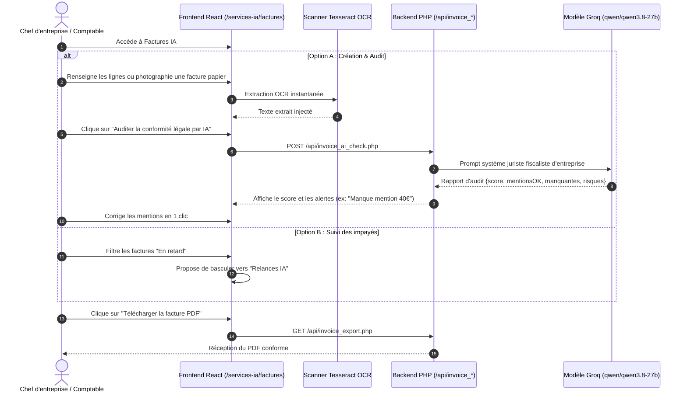

# Vérificateur & Gestionnaire de Factures IA

## 1. Résumé de l'application

- **Nom de l'application :** Vérificateur & Gestionnaire de Factures IA (MDIV Business)
- **Objectif principal :** Contrôler la conformité légale et fiscale des factures avant émission, scanner des reçus et factures papier par OCR pour pré-remplir la comptabilité, et anticiper les obligations de la réforme de facturation électronique.
- **Problème résolu :** Une facture sur quatre émise par les TPE/PME comporte des erreurs ou des mentions obligatoires manquantes (absence des pénalités de retard, SIRET erroné, mauvais taux de TVA, absence de l'indemnité forfaitaire de 40 €). Ces erreurs exposent à des amendes fiscales (jusqu'à 15 € par mention manquante) et servent souvent de prétexte aux clients pour retarder le paiement.
- **Utilisateurs concernés :** Dirigeants de TPE/PME, directeurs administratifs et financiers (DAF), comptables, auto-entrepreneurs, indépendants.
- **Cas d'utilisation :** Audit d'une facture avant envoi au client, numérisation d'un reçu de frais ou facture fournisseur papier par smartphone, suivi des échéances de paiement.
- **Valeur ajoutée :** Audit juridique IA instantané avec score de conformité sur 100, extraction OCR mobile en direct, détection automatique des anomalies fiscales et export PDF haute conformité.
- **Type d'application :** Outil de conformité réglementaire, gestion administrative et vision OCR.
- **Niveau d'automatisation :** Semi-autonome (l'IA audite et valide le document, signale les anomalies détectées et suggère les mentions légales obligatoires).
- **Rôle de l'IA :** Analyse de conformité juridique (Code de commerce et Code général des impôts), extraction OCR de reçus papier et vérification de la cohérence arithmétique.

> **Description courte (Pitch commercial) :**  
> Le Vérificateur de Factures IA MDIV Business protège votre entreprise des amendes et des retards de paiement. Photographiez vos reçus ou auditez vos factures en un clic : l'IA vérifie instantanément les mentions obligatoires, les taux de TVA et la conformité légale avant l'envoi.

---

## 2. À quoi sert l'application ?

L'application sécurise la chaîne de facturation de l'entreprise :
1. **Éviter les sanctions fiscales :** Contrôler automatiquement la présence des mentions obligatoires imposées par la loi française.
2. **Accélérer le règlement :** Une facture sans erreur juridique ne peut pas être contestée ou renvoyée par le service comptabilité du client.
3. **Numériser les justificatifs sans saisie :** Photographier une facture fournisseur pour extraire automatiquement le montant HT, la TVA et la date d'échéance.
4. **Préparer la facturation électronique :** Structurer les données selon les standards modernes en vigueur.

---

## 3. Fonctionnalités complètes

### 1. Scanner de factures & OCR mobile
- **Objectif :** Numériser instantanément une facture papier, un ticket de caisse ou un bon de commande.
- **Ce que fait l'utilisateur :** Clique sur "Scanner / Importer" et prend en photo le document depuis son téléphone.
- **Ce que fait l'application :** Lance le traitement Tesseract.js dans le navigateur.
- **Ce que fait l'IA :** Analyse le texte pour repérer le nom du fournisseur, les dates et les montants.
- **Technologies utilisées :** `DocumentUploadCapture.tsx`, `tesseract.js`.

### 2. Moteur d'audit légal par IA
- **Objectif :** Vérifier point par point la conformité juridique de la facture avant expédition.
- **Ce que fait l'utilisateur :** Clique sur "Auditer la conformité légale par IA".
- **Ce que fait l'application :** Envoie la structure de la facture à `/api/invoice_ai_check.php`.
- **Ce que fait l'IA :** Passe en revue :
  - La présence du numéro SIREN/SIRET et de l'adresse de facturation.
  - La mention de l'indemnité forfaitaire de compensation des frais de recouvrement (40 €).
  - Le taux des pénalités de retard exigibles.
  - La date d'échéance et les conditions d'escompte.
  - La conformité des taux de TVA appliqués.
- **Résultat obtenu :** Un *Score de conformité légale* /100, un badge de statut (Conforme, Attention, Non conforme) et la liste des correctifs immédiats.
- **Technologies utilisées :** Groq `qwen/qwen3.8-27b`, mode JSON.

### 3. Gestionnaire d'échéances et de statuts
- **Objectif :** Avoir une visibilité claire sur l'état des encaissements.
- **Ce que fait l'utilisateur :** Consulte le tableau de bord avec filtres : *Toutes*, *En attente*, *En retard*, *Réglées*.
- **Ce que fait l'application :** Affiche les factures avec code couleur d'urgence (rouge pour échue, ambre pour en cours, vert pour payée).
- **Technologies utilisées :** React, Lucide Icons, `/api/invoices.php`.

### 4. Générateur et export de facture PDF officielle
- **Objectif :** Produire un document PDF haute résolution intégrant toutes les mentions légales requises.
- **Ce que fait l'utilisateur :** Clique sur "Télécharger la facture PDF".
- **Ce que fait l'application :** Génère via `/api/invoice_export.php` le PDF officiel mis en page.
- **Technologies utilisées :** TCPDF / PHP.

---

## 4. Parcours utilisateur complet



---

## 5. Comment fonctionne l'IA ?

- **Modèle :** `qwen/qwen3.8-27b` (Groq API Cloud).
- **Base de connaissances juridique intégrée au prompt :**
  - Code de commerce (Article L441-9 et suivants).
  - Mentions obligatoires de facturation : numéro unique chronologique, date d'émission, date de prestation, identité des parties, ventilation TVA, taux des pénalités (minimum 3 fois le taux d'intérêt légal), indemnité forfaitaire de 40 € pour frais de recouvrement (article D441-5).
- **Format de sortie :** JSON strict structuré comprenant `complianceScore`, `status`, `validMentions`, `missingMentions` et `recommendations`.

---

## 6. Architecture technique

- **Frontend :** [`ServicesIAInvoice.tsx`](file:///c:/Users/mezat/Desktop/Famillle/Eric/Projet%20MDIV%20Business/Mdiv%20Business/Site%20web/MDIV_Business/src/pages/ServicesIAInvoice.tsx), [`invoiceService.ts`](file:///c:/Users/mezat/Desktop/Famillle/Eric/Projet%20MDIV%20Business/Mdiv%20Business/Site%20web/MDIV_Business/src/lib/invoiceService.ts).
- **Backend :** [`invoice_ai_check.php`](file:///c:/Users/mezat/Desktop/Famillle/Eric/Projet%20MDIV%20Business/Mdiv%20Business/Site%20web/MDIV_Business/public/api/invoice_ai_check.php), [`invoices.php`](file:///c:/Users/mezat/Desktop/Famillle/Eric/Projet%20MDIV%20Business/Mdiv%20Business/Site%20web/MDIV_Business/public/api/invoices.php), [`invoice_export.php`](file:///c:/Users/mezat/Desktop/Famillle/Eric/Projet%20MDIV%20Business/Mdiv%20Business/Site%20web/MDIV_Business/public/api/invoice_export.php).
- **Base de données :** Table MySQL `invoices` avec clé étrangère `company_id` et champ `legal_check_result` de type JSON.

---

## 7. Architecture fonctionnelle

```text
Vérificateur Factures IA
├── 1. Tableau de bord Facturation
│   ├── Vue d'ensemble des encaissements
│   └── Filtres par statut (Toutes, En attente, En retard, Réglées)
├── 2. Scanner Documentaire & OCR
│   ├── Prise de photo smartphone (caméra arrière)
│   └── Extraction de données brutes
├── 3. Moteur d'Audit de Conformité Légale
│   ├── Vérification des mentions fiscales obligatoires
│   ├── Contrôle TVA et calculs
│   └── Score de conformité et recommandations
└── 4. Production & Sorties
    ├── Enregistrement en base de données
    └── Export PDF haute conformité
```

---

## 8. Données entrantes et sortantes

### Données entrantes :
- Numéro de facture, client, dates (émission, échéance).
- Lignes de facturation (désignation, HT, TVA).
- Photos ou scans de justificatifs.
- Mentions actuelles renseignées.

### Données sortantes :
- Score de conformité (0 à 100).
- Liste des mentions manquantes avec référence légale.
- Fichier PDF officiel de la facture.

---

## 9. Exemples concrets d'utilisation

### Exemple 1 : Détection d'une mention manquante chez un artisan du bâtiment
- **Cas :** Une facture de 4 800 € pour des travaux de rénovation est soumise à l'audit.
- **Analyse IA :** L'IA détecte immédiatement l'absence de la mention de l'indemnité forfaitaire de 40 € et l'oubli de la mention de l'assurance décennale obligatoire.
- **Résultat :** L'artisan ajoute les mentions suggérées d'un simple clic avant l'envoi, évitant un risque d'amende de 375 €.

### Exemple 2 : Numérisation d'une facture de sous-traitance papier
- **Cas :** Le dirigeant reçoit une facture papier de son transporteur.
- **Action :** Il clique sur "Prendre une photo", l'OCR extrait le montant TTC (1 240 €) et l'échéance au 15 du mois prochain.
- **Résultat :** La facture est enregistrée et classée dans l'échéancier sans saisie manuelle.

---

## 10. Valeur ajoutée

- **Sécurité juridique :** Zéro risque d'amende administrative pour mention légale omise.
- **Réduction des litiges :** Des factures claires, complètes et indiscutables pour vos débiteurs.
- **Gain de temps :** Remplissage accéléré grâce au scanner de documents intégré.

---

## 11. Limites actuelles

- **Transmission directe Chorus Pro :** L'export actuel est au format PDF standard. La passerelle directe API vers Chorus Pro ou les PDP pour la facture électronique 2026 est prévue au planning.

---

## 12. Évolutions possibles

- **Déjà implémenté :** Scanner photo OCR, grille de calcul, audit juridique IA, calcul de score de conformité, export PDF.
- **Prévu mais non implémenté :** Export au format Factur-X (PDF mixte contenant un fichier XML structuré pour la réforme 2026).
- **Proposition d'évolution :** Rapprochement bancaire automatique via connexion Open Banking (Bridge / Powens).

---

## 13. Présentation marketing de l'application

### Pitch en 1 phrase :
« Auditez la conformité légale de vos factures en 2 secondes et protégez-vous des amendes fiscales et des contestations clients. »

### Pitch en 30 secondes :
« Saviez-vous qu'une facture sans la mention de l'indemnité de 40 € ou avec une mauvaise date d'échéance peut vous coûter jusqu'à 75 000 € d'amende en cas de contrôle ? Avec le Vérificateur de Factures IA MDIV Business, vous scannez ou créez votre facture, et notre IA juridique vérifie instantanément toutes les mentions obligatoires du Code de commerce. Vos factures sont 100% blindées et payées plus vite. »

---

## 14. Script pour vidéo CapCut (45 secondes)

- **Scène 1 — Hook (00:00 - 00:06)**
  - *Visuel :* Tampon rouge "NON CONFORME" qui frappe une facture à l'écran.
  - *Texte écran :* « Ta facture est-elle 100% légale ? ⚠️ »
  - *Voix off :* « Une seule mention manquante sur tes factures peut te coûter une amende de 75 000 euros. »

- **Scène 2 — Le problème (00:06 - 00:13)**
  - *Visuel :* Zoom sur les petits textes illisibles en bas d'une facture.
  - *Texte écran :* « 1 facture sur 4 n'est pas conforme »
  - *Voix off :* « Pénalités de retard, indemnité de 40 €, TVA intracommunautaire... Un oubli, et ton client a une excuse pour ne pas te payer. »

- **Scène 3 — La solution & Démo (00:13 - 00:30)**
  - *Visuel :* Démonstration sur l'application Factures IA. Clic sur "Auditer par IA", la jauge de conformité passe au vert (Score 98/100) avec la liste des mentions validées.
  - *Texte écran :* « Audit IA en 2 secondes chrono 🛡️ »
  - *Voix off :* « Avec le Vérificateur de Factures IA MDIV Business, scanne ta facture en photo : notre IA vérifie chaque ligne et te signale ce qui manque avant l'envoi. »

- **Scène 4 — Résultat (00:30 - 00:38)**
  - *Visuel :* Téléchargement de la facture PDF certifiée avec son en-tête soigné.
  - *Texte écran :* « Zéro amende, paiement plus rapide 💰 »
  - *Voix off :* « Résultat : des factures indiscutables, conformes à la loi 2026, payées sans retard. »

- **Scène 5 — Call To Action (00:38 - 00:45)**
  - *Visuel :* Logo MDIV Business et URL.
  - *Texte écran :* « Vérifie tes factures gratuitement sur mdiv-business.fr »
  - *Voix off :* « Sécurise ton entreprise dès maintenant sur MDIV Business. Lien en description ! »

---

## 15. Plan de capture d'écran pour la vidéo

1. **Capture 1 :** Tableau de bord Factures IA avec les statuts "En retard" et "En attente".
2. **Capture 2 :** Bouton "Prendre une photo du document" et déclenchement de l'OCR.
3. **Capture 3 :** Clic sur "Auditer la conformité légale par IA".
4. **Capture 4 :** Affichage du badge de conformité et des recommandations juridiques de l'IA.
5. **Capture 5 :** Téléchargement du PDF officiel.

---

## 16. Guide de montage CapCut

- **Format :** 9:16 vertical (Shorts / Reels / TikTok).
- **Durée :** 45 secondes.
- **Effets :** Son de tampon d'approbation au moment où le score passe au vert.
- **Sous-titres :** Typographie impactante rouge et jaune pour les alertes, blanc et vert pour la solution.

---

## 17. Textes pour campagnes publicitaires

### LinkedIn :
« ⚖️ **Facturation d'entreprise : êtes-vous certain d'être en règle avec la réglementation 2026 ?**  
Le fisc et la DGCCRF ont renforcé les contrôles sur les mentions obligatoires des factures B2B.  
Notre **Vérificateur de Factures IA** audite vos documents en 2 secondes :  
🔍 Contrôle automatique des mentions légales et pénalités obligatoires  
📱 Numérisation de reçus papier par simple photo  
📄 Export PDF sécurisé et infalsifiable  
Protégez votre trésorerie dès aujourd'hui : [Lien] »

---

## 18. Foire Aux Questions (FAQ)

- **Q : Quelles mentions obligatoires sont vérifiées ?**  
  *R :* Le SIRET, l'adresse de facturation, les délais de paiement, les pénalités de retard applicables, l'indemnité forfaitaire de 40 € et le détail de la TVA.
- **Q : L'outil est-il adapté aux auto-entrepreneurs ?**  
  *R :* Oui, il vérifie également la mention obligatoire d'exonération de TVA (Article 293 B du CGI).

---

## 19. Fiche Commerciale Synthétique

- **Nom :** Vérificateur de Factures IA
- **Catégorie :** Juridique, Fiscalité & Facturation
- **Public cible :** Dirigeants de TPE/PME, DAF, comptables, indépendants
- **Problème :** Factures incomplètes, risque d'amendes et retards de paiement
- **Solution :** Audit de conformité légale par IA en 2 secondes et scanner photo mobile
- **Technologies IA :** Groq `qwen/qwen3.8-27b`, OCR `tesseract.js`
- **Statut :** ✅ Opérationnel et testé en ligne
- **URL :** `/services-ia/factures`

---

## 20. Checklist de Présentation

- [x] Interface de facturation fonctionnelle
- [x] Moteur d'audit légal vérifié avec Groq
- [x] Module de photo mobile testé
- [x] Export PDF vérifié
- [ ] Réalisation de la vidéo promotionnelle CapCut
- [ ] Publication du post d'information légale sur LinkedIn
