# CARTOGRAPHIE COMPLÈTE & AUDIT EXHAUSTIF — MDIV EVENT ENGINE v2.0

> **Date de l'audit** : 2 Novembre 2026  
> **Branche Git** : `event_subscribe`  
> **Statut de validation** : CONTRÔLE DE BOUT EN BOUT RÉUSSI (Zero rupture relationnelle)  
> **Sécurité** : Module `/services-ia` strictement verrouillé conformément aux consignes.

---

## 1. CARTOGRAPHIE D'ARCHITECTURE COMPLÈTE

```mermaid
graph TD
    subgraph FRONTEND ["1. Frontend (React 18 / Vite / Tailwind / Lucide)"]
        UI_PUBLIC_EVENT["Page Publique Événement (/evenements/:id)"]
        UI_MODAL_REG["Modal Inscription Publique (PublicEventRegistrationModal.tsx)"]
        UI_BADGE["Badge VIP & QR Code Pass (DigitalBadgeCard.tsx)"]
        UI_NETWORKING["Networking Wall & Trombinoscope (EventNetworkingWall.tsx)"]
        UI_ADMIN_EVT["CMS Événements & Actions CRM (AdminEvents.tsx)"]
        UI_CF_BUILDER["Constructeur Questions Sur-Mesure (CustomFieldsBuilder.tsx)"]
        UI_ATTENDEES["Gestion Inscrits & Émargement (EventAttendeesView.tsx)"]
        UI_PITCHES["Modération Pitches B2B (EventPitchesAdminTab.tsx)"]
        UI_MEETINGS["Planning Rendez-vous B2B (EventMeetingsAdminTab.tsx)"]
        UI_TOMBOLA["Tirage Tombola en Direct (EventTombolaAdminTab.tsx)"]
        UI_REGIE["Pupitre Régie LIVE 1080p (EventRegieControlTab.tsx)"]
    end

    subgraph API ["2. Couche d'Orchestration API & Contrôleurs"]
        PHP_ENGINE["public/api/event_engine.php (Serveur cPanel / OVH / MySQL)"]
        TS_ENGINE["server/modules/events/event.controller.ts (Serveur Node/Express)"]
        SVC_ENGINE["server/modules/events/event.service.ts (Logique Métier & Modèles)"]
    end

    subgraph DATABASE ["3. Base de Données Relationnelle Hermétique (MySQL)"]
        TB_EVENTS[("events")]
        TB_COMPANIES[("companies (Entreprises / Tenants)")]
        TB_CLIENTS[("clients (Contacts CRM unifiés)")]
        TB_ATTENDEES[("event_attendees (Inscriptions & Billetterie)")]
        TB_CUSTOM_FIELDS[("event_custom_fields (Questions sur-mesure)")]
        TB_CUSTOM_ANSWERS[("event_custom_field_answers (Réponses form)")]
        TB_PITCHES[("event_pitches (Candidatures & Passages scène)")]
        TB_MEETINGS_SLOTS[("event_meeting_slots (Créneaux tables B2B)")]
        TB_MEETINGS_BOOKINGS[("event_meeting_bookings (Réservations rendez-vous)")]
        TB_TOMBOLA_PRIZES[("event_tombola_prizes (Lots & Gagnants)")]
        TB_TOMBOLA_TICKETS[("event_tombola_tickets (Tickets tombola)")]
    end

    %% Relations Frontend vers API
    UI_MODAL_REG -->|POST action=register| PHP_ENGINE
    UI_CF_BUILDER -->|CRUD action=*_custom_field| PHP_ENGINE
    UI_ATTENDEES -->|GET action=get_attendees / check_in| PHP_ENGINE
    UI_PITCHES -->|POST action=moderate_pitch| PHP_ENGINE
    UI_MEETINGS -->|POST action=book_meeting| PHP_ENGINE
    UI_ADMIN_EVT -->|POST action=duplicate_event / archive_event| PHP_ENGINE

    %% Relations API vers Base de Données
    PHP_ENGINE --> TB_EVENTS
    PHP_ENGINE --> TB_ATTENDEES
    PHP_ENGINE --> TB_CLIENTS
    PHP_ENGINE --> TB_CUSTOM_FIELDS
    PHP_ENGINE --> TB_CUSTOM_ANSWERS
    PHP_ENGINE --> TB_PITCHES
    PHP_ENGINE --> TB_MEETINGS_SLOTS
    PHP_ENGINE --> TB_MEETINGS_BOOKINGS
    PHP_ENGINE --> TB_TOMBOLA_PRIZES
```



---

## 2. AUDIT TECHNIQUE & RÉSOLUTIONS DÉTAILLÉES

### A. Problème observé : Questions affichées comme champs texte & perte du type
* **Diagnostic contradictoire précis** :
  1. Dans `CustomFieldsBuilder.tsx`, la mutation envoyait le corps JSON sous la forme `{ event_id, field: fieldData }`.
  2. Le backend (`event_engine.php` et `event.service.ts`) lisait directement à la racine `$data['field_type']` / `fieldData.field_type`.
  3. Ces clés étant encapsulées dans le sous-objet `field`, elles étaient évaluées à `undefined` ou `null`.
  4. Le backend appliquait donc systématiquement la valeur par défaut : `$fieldType = $data['field_type'] ?? 'text';`. Les options (`options`) étaient également perdues (`NULL` / `[]`).
  5. Côté affichage dans `PublicEventRegistrationModal.tsx`, les options n'étaient pas protégées contre le format JSON stringifié issu de MySQL, et les types `checkbox_group`, `email`, `phone`, `url` n'avaient pas de composant dédié.
* **Corrections appliquées** :
  - **Normalisation bi-directionnelle** : le backend et le composant gèrent à la fois `{ ...fieldData }` à plat et `{ field: fieldData }`.
  - **Parsing sécurisé des options** : gestion automatique des chaînes JSON (`JSON.parse`) ou des tableaux d'objets `FieldOption[]`.
  - **Support intégral des types** :
    - `text` : champ texte court
    - `textarea` : champ texte multilignes (paragraphe)
    - `select` : menu déroulant avec options dynamiques
    - `radio` : boutons radio à sélection unique
    - `checkbox` : case à cocher booléenne
    - `checkbox_group` : sélection multiple à choix multiples (tableau de valeurs)
    - `date` : sélecteur de date natif
    - `email` : validation format e-mail
    - `phone` : format téléphone international
    - `number` : saisie numérique
    - `url` : validation URL web

---

### B. CRUD Complet des Questions Personnalisées
* **Création** : Validation du libellé, génération de clé unique (`field_key`), attribution de l'ordre de tri.
* **Modification** : Mise à jour en place sans perte des réponses déjà collectées.
* **Suppression en cascade** : La suppression d'une question supprime au préalable ses réponses associées dans `event_custom_field_answers` pour éviter tout orphelin SQL.
* **Duplication** : Ajout du bouton **Dupliquer** avec icône copie, qui clone la question, son type et ses options avec clé auto-incrémentée (`_copy_timestamp`).
* **Tri / Réordonnancement** : Boutons Monter / Descendre opérationnels avec réattribution séquentielle du `sort_order` et persistance par `reorder_custom_fields`.

---

### C. Inscriptions, Compteurs Dynamiques & Synchronisation CRM
* **Enregistrement de bout en bout** :
  1. Vérification de la jauge (`max_attendees`).
  2. Traitement et upload de la photo de profil (`/assets/uploads/attendees/`).
  3. **Synchronisation CRM automatique** :
     - Si l'e-mail existe déjà dans la table `clients`, la photo (`photo_url`), l'entreprise et le téléphone sont mis à jour sans écraser les données commerciales fermes.
     - Si l'e-mail est nouveau, un nouveau contact est créé dans `clients` avec `photo_url`, statut `prospect` et trace d'interaction dans `client_interactions`.
  4. Création du participant dans `event_attendees` avec `client_id` résolu.
  5. Enregistrement de chaque réponse aux questions sur-mesure dans `event_custom_field_answers`.
  6. **Auto-alimentation de la table Pitch** : Si le participant renseigne un pitch dans le formulaire, un enregistrement est automatiquement inséré dans `event_pitches` avec le statut `pending` relié à l'événement et au participant.
  7. **Envoi d'e-mail de confirmation** : Notification e-mail automatique avec le récapitulatif du billet, l'événement et les consignes d'accès.
* **Compteurs dynamiques calculés en temps réel** :
  - **Total Inscrits** : Décompté dynamiquement sur la base des participants enregistrés (`status !== 'cancelled'`).
  - **Présents (Émargés)** : Décompté dynamiquement selon `status === 'attended'`.
  - **En attente / Absents** : Décompté dynamiquement (`status !== 'attended' && status !== 'cancelled'`).
  - **Taux de Présence** : Calculé en temps réel en pourcentage (`Math.round((attended / total) * 100)`).
  - Aucune valeur figée en dur dans l'interface.

---

### D. QR Code Structuré & Rework du Badge Numérique
* **Structure JSON du QR Code** :
  ```json
  {
    "system": "MDIV_EVENT_ENGINE",
    "version": "2.0",
    "ticket": {
      "id": "EVT-1-A7B8C9",
      "type": "REGISTRATION_BADGE"
    },
    "event": {
      "id": 1,
      "title": "Journée Réseau & Synergies B2B"
    },
    "attendee": {
      "id": 14,
      "name": "Alexandre Martin",
      "company": "Montmirail Capital",
      "email": "alexandre@montmirail.fr"
    },
    "checkin": {
      "url": "/admin/events/checkin?ticket=EVT-1-A7B8C9",
      "token": "RVZULTEtQTdCOEM5OjE="
    }
  }
  ```
* **Badge VIP Redessiné (`DigitalBadgeCard.tsx`)** :
  - Design premium avec dégradé bleu nuit et or brossé.
  - Fente tour de cou réaliste (Lanyard punch hole).
  - Pastille d'état "Pass VIP Officiel" avec pulsation d'accès validé.
  - Photo de profil grand format cerclée d'or et bouclier de conformité.
  - Cadre QR code haute résolution avec code d'accès typographié en monospace.
  - Bouton **Imprimer mon badge** (`window.print()`) et bouton **Télécharger QR**.

---

### E. Résolution des Relations Inter-Modules
| Relation | Source | Cible | Mécanisme de liaison | Statut |
| :--- | :--- | :--- | :--- | :--- |
| **Événement ➔ Inscription** | `events.id` | `event_attendees.event_id` | Clé étrangère ON DELETE CASCADE |  Vérifié |
| **Inscription ➔ Participant CRM** | `event_attendees.client_id` | `clients.id` | Résolution par e-mail sans doublon |  Vérifié |
| **Participant ➔ Réponses** | `event_attendees.id` | `event_custom_field_answers.attendee_id` | Clé étrangère ON DELETE CASCADE |  Vérifié |
| **Participant ➔ Pitch** | `event_attendees.id` | `event_pitches.attendee_id` | Auto-hook à l'inscription en ligne |  Vérifié |
| **Participant ➔ Rendez-vous** | `event_attendees.id` | `event_meeting_bookings.attendee_id` | Résolution automatique par e-mail |  Vérifié |
| **Entreprise ➔ Rendez-vous** | `event_meeting_slots.partner_id` | `companies.id` | Clé partenaire liée au tenant |  Vérifié |

---

### F. Audit des Boutons d'Action CRM
* **Voir** : Lien direct externe vers `/evenements/:id` avec icône `ExternalLink`.
* **Modifier** : Ouvre le formulaire de modification avec réhydratation de l'événement et du programme.
* **Dupliquer** : Clone instantanément l'événement, ses métadonnées, sa configuration de modules et l'ensemble de ses questions sur-mesure.
* **Archiver** : Bascule d'un clic le statut entre événement actif (`upcoming`) et événement archivé (`past`).
* **Supprimer** : Confirmation sécurisée puis suppression en cascade en base de données.
* **Valider (Pitch)** : Validation du pitch avec assignation de l'ordre de passage et de l'horaire.
* **Refuser (Pitch)** : Rejet motivé avec conservation de la note du modérateur.
* **Exporter (Inscrits)** : Export propre au format CSV UTF-8 avec BOM (compatible Excel/Google Sheets).
* **Importer (Inscrits)** : Importateur CSV pour charger une liste de participants et synchroniser le CRM en lot.
* **Débordement de texte** : Correction intégrale par `break-all`, `break-words`, `overflow-hidden` et `max-w-lg` sur la modale de fiche participant et le networking wall.

