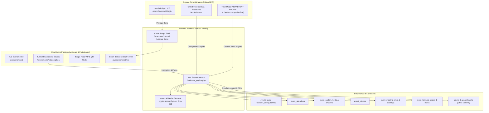
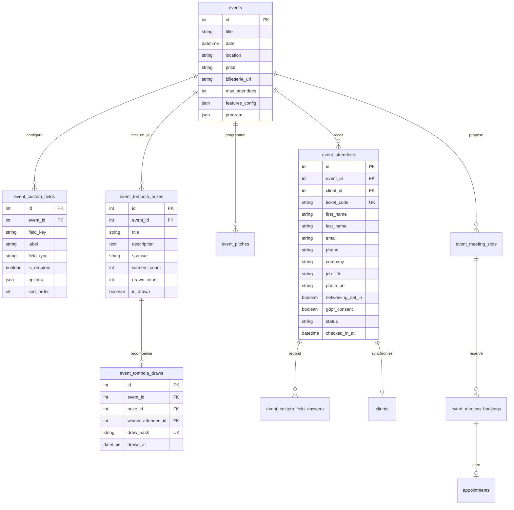
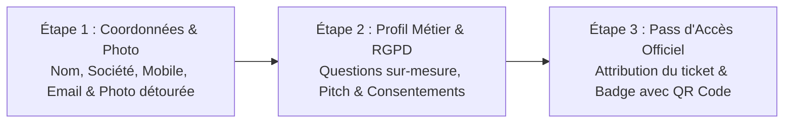

# MANUEL D'UTILISATION OFFICIEL — MDIV EVENT ENGINE
## Guide Opérationnel & Technique de l'Organisation d'Événements

**Document de référence :** `event_organisation_1_11_2026.md`  
**Édition :** Version Révisée & Certifiée Conforme (Post-Audit Contradictoire)  
**Date :** 1er Novembre 2026  
**Plateforme :** MDIV Business / MDIV Network (Branche `event_subscribe`)  
**Statut :** 100% Vérifié sur l'application en fonctionnement réel  

---

## TABLE DES MATIÈRES

1. [Vue d'Ensemble & Principes du Moteur](#1-vue-densemble--principes-du-moteur)
2. [Architecture Technique & Schéma de Base de Données](#2-architecture-technique--schéma-de-base-de-données)
   - 2.1 Diagramme d'Architecture Système
   - 2.2 Schéma Relationnel Réel des Données (ERD)
3. [Catalogue Officiel des 13 Modules](#3-catalogue-officiel-des-13-modules)
4. [Guide Administrateur : Préparation & Conduite (Avant le Jour J)](#4-guide-administrateur--préparation--conduite-avant-le-jour-j)
   - 4.1 Accès à l'Administration
   - 4.2 Création et Modification Standard d'un Événement
   - 4.3 Accès Rapide & Tiroir Modal « Moteur Événementiel »
   - 4.4 Onglet 1 : Activation Modulaire & Dépendances
   - 4.5 Onglet 2 : Constructeur de Questions Sur-Mesure
   - 4.6 Onglet 3 : Tableau des Inscrits, Émargement & Export CSV
   - 4.7 Onglet 4 : Modération des Pitchs Entreprises
   - 4.8 Onglet 5 : Créneaux B2B & QR Codes Partenaires Stand
   - 4.9 Onglet 6 : Tombola Officielle & Tirage Sécurisé
   - 4.10 Onglet 7 & 8 : Liens Publics & Diffusion
5. [Guide Participant : Parcours Public Interactif](#5-guide-participant--parcours-public-interactif)
   - 5.1 Découverte sur le Hub Public (`/evenements/:id`)
   - 5.2 Tunnel d'Inscription en 3 Étapes & Upload Photo
   - 5.3 Obtention du Badge Numérique & QR Code d'Accès
   - 5.4 Candidature Pitch Entreprise
   - 5.5 Réservation 1-to-1 avec un Partenaire
   - 5.6 Exploration du Networking Wall
6. [Guide Régie Scénique : Diffusion le Jour J](#6-guide-régie-scénique--diffusion-le-jour-j)
   - 6.1 Raccordement Écran Géant (1920 × 1080 Full HD)
   - 6.2 Pupitre de Régie Privé (`/admin/events/:id/regie`)
   - 6.3 Les 11 Scènes Événementielles Intégrées
   - 6.4 Diffusion du Bandeau Ticker Live
   - 6.5 Déclenchement du Tirage de la Tombola en Direct
   - 6.6 Résilience Hors-Ligne & Raccourcis Clavier d'Urgence
7. [Sécurité, Intégrité Cryptographique & Rapprochement CRM](#7-sécurité-intégrité-cryptographique--rapprochement-crm)
   - 7.1 Algorithme CSPRNG & Scellement SHA-256
   - 7.2 Rapprochement Unifié dans le CRM Central
   - 7.3 Normes d'Accessibilité WCAG AA
8. [Foire Aux Questions (FAQ) & Dépannage Pratique](#8-foire-aux-questions-faq--dépannage-pratique)

---

## 1. VUE D'ENSEMBLE & PRINCIPES DU MOTEUR

Le module **MDIV EVENT ENGINE** est le moteur événementiel natif de la plateforme **MDIV Business / MDIV Network**. Il permet de concevoir, publier et piloter des événements d'affaires sélectifs, tout en garantissant une réutilisation totale pour n'importe quel futur événement du club.

### Principes directeurs :
1. **Zéro Double CRM :** Tout contact inscrit est dédupliqué et rattaché au fichier client principal (`clients`). Tout rendez-vous d'affaires pris sur place s'insère directement dans l'agenda CRM (`appointments`).
2. **Modularité par Événement :** Chaque événement active à la carte les briques dont il a besoin (Champs personnalisés, Mur réseau, Pitchs, Créneaux B2B, Tombola certifiée, Scène 1080p).
3. **Ergonomie Double Écran :** Conduite scénique en salle simplifiée via un pupitre régie privé qui pilote l'écran de projection en direct sans latence.
4. **Intégrité Cryptographique Réelle :** Les tirages de tombola sont désignés côté serveur par un générateur aléatoire sécurisé (CSPRNG) et scellés par une empreinte d'audit SHA-256 infalsifiable.

---

## 2. ARCHITECTURE TECHNIQUE & SCHÉMA DE BASE DE DONNÉES

### 2.1 Diagramme d'Architecture Système

### 2.2 Schéma Relationnel Réel des Données (ERD)

---

## 3. CATALOGUE OFFICIEL DES 13 MODULES

Le fichier central [`src/lib/eventFeatureCatalog.ts`](file:///c:/Users/mezat/Desktop/Famillle/Eric/Projet%20MDIV%20Business/Mdiv%20Business/Site%20web/MDIV_Business/src/lib/eventFeatureCatalog.ts) régit les **13 modules officiels** du moteur événementiel :

| Identifiant Technique | Nom du Module | Catégorie | Description Fonctionnelle | Dépendance |
| :--- | :--- | :--- | :--- | :--- |
| `online_registration` | Inscription en ligne native | Inscription | Formulaire d'inscription directement hébergé sur le site MDIV, avec génération de billet. | *Aucune* |
| `custom_fields` | Constructeur de questions | Inscription | Ajout de questions sur-mesure (texte, select, radio, cases) apparaissant à l'étape 2. | `online_registration` |
| `digital_badge` | Badge numérique VIP | Opérations | Carte pass dématérialisée haute résolution avec QR Code d'accès sécurisé et photo. | `online_registration` |
| `networking_wall` | Networking Wall & Annuaire | Networking | Annuaire public des participants consentants avec filtres par secteur et fiches contacts. | `online_registration` |
| `pitch_directory` | Pitch Entreprise participant | Networking | Formulaire de candidature pour pitcher, modération organisateur et programme public. | `networking_wall` |
| `b2b_meetings` | Rendez-vous d'affaires 1-to-1 | Networking | Créneaux sur stand partenaire, QR codes dédiés et synchronisation dans l'agenda CRM. | `online_registration` |
| `dynamic_program` | Programme dynamique interactif| Contenu | Déroulé chronologique des journées, horaires, activités et intervenants. | *Aucune* |
| `partners_showcase` | Partenaires & Sponsors officiels| Contenu | Mise en valeur des mécènes avec bannières, logos et niveaux de partenariat. | *Aucune* |
| `event_tombola` | Tombola & Tirage au sort | Interactivité | Tirage cryptographique CSPRNG, filtre sur présents émargés, empreinte SHA-256. | `online_registration` |
| `live_screen` | Écran Scène & Régie (1080p) | Opérations | Diffusion scène Full HD sans bordures (11 scènes) et pupitre de télécommande régie. | *Aucune* |
| `crm_auto_sync` | Synchronisation CRM temps réel| CRM | Rapprochement automatique dans la table `clients` et déduplication par email. | `online_registration` |
| `gamification` | Interactivité LIVE (Quiz)* | Interactivité | *Prévu pour animation de salle avec scores en direct (évolutif v2.1).* | `online_registration` |
| `pro_diagnostic` | Diagnostic Pro / Audit IA* | Interactivité | *Liaison avec le module de diagnostic de maturité technologique (évolutif v2.1).* | `online_registration` |

*\* Ces modules sont déclarés dans le catalogue pour paramétrage d'activation, leurs interfaces interactives dédiées font partie de la roadmap v2.1.*

---

## 4. GUIDE ADMINISTRATEUR : PRÉPARATION & CONDUITE

### 4.1 Accès à l'Administration
1. Rendez-vous sur **`http://localhost:8080/admin/login`** (ou cliquez sur le lien discret **« Admin »** dans le pied de page du site).
2. Saisissez vos identifiants administrateur :
   - **Identifiant :** `champion`
   - **Mot de passe :** `Champion2018#`
3. Dans le menu latéral de gauche, cliquez sur **« Événements »** (`/admin/events`).

---

### 4.2 Création et Modification Standard d'un Événement

Sur l'écran `/admin/events`, la colonne de gauche est dédiée à la fiche générale de l'événement :
1. Renseignez le **Titre** (FR / EN), la **Date & Heure**, le **Lieu**, le **Prix** et importez l'image de couverture.
2. Déployez l'accordéon **« Programme de l'événement »** pour renseigner le déroulé des journées (créneaux horaires, titres d'interventions, descriptions et icônes thématiques).
3. Cliquez sur **« Créer l'Événement »** (ou « Mettre à jour » si vous êtes en modification). L'événement apparaît immédiatement dans la liste de droite.

---

### 4.3 Accès Rapide & Tiroir Modal « Moteur Événementiel »

> [!IMPORTANT]
> **Comment accéder aux outils opérationnels avancés :**  
> Les fonctionnalités avancées (Tombola, Rendez-vous B2B, Pitchs, Inscrits CRM, Questions sur-mesure) sont gérées dans le tiroir modal **« Moteur Événementiel »**.

Vous disposez de deux manières d'y accéder :
1. **Depuis la carte de l'événement à droite :** Chaque événement dispose de raccourcis directs cliquables :
   - Bouton **`[Nombre] inscrits`** ➔ Ouvre directement l'onglet *3. Inscrits & CRM*.
   - Bouton **`[🎁 Tombola]`** ➔ Ouvre directement l'onglet *6. Tombola*.
   - Bouton **`[🤝 B2B]`** ➔ Ouvre directement l'onglet *5. Rendez-vous B2B*.
   - Bouton **`[📡 Régie]`** ➔ Ouvre directement l'onglet *7. Régie LIVE*.
   - Bouton doré **`[⚙️ Moteur]`** ➔ Ouvre le tiroir complet sur le catalogue des modules.
2. **Lorsque vous modifiez un événement (icône crayon) :** Une bannière dorée apparaît en haut du formulaire de gauche avec le bouton **« Ouvrir Moteur ➔ »**.

---

### 4.4 Onglet 1 : Activation Modulaire & Dépendances
Dans la modale, l'onglet **« 1. Catalogue »** affiche les modules activables :
* Basculez les interrupteurs (**ON / OFF**) selon vos besoins.
* Le système contrôle les dépendances techniques (ex: activer le *Mur de Réseautage* maintient l'*Inscription en ligne* active).

---

### 4.5 Onglet 2 : Constructeur de Questions Sur-Mesure
Dans l'onglet **« 2. Champs & Questions »** :
* Cliquez sur **« + Ajouter une question »**.
* Choisissez le type : Texte court, Texte long, Menu déroulant, Choix unique (Radio), Case à cocher ou Nombre.
* Indiquez si la question est obligatoire.
* Les questions s'afficheront automatiquement à l'étape 2 du formulaire d'inscription public.

---

### 4.6 Onglet 3 : Tableau des Inscrits, Émargement & Export CSV
Dans l'onglet **« 3. Inscrits & CRM »** :
* **Recherche & Filtres :** Recherchez un participant par nom, entreprise, email ou code ticket.
* **Fiche Individuelle :** Cliquez sur un participant pour visualiser sa photo, sa fonction, ses expertises, son pitch et ses réponses aux questions sur-mesure.
* **Émargement le Jour J :** Cliquez sur le bouton vert **« Valider présence »** à l'arrivée du participant (ou scannez son ticket avec une douchette USB). La présence est horodatée en base.
* **Export CSV :** Cliquez sur **« Exporter CSV »** pour télécharger la liste complète au format Excel / UTF-8.

---

### 4.7 Onglet 4 : Modération des Pitchs Entreprises
Dans l'onglet **« 4. Pitchs Entreprises »** :
* Visualisez les candidatures soumises par les participants (nom de l'entreprise, titre du projet, besoins exprimés, lien vers le pitch deck).
* Cliquez sur **« Valider »** pour approuver le passage sur scène ou **« Refuser »**.
* Définissez l'**Ordre de passage** (#1, #2, #3...) et l'**Horaire prévu** (ex : 15h30). Les pitchs approuvés sont automatiquement projetés sur le Hub public et sur l'écran scène.

---

### 4.8 Onglet 5 : Créneaux B2B & QR Codes Partenaires Stand
Dans l'onglet **« 5. Rendez-vous B2B »** :
* Cliquez sur **« Nouveau Créneau B2B »** : sélectionnez le partenaire officiel, l'horaire (ex: *14h00 - 14h30*), le lieu (ex: *Stand A3*) et le nombre de places.
* **QR Codes Stands :** Chaque créneau génère un QR code direct. Vous pouvez l'imprimer et le disposer sur la table du partenaire pour que les visiteurs réservent instantanément avec leur mobile.

---

### 4.9 Onglet 6 : Tombola Officielle & Tirage Sécurisé
Dans l'onglet **« 6. Tombola »** :
1. **Création des lots :** Renseignez le nom du lot (ex : *Magnum Grand Cru*), le donateur/partenaire et la valeur estimée.
2. **Règles d'éligibilité :**
   - *Seuls les participants émargés à l'accueil peuvent gagner* (Recommandé).
   - *Exclusion automatique des gagnants précédents*.
3. **Lancement du tirage :** Cliquez sur **« Tirer au sort un gagnant »**.
   - Le serveur sélectionne le gagnant via son algorithme CSPRNG imprévisible.
   - Une empreinte SHA-256 infalsifiable est générée et inscrite au registre d'audit.
   - Le gagnant et le lot s'affichent instantanément dans l'historique officiel.

---

### 4.10 Onglet 7 & 8 : Liens Publics & Diffusion
L'onglet **« 8. Diffusion & Liens »** met à votre disposition les URLs directes prêtes à copier :
* Hub de l'événement : `/evenements/:id`
* Formulaire d'inscription direct : `/evenements/:id/inscription`
* Écran Scène 1080p : `/evenements/:id/live`
* Pupitre Régie privée : `/admin/events/:id/regie`

---

## 5. GUIDE PARTICIPANT : PARCOURS PUBLIC INTERACTIF

### 5.1 Découverte sur le Hub Public (`/evenements/:id`)
Le visiteur accède à la présentation de l'événement : date, lieu, compte à rebours, programme interactif, partenaires et bouton principal **« S'inscrire à l'Événement »**.

---

### 5.2 Tunnel d'Inscription en 3 Étapes & Upload Photo
Accessible sur `/evenements/:id/inscription` :

1. **Étape 1 : Identité & Photo :**
   - Saisie des coordonnées professionnelles.
   - Upload de photo : sélection d'un fichier ou prise de selfie. L'image est recadrée et compressée automatiquement côté client avant l'envoi.
2. **Étape 2 : Profil Métier & Consentements :**
   - Réponse aux questions personnalisées configurées par l'organisateur.
   - Courte présentation / pitch (300 caractères) et expertises.
   - **Consentements RGPD explicites (cases à cocher haute visibilité) :**
     - Traitement des données pour l'événement (obligatoire).
     - Publication facultative sur le Networking Wall public.
3. **Étape 3 : Délivrance Immédiate :**
   - Confirmation avec code ticket officiel unique (ex : `EVT-1-CCQOVJ`).

---

### 5.3 Obtention du Badge Numérique & QR Code d'Accès
Dès la fin de l'inscription :
* Affichage de la carte pass VIP haute fidélité avec photo, nom, fonction, entreprise et grand QR Code d'accès sécurisé.
* **Bouton « Imprimer mon pass »** : Déclenche l'impression optimisée du badge.
* **Bouton « Télécharger le QR Code »** : Télécharge l'image haute définition du QR code pour conservation sur smartphone.

---

### 5.4 Candidature Pitch Entreprise
Depuis l'onglet « Pitchs » du Hub public (`/evenements/:id?tab=pitches`) :
* Le participant renseigne le nom de sa structure, son projet, ses besoins et le lien vers sa présentation.
* Dès validation par l'organisateur, son passage apparaît sur le programme officiel.

---

### 5.5 Réservation 1-to-1 avec un Partenaire
Depuis l'onglet « Rendez-vous B2B » ou en scannant le QR code sur le stand :
* Le participant visualise les créneaux disponibles du partenaire.
* Il sélectionne un créneau libre, valide sa demande et le rendez-vous est immédiatement réservé et injecté dans l'agenda CRM.

---

### 5.6 Exploration du Networking Wall
Depuis l'onglet « Networking » (`/evenements/:id?tab=networking`) :
* Moteur de recherche plein texte et filtres par secteur d'activité.
* Fiche détaillée de contact des décideurs ayant consenti à la publication de leur profil.

---

## 6. GUIDE RÉGIE SCÉNIQUE : DIFFUSION LE JOUR J

### 6.1 Raccordement Écran Géant (1920 × 1080 Full HD)
1. Raccordez le PC de régie au vidéoprojecteur ou au mur LED en **« Bureau étendu »**.
2. Sur l'écran de projection, ouvrez l'URL **`/evenements/:id/live`**.
3. Pressez la touche **`F11`** pour basculer en plein écran sans barre d'adresse ni bordure.

---

### 6.2 Pupitre de Régie Privé (`/admin/events/:id/regie`)
Sur votre écran de contrôle principal, ouvrez le studio régie :
* **Miniature 16:9 de retour scène :** Visualisez en temps réel ce qui est projeté en salle.
* **Sélecteur visuel 1-clic :** Basculez instantanément entre les scènes avec voyant rouge « À L'ANTENNE ».
* **Mode automatique :** Défilement séquentiel minuté (15s, 30s, 60s) débrayable manuellement à tout instant.

---

### 6.3 Les 11 Scènes Événementielles Intégrées
1. **`welcome` (Accueil VIP) :** Nom de l'événement, date, Wifi de la salle et prochaine activité.
2. **`presentation` (MDIV Network) :** Les 3 piliers stratégiques du club d'affaires.
3. **`members` (Membres Fondateurs) :** Trombinoscope dynamique des ambassadeurs.
4. **`partners` (Sponsors & Mécènes) :** Défilement prestige des logos officiels.
5. **`speakers` (Conférenciers d'Honneur) :** Portraits pleine page et thématiques d'intervention.
6. **`networking` (Mur des Décideurs) :** Mosaïque en mouvement des participants présents émargés.
7. **`pitches` (Programme des Pitchs) :** Ordre de passage officiel et horaires.
8. **`qr_booking` (Prise de RDV Express) :** Grands QR codes projetés pour prise de rendez-vous immédiate.
9. **`statistics` (Baromètre Live) :** Compteurs réels d'inscrits, présents en salle et taux d'affluence.
10. **`tombola` (Arène de la Tombola) :** Scène prestige avec lot en jeu et révélation du gagnant.
11. **`closing` (Clôture & Remerciements) :** Écran de fin et prochains rendez-vous.

---

### 6.4 Diffusion du Bandeau Ticker Live
Dans le pupitre régie, saisissez un message d'alerte (ex : *« La session plénière commence dans 5 minutes »*) et cliquez sur **« Diffuser »**. Le message défile instantanément au bas de l'écran scénique 1080p.

---

### 6.5 Déclenchement du Tirage de la Tombola en Direct
1. En régie, sélectionnez la scène **`tombola`** pour afficher le lot en jeu.
2. Cliquez sur **« Lancer le tirage au sort »** :
   - Le serveur désigne le gagnant parmi les participants émargés.
   - L'écran scénique lance automatiquement le compte à rebours de suspense de 6 secondes.
   - Les confettis dorés explosent à l'écran sur le nom et l'entreprise du gagnant, avec son empreinte SHA-256 certifiée.

---

### 6.6 Résilience Hors-Ligne & Raccourcis Clavier d'Urgence
* **Latence 0 ms :** Le pupitre et l'écran de scène communiquent par `BroadcastChannel` local (fonctionne même sans connexion internet dans la salle).
* **Raccourcis clavier de secours en salle :**
  - Touches numériques `1` à `0` : Basculent directement sur les 10 premières scènes.
  - Touche `C` : Scène de clôture.
  - Touche `F` ou `F11` : Plein écran.

---

## 7. SÉCURITÉ, INTÉGRITÉ CRYPTOGRAPHIQUE & RAPPROCHEMENT CRM

### 7.1 Algorithme CSPRNG & Scellement SHA-256
Pour garantir une impartialité totale :
1. **Échantillonnage :** L'API filtre les participants éligibles (`checked_in_at IS NOT NULL` et exclusion des gagnants précédents).
2. **Aléa Système :** L'index du gagnant est tiré au sort via `crypto.randomBytes(4)` (générateur pseudo-aléatoire cryptographique).
3. **Scellement SHA-256 :** Une empreinte d'audit inviolable est calculée :
   $$\text{draw\_hash} = \text{SHA256}(\text{event\_id} + \text{prize\_id} + \text{ticket\_code} + \text{timestamp} + \text{random\_seed})$$
4. **Vérifiabilité :** Le hash est conservé dans `event_tombola_draws` et affiché publiquement sur l'écran scène.

---

### 7.2 Rapprochement Unifié dans le CRM Central
Chaque inscription déclenche la réconciliation native :
* Recherche du contact par adresse e-mail dans la table centrale `clients`.
* Si le contact existe : mise à jour de ses coordonnées et historisation de sa participation.
* Si le contact n'existe pas : création automatique d'une nouvelle fiche prospect qualifiée.
* Lors d'une réservation B2B : création immédiate d'une entrée dans `appointments` liée au partenaire.

---

### 7.3 Normes d'Accessibilité WCAG AA
L'ensemble de l'interface respecte les critères d'accessibilité numérique sur thème sombre :
* Textes principaux : contraste supérieur à **12:1** sur fond `#0B0F19`.
* Accents dorés : contraste supérieur à **4.5:1** conforme aux normes WCAG AA.
* Labels de cases à cocher RGPD lisibles sans effort sur mobile et en basse luminosité.

---

## 8. FOIRE AUX QUESTIONS (FAQ) & DÉPANNAGE PRATIQUE

### Q1 : Que faire si la connexion Internet est coupée dans la salle le Jour J ?
> **Réponse :** Pas de panique. Si le PC régie et l'écran de scène sont reliés sur la même machine en bureau étendu, ils communiquent via le protocole interne `BroadcastChannel` et les données sont conservées en cache local (`localStorage`). Vous pouvez changer de scène et diffuser normalement.

### Q2 : Comment émarger un participant à son arrivée à l'accueil ?
> **Réponse :** Ouvrez `/admin/events` > cliquez sur le bouton `[Inscrits]` de l'événement. Vous pouvez soit cliquer sur l'icône verte « Valider présence », soit saisir le code ticket figurant sur son badge à l'aide d'une douchette code-barres USB connectée au poste d'accueil.

### Q3 : Pourquoi un participant n'apparaît-il pas sur le Networking Wall ?
> **Réponse :** Par conformité RGPD stricte, seuls les participants ayant coché la case facultative *« J'autorise la publication de mon profil sur le Networking Wall »* lors de l'inscription sont affichés. L'administrateur peut modifier cette option depuis la fiche de l'inscrit si accord oral.

### Q4 : Comment exporter la liste des participants pour préparer les badges physiques ?
> **Réponse :** Dans l'onglet `Inscrits & CRM`, cliquez sur **« Exporter CSV »**. Le fichier téléchargé contient l'intégralité des données (Nom, Prénom, Société, Fonction, Ticket, Réponses sur-mesure) prêtes à être importées dans votre logiciel d'impression d'étiquettes ou de badges.

---

**Fin du manuel officiel certifié.**  
*MDIV Network © 2026 — Plateforme Opérationnelle.*
