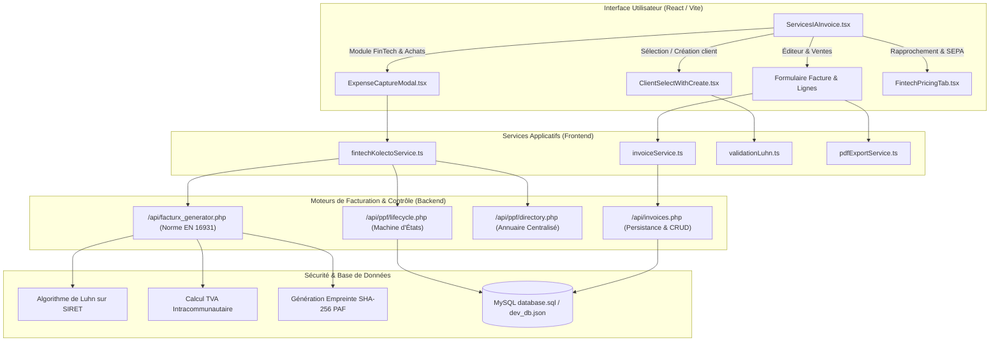
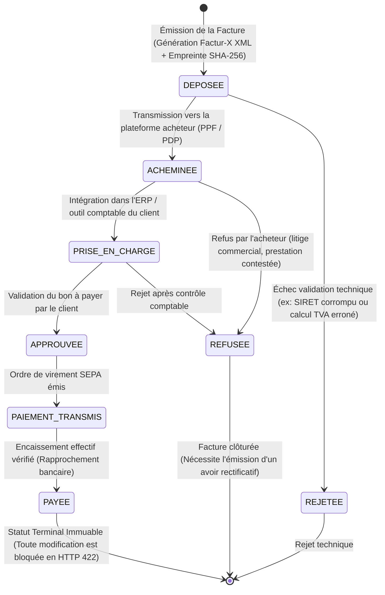
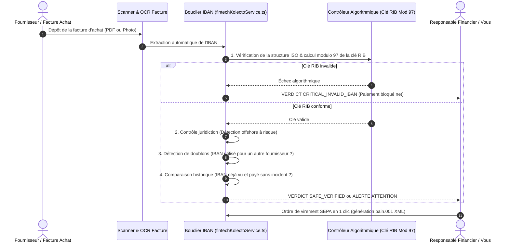

# Module Facturation Électronique & FinTech 2026 (Factur-X / PPF / DGFiP)

> **Document de Référence & Guide Fonctionnel de la Facturation**  
> **Dernière mise à jour :** 16/10/2026  
> **Statut technique :** 100% Opérationnel & Conforme aux normes françaises et européennes (19/19 tests validés)  
> **Normes appliquées :** Factur-X (Profil Basic / Norme EN 16931), Machine d'états Chorus Pro / PPF (Portail Public de Facturation), Piste d'Audit Fiable (PAF SHA-256), Bouclier Anti-Fraude IBAN & SEPA ISO 20022 (`pain.001`).

---

## 1. Schémas Explicatifs du Fonctionnement

### Schéma 1 : Architecture Globale du Système de Facturation

---

### Schéma 2 : Cycle de Vie Légal d'une Facture (Machine d'États PPF)

---

### Schéma 3 : Bouclier Anti-Fraude aux Faux RIB (Vérification IBAN Fournisseur)

---

## 2. Tableau Comparatif : Ce qui est POSSIBLE vs Ce qui n'est PAS POSSIBLE

Ce tableau présente de façon exhaustive et transparente les fonctionnalités réelles et les limites légales du moteur de facturation :

| Domaine | Ce qui est POSSIBLE ✅ | Ce qui n'est PAS POSSIBLE ❌ |
|---|---|---|
| **Format Factur-X & Norme EN 16931** | • Générer des factures conformes à la réforme 2026/2027 combinant un **PDF lisible** et un flux **XML normalisé CII (Cross Industry Invoice)** embarqué. • Certification du profil européen **EN 16931 BASIC**. • Gestion des 3 typologies d'opérations : **Prestations de services**, **Livraisons de biens**, et **Opérations mixtes**. • Calcul automatique du n° de **TVA Intracommunautaire français** (`FR` + clé de contrôle + SIREN). | • Générer une facture Factur-X sans numéro de facture ou sans SIRET client. • Utiliser un faux numéro SIRET inventé (bloqué net par le contrôle d'intégrité de clé de Luhn). |
| **Gestion de la TVA & Exonérations** | • Gestion de tous les taux légaux français (20%, 10%, 5.5%, 2.1%). • Gestion de l'option de paiement : *« Option pour le paiement de la taxe d'après les débits »* ou *« TVA sur les encaissements »*. • Gestion des entreprises exonérées de TVA (Auto-entrepreneurs, Franchise en base **Article 293 B du CGI**) avec génération automatique de la catégorie de TVA `E` (*Exempted*) et mention légale obligatoire dans le XML. | • Émettre une facture à taux de TVA 0% sans spécifier de motif légal d'exonération (rejeté par la norme européenne EN 16931). |
| **Piste d'Audit Fiable (PAF) & Intégrité** | • Calcul automatique d'une **empreinte cryptographique SHA-256** unique pour chaque facture émise. • Horodatage et traçabilité inaltérable des événements (création, dépôt, validation). • Chaînage séquentiel inaltérable entre factures consécutives (`previous_invoice_hash`). | • Modifier discrètement le montant, la date ou les lignes d'une facture sans invalider son empreinte SHA-256 certifiée. |
| **Machine d'États PPF / Chorus Pro** | • Suivi complet du cycle de vie officiel : `DEPOSEE` ➔ `ACHEMINEE` ➔ `PRISE_EN_CHARGE` ➔ `APPROUVEE` ➔ `PAIEMENT_TRANSMIS` ➔ `PAYEE`. • Gestion des rejets et refus avec motif explicite (`REFUSEE`, `REJETEE`). • **Garde-fou légal absolu** : une facture au statut terminal `PAYEE` devient totalement immuable. | • Modifier ou supprimer une facture déjà enregistrée au statut `PAYEE` (l'API répond strictement en HTTP 422 pour empêcher toute fraude fiscale). • Passer directement d'un statut `DEPOSEE` à `PAYEE` sans franchir les étapes de validation. |
| **Typologies de Facturation Avancées** | • **Facture Standard** : facturation complète de produits ou services. • **Facture d'Acompte** (`downpayment`) : calcul au pourcentage (ex: 30%) avec mention spécifique (Code type 389). • **Facture de Situation** (`situation`) : suivi d'avancement pour le BTP et les projets au long cours (ex: 50% d'avancement). • **Facture Récurrente** : pour les abonnements et contrats de maintenance. | • Émettre un acompte avec un pourcentage négatif ou supérieur à 100%. |
| **Bouclier Anti-Fraude IBAN (FinTech)** | • Contrôle en temps réel de la clé RIB (Module 97) et de la validité internationale de l'IBAN. • Détection des comptes offshore ou juridictions financières à risque. • Détection des attaques au faux RIB (alerte si le RIB d'un fournisseur habituel change soudainement). • Détection des doublons d'IBAN partagés entre deux tiers distincts. • Verdicts clairs : `SAFE_VERIFIED`, `FIRST_SEEN_IBAN`, `CRITICAL_ALTERED_IBAN`, `CRITICAL_INVALID_IBAN`. | • Autoriser le règlement SEPA sur un IBAN dont la clé bancaire est fausse (le bouton de paiement est désactivé d'office pour sécurité). |
| **Virement SEPA & Rapprochement Bancaire** | • Génération du fichier XML de virement SEPA normalisé **ISO 20022 (`pain.001.001.03`)** prêt à être téléversé dans votre banque en ligne. • Rapprochement bancaire intelligent : calcul d'un score de confiance (0 à 100%) associant une ligne de relevé bancaire à la bonne facture client ou dépense fournisseur. • Export du **Fichier des Écritures Comptables (FEC)** conforme aux contrôles fiscaux de la DGFiP. | • Forcer un rapprochement bancaire automatique si l'écart de montant ou d'intitulé est trop important (l'arbitrage humain reste requis). |
| **Gestion des Clients** | • Sélection de client existant avec remplissage instantané des informations fiscales. • **Création de client en direct dans la modal** sans quitter la facture en cours de rédaction. • Validation automatique du SIRET par l'algorithme de Luhn dès la frappe. | • Enregistrer un client avec un numéro SIRET à 14 chiffres mathématiquement faux. |

---

## 3. Détail des Composants Techniques et Légaux

### 1. La Norme Factur-X (Format Hybride PDF + XML)
À partir de la réforme de la facturation électronique 2026/2027 en France (ordonnance du 15 septembre 2021) :
- Le simple PDF bureautique ne suffit plus pour les échanges inter-entreprises (B2B).
- Une facture doit être lisible à la fois par **un être humain** (rendu visuel PDF/A-3) et par **une machine** (fichier `factur-x.xml` structuré selon la norme sémantique européenne **EN 16931** et le schéma **UN/CEFACT Cross Industry Invoice 100**).
- Le moteur [public/api/facturx_generator.php](file:///c:/Users/mezat/Desktop/Famillle/Eric/Projet%20MDIV%20Business/Mdiv%20Business/Site%20web/MDIV_Business/public/api/facturx_generator.php) génère ce flux XML complet avec :
  - L'identifiant de profil : `urn:cen.eu:en16931:2017#compliant#urn:factur-x.eu:1p0:basic` ;
  - Les informations vendeur et acheteur (SIREN, SIRET, Numéro TVA intracommunautaire, adresses postales complètes) ;
  - Les lignes de facture avec code unité normalisé UN/ECE (ex: `H87` pour pièce, `HUR` pour heure) ;
  - La ventilation des bases et montants de TVA.

---

### 2. Le Contrôle Algorithmique de Luhn & TVA
Le numéro **SIRET** est composé de 14 chiffres :
$$\text{SIRET} = \text{SIREN (9 chiffres)} + \text{NIC (5 chiffres)}$$
- Pour éviter qu'une facture ne soit rejetée par le portail gouvernemental (Chorus Pro / PPF), le module [src/lib/validationLuhn.ts](file:///c:/Users/mezat/Desktop/Famillle/Eric/Projet%20MDIV%20Business/Mdiv%20Business/Site%20web/MDIV_Business/src/lib/validationLuhn.ts) applique la formule mathématique de Hans Peter Luhn :
  - Chaque chiffre de rang impair (en partant de la droite) est multiplié par 2 ;
  - Si le résultat dépasse 9, on soustrait 9 ;
  - La somme de tous les chiffres doit être un multiple exact de 10.
- Le numéro de **TVA Intracommunautaire** français est calculé automatiquement à partir du SIREN grâce à la formule officielle de la DGFiP :
  $$\text{Clé TVA} = [12 + 3 \times (\text{SIREN} \pmod{97})] \pmod{97}$$
  Exemple : Pour le SIREN `542051180`, la clé calculée est `59`, ce qui donne `FR59542051180`.

---

### 3. La Piste d'Audit Fiable (PAF) & SHA-256
L'administration fiscale exige que l'émetteur d'une facture garantisse l'**authenticité de son origine**, l'**intégrité de son contenu** et la **lisibilité** de la facture depuis son émission jusqu'à la fin de la période de conservation (10 ans).
- Dès qu'une facture est validée dans MDIV Business, une signature cryptographique **SHA-256** est calculée sur l'ensemble de ses données (numéro, date, montants, lignes, acheteur).
- Cette empreinte est enregistrée dans la table immuable `paf_invoice_audit_trail`.
- Toute tentative de falsification ultérieure est immédiatement détectée car l'empreinte recalculée ne correspondrait plus à l'empreinte d'origine.

---

### 4. Le Bouclier Anti-Fraude IBAN & SEPA
La fraude au faux RIB (usurpation d'identité d'un fournisseur pour détourner des paiements) représente chaque année plusieurs centaines de millions d'euros de préjudice pour les PME.  
Le service [src/lib/fintechKolectoService.ts](file:///c:/Users/mezat/Desktop/Famillle/Eric/Projet%20MDIV%20Business/Mdiv%20Business/Site%20web/MDIV_Business/src/lib/fintechKolectoService.ts) protège vos finances :
1. **Contrôle Modulo 97** : Vérifie mathématiquement la validité du code banque, du code guichet, du numéro de compte et de la clé RIB.
2. **Détection d'Altération** : Si un fournisseur habituel envoie une facture avec un IBAN différent de celui enregistré, une alerte critique `CRITICAL_ALTERED_IBAN` est déclenchée.
3. **Paiement SEPA Sécurisé** : En un clic, un fichier de virement bancaire groupé `pain.001.001.03` est généré, prêt à être validé dans votre banque sans risque d'erreur de saisie manuelle.

---

## 4. Endpoints API du Module Facturation

| Endpoint | Méthode | Rôle & Fonctionnalité |
|---|---|---|
| `/api/invoices.php` | `GET` | Récupère la liste des factures d'une entreprise avec filtres et statuts PPF. |
| `/api/invoices.php` | `POST` | Enregistre ou met à jour une facture (avec calculs HT, TVA, TTC). |
| `/api/invoices.php` | `DELETE` | Supprime une facture non verrouillée (ou `POST` avec `action=delete`). |
| `/api/invoices_kpis.php` | `GET` | Calcule les indicateurs financiers en direct (Total émis, Payé, En attente, En retard). |
| `/api/facturx_generator.php` | `POST` | Génère le flux XML normalisé Factur-X EN 16931 et l'empreinte SHA-256. |
| `/api/ppf/directory.php` | `GET` / `POST` | Vérifie l'enrôlement et la validité du SIRET d'une entreprise dans l'annuaire central. |
| `/api/ppf/lifecycle.php` | `POST` | Gère les transitions de statuts légaux PPF (`DEPOSEE` ➔ `PAYEE`) avec blocage des statuts terminaux. |
| `/api/clients.php` | `GET` / `POST` | Gère le répertoire des clients avec leurs données légales (SIREN, SIRET, TVA). |

---

## 5. Synthèse des Tests de Validation (19/19 Validés)

L'ensemble des composants a été soumis au protocole de triple contrôle automatisé [test_facturation_compliance.mjs](file:///c:/Users/mezat/Desktop/Famillle/Eric/Projet%20MDIV%20Business/Mdiv%20Business/Site%20web/MDIV_Business/test_facturation_compliance.mjs) :

- **Contrôle 1 : Norme EN 16931 & Génération Factur-X (7 tests)** :
  - Validation de la génération de prestation de services.
  - Certification du profil européen EN 16931.
  - Calcul de l'empreinte cryptographique SHA-256.
  - Validation d'une livraison de biens multi-lignes.
  - Validation du régime d'exonération de TVA (0% avec motif obligatoire et catégorie `E`).

- **Contrôle 2 : Cycle de Vie & Machine d'États PPF (7 tests)** :
  - Initialisation au statut légal `DEPOSEE`.
  - Enregistrement de l'empreinte Piste d'Audit Fiable (PAF).
  - Validation des transitions successives `DEPOSEE` ➔ `ACHEMINEE` ➔ `PRISE_EN_CHARGE` ➔ `PAYEE`.
  - **Vérification du garde-fou légal** : rejet immédiat en HTTP 422 de toute tentative de modification d'une facture au statut terminal `PAYEE`.
  - Traitement du statut `REFUSEE`.

- **Contrôle 3 : Annuaire Centralisé & Validation de Luhn (5 tests)** :
  - Rejet HTTP 422 sur détection d'un faux SIRET (échec formule de Luhn).
  - Validation du SIRET officiel de test (`54205118000017`).
  - Calcul exact du numéro de TVA intracommunautaire (`FR59542051180`).
  - Statut annuaire PPF actif (`ENROLLED`).
  - Rejet de création client avec un SIRET corrompu.
