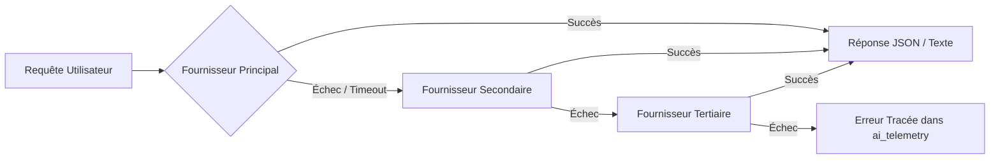

# Architecture IA & Guide des Modèles par Application — MDIV Business

Ce document fournit la cartographie technique exhaustive de l'ensemble des modules d'Intelligence Artificielle développés au sein de la plateforme **MDIV Business**. 

Pour chaque application, vous trouverez la liste précise des modèles de langage (LLM) et de vision utilisés, leur fonctionnement opérationnel détaillé, ainsi que **l'emplacement exact dans le code et les exemples concrets pour changer de modèle**.

---

## 1. Architecture Globale du Moteur IA (`callLLM`)

Tous les modules IA de MDIV Business reposent sur un **orchestrateur d'inférence multi-fournisseurs dynamique** implémenté dans le backend (`vite-dev-api.ts` et `api-admin.php`).

### 1.1 Fournisseurs et Modèles Supportés

L'administrateur peut à tout moment changer de modèle prioritaire ou activer la cascade automatique depuis l'écran **Administration > Paramètres IA** (`/admin/ai-settings`).

| Fournisseur | Modèle par Défaut | Modèles Alternatifs Configurables | Rôle & Spécificités |
| :--- | :--- | :--- | :--- |
| **Groq Cloud (LPU)** | `qwen/qwen3.8-27b` | `llama-3.3-70b-versatile`<br>`llama-3.1-8b-instant` | **Vitesse ultra-haute** (< 1,2s par réponse). Recommandé pour la fluidité des diagnostics, de la génération de devis et des emails. |
| **OpenAI GPT** | `gpt-4o-mini` | `gpt-4o` | **Haute précision et multimodalité**. Utilisé pour les audits fiscaux, l'analyse OCR Vision haute résolution et le raisonnement juridique. |
| **Mistral AI** | `mistral-small-latest` | `mistral-large-latest`<br>`open-mistral-nemo` | **Souveraineté européenne (RGPD)**. Modèles conçus en France avec une parfaite maîtrise des nuances linguistiques et administratives françaises. |
| **OpenAI Embeddings** | `text-embedding-3-large` | 1536 dimensions | **Mémoire sémantique & RAG Vectoriel**. Indexation et recherche sémantique multi-tenant. |
| **Groq Vision** | `llama-3.2-11b-vision-preview` | Fallback sur `gpt-4o-mini` Vision | **Reconnaissance optique multimodale**. Extraction des tickets de caisse, notes de frais et factures. |

### 1.2 Mécanisme de Cascade Automatique (Failover)
Si le fournisseur prioritaire est indisponible, atteint son quota de requêtes (Rate Limit) ou génère une erreur réseau, l'orchestrateur `callLLM` bascule automatiquement et de manière transparente sur les fournisseurs secondaires :


### 1.3 Garde-Fous Systèmes Globaux
Chaque appel d'inférence injecte automatiquement des directives fondamentales :
1. **Filtre Anti-Gribouillage (Anti-Gibberish)** : Détecte les répétitions arbitraires de caractères (`"asdfgh"`, `"zzzz"`, frappes sans voyelles) pour refuser poliment de traiter des entrées incohérentes au lieu d'inventer des hallucinations.
2. **Directive Tarification Contact (`NO_PRICE_INSTRUCTION`)** : Interdit formellement aux modèles textuels de générer des tarifs fantaisistes ; ils renvoient systématiquement vers la fiche de contact `[Contactez-nous](/contact)`.
3. **Contrainte Linguistique Stricte** : Toutes les générations à destination de l'utilisateur final sont obligatoirement formulées en français professionnel.

---

## 2. Tableau Synthétique par Application IA (Avec Emplacement Code & Exemple de Modification)

| # | Application IA | Route | Endpoint API | Modèle(s) Utilisé(s) | Emplacement Code | Comment Changer dans le Code (Exemple Concret) |
| :--- | :--- | :--- | :--- | :--- | :--- | :--- |
| **01** | **Diagnostic IA Express** | `/services-ia/diagnostic` | `/api/diagnostic_step.php`<br>`/api/diagnostic_agents.php` | `qwen/qwen3.8-27b`<br>*(repli : `gpt-4o-mini`)* | `vite-dev-api.ts`<br>lignes 1670 & 1760 | `await callLLM(messages)` hérite du modèle global.<br>**Pour forcer GPT-4o** : remplacer `callLLM(messages)` par `callOpenAIProvider(messages, true, 'gpt-4o')`. |
| **02** | **Comptes-Rendus de Réunions IA** | `/services-ia/comptes-rendus` | `/api/meeting_upload.php`<br>`/api/meeting_agents.php` | Pipeline 4 Agents :<br>`qwen/qwen3.8-27b` / `gpt-4o-mini` | `vite-dev-api.ts`<br>lignes 1542, 1566, 1590 | Chaque tour appelle `callLLM(messages)`.<br>**Pour donner le rôle d'arbitre à Mistral** : remplacer à la ligne 1590 `callLLM` par `callMistralProvider(messages, false, 'mistral-large-latest')`. |
| **03** | **Résumeur de Documents Pro** | `/services-ia/resume-documents` | `/api/classify_document.php`<br>`/api/summarizer_agents.php` | `qwen/qwen3.8-27b`<br>`gpt-4o-mini` | `vite-dev-api.ts`<br>lignes 1005 & 1260 | `await callLLM(messages, true)`.<br>**Pour forcer Llama 3.3 70B** : remplacer par `callGroqProvider(messages, true, 'llama-3.3-70b-versatile')`. |
| **04** | **Assistant Email & Hub Client 360** | `/services-ia/assistant-email` | `/api/email_analyze.php`<br>`/api/email_generate.php`<br>`/api/client_context_hub.php` | `qwen/qwen3.8-27b`<br>`gpt-4o-mini` | `vite-dev-api.ts`<br>lignes 1923, 2648, 5045 | `await callLLM(messages, true)` à la ligne 5045.<br>**Pour forcer GPT-4o Mini** : remplacer par `callOpenAIProvider(messages, true, 'gpt-4o-mini', 0.5)`. |
| **05** | **Calculateur ROI IA & Benchmark** | `/services-ia/calc-roi`<br>`/services-ia/benchmark` | `/api/deep_dive.php`<br>`/api/benchmark_stats.php` | `qwen/qwen3.8-27b`<br>`gpt-4o-mini` | `vite-dev-api.ts`<br>ligne 3103 | `await callLLM(messages, true)` pour le micro-chat.<br>**Pour utiliser Mistral** : `callMistralProvider(messages, true, 'mistral-small-latest')`. |
| **06** | **Devis & Chiffrage IA** | `/services-ia/devis` | `/api/quote_ai_assist.php` | `qwen/qwen3.8-27b` (JSON Mode)<br>Few-Shot in-context | `vite-dev-api.ts`<br>ligne 3028 | `await callLLM(messages, true)`.<br>**Pour forcer GPT-4o** : remplacer par `callOpenAIProvider(messages, true, 'gpt-4o', 0.2)`. |
| **07** | **Facture IA : OCR Vision & Factur-X** | `/services-ia/factures` | `/api/ocr_vision_parse.php`<br>`/api/ocr_document_vision.php`<br>`/api/invoice_extract_lines.php` | **Vision 1** : `llama-3.2-11b-vision`<br>**Vision 2** : `gpt-4o-mini`<br>**Vision Pro** : `gpt-4o` | `vite-dev-api.ts`<br>lignes 3674, 3712 & 5164 | **Groq Vision** ligne 3674 : changer `model: 'llama-3.2-11b-vision-preview'`.<br>**OpenAI Vision** ligne 3712 : changer `model: 'gpt-4o-mini'` en `'gpt-4o'`.<br>**Sélecteur Haute Précision** ligne 5164 : `modelsToTry = ['gpt-4o', 'gpt-4o-mini']`. |
| **08** | **Relances & Recouvrement IA** | `/services-ia/relances` | `/api/followup_generate.php` | `qwen/qwen3.8-27b`<br>`gpt-4o-mini` | `vite-dev-api.ts`<br>ligne 2677 | `await callLLM(messages, true)`.<br>**Pour forcer Mistral** : `callMistralProvider(messages, true, 'mistral-small-latest')`. |
| **09** | **Studio de Contenu Multi-Canal** | `/services-ia/generateur-contenu` | `/api/content_generate.php` | `qwen/qwen3.8-27b`<br>`gpt-4o-mini` | `vite-dev-api.ts`<br>ligne 2785 | `await callLLM(messages, true)`.<br>**Pour Llama 70B** : `callGroqProvider(messages, true, 'llama-3.3-70b-versatile', 0.8)`. |
| **10** | **Générateur de Leads B2B** | `/services-ia/generateur-leads` | `/api/leads_search.php` | `qwen/qwen3.8-27b` (JSON Mode) | `vite-dev-api.ts`<br>ligne 2876 | `await callLLM(messages, true)` avec validation anti-404 des sites web. |
| **11** | **Préparation de RDV Stratégique** | `/services-ia/prepa-reunion` | `/api/meeting_prep_generate.php` | `qwen/qwen3.8-27b`<br>`gpt-4o-mini` | `vite-dev-api.ts`<br>ligne 2944 | `await callLLM(messages, true)`.<br>**Pour forcer GPT-4o** : `callOpenAIProvider(messages, true, 'gpt-4o', 0.5)`. |
| **12** | **Prospection Email B2B (Cold Outreach)** | `/services-ia/prospection-email` | `/api/prospecting_generate.php` | `qwen/qwen3.8-27b`<br>`gpt-4o-mini` | `vite-dev-api.ts`<br>ligne 2818 | `await callLLM(messages, true)`.<br>**Pour forcer Mistral Nemo** : `callMistralProvider(messages, true, 'open-mistral-nemo')`. |
| **13** | **Veille Appels d'Offres & Marchés** | Module Intégré / API | `/api/tenders_search.php` | `qwen/qwen3.8-27b`<br>`gpt-4o-mini` | `vite-dev-api.ts`<br>ligne 3183 | `await callLLM(messages, false)`. Génère des URLs officielles réelles (BOAMP, TED Europa). |
| **14** | **Mémoire RAG Vectoriel Multi-Tenant** | Module Transversal | `/api/rag_document_indexer.php`<br>`/api/rag_query.php` | `text-embedding-3-large` (1536 dim) | `vite-dev-api.ts`<br>ligne 4649 | Ligne 4649 : changer `model: 'text-embedding-3-large'` par `'text-embedding-3-small'` ou `'text-embedding-ada-002'`. |
| **15** | **Apprentissage Continu (Few-Shot)** | Module Transversal | `/api/feedback_loop.php` | Ingestion in-prompt | `vite-dev-api.ts`<br>ligne 4754 | Enregistre les exemples validés dans `db.fewShotExamples` et les injecte automatiquement dans les prompts cibles. |
| **16** | **Configuration Globale Admin** | `/admin/ai-settings` | `/api/ai_settings.php` | Paramètres persistés | `src/pages/admin/AdminAISettings.tsx`<br>lignes 203-237 | Définition des listes déroulantes de modèles et réglage du fournisseur prioritaire (`groq`, `openai`, `mistral`, `auto`). |

---

## 3. Guide Pas à Pas : Comment Changer les Modèles Directement dans le Code (Avec Exemples Concrets)

### Cas 1 : Changer le Modèle OCR Vision (Reconnaissance de Tickets, Reçus et Factures)

Les fonctionnalités de reconnaissance d'images et de factures reposent sur deux endpoints distincts dans `vite-dev-api.ts`. Voici comment modifier leur modèle.

#### A. Endpoint `/api/ocr_vision_parse.php` (Parsing automatique des reçus et tickets)
Ouvrez le fichier `vite-dev-api.ts` autour de la **ligne 3664**. Vous verrez la cascade Groq Vision puis OpenAI Vision :

```typescript
// vite-dev-api.ts (Ligne 3664)

// 1. TENTATIVE GROQ VISION
if (GROQ_API_KEY && !extractedData) {
  try {
    const groqRes = await fetch(GROQ_URL, {
      method: 'POST',
      headers: { 'Authorization': `Bearer ${GROQ_API_KEY}`, 'Content-Type': 'application/json' },
      body: JSON.stringify({
        model: 'llama-3.2-11b-vision-preview', // <-- CHANGER LE MODÈLE GROQ ICI
        messages: [{ role: 'user', content: [...] }],
        temperature: 0.1,
        max_tokens: 800
      })
    });
    // ...
  } catch (err) {}
}

// 2. REPLI OPENAI VISION (Ligne 3703)
if (OPENAI_API_KEY && !extractedData) {
  try {
    const oaiRes = await fetch(OPENAI_URL, {
      method: 'POST',
      headers: { 'Authorization': `Bearer ${OPENAI_API_KEY}`, 'Content-Type': 'application/json' },
      body: JSON.stringify({
        model: 'gpt-4o-mini', // <-- CHANGER LE MODÈLE OPENAI ICI (ex: 'gpt-4o')
        messages: [{ role: 'user', content: [...] }],
        temperature: 0.1,
        max_tokens: 800
      })
    });
    // ...
  } catch (err) {}
}
```

> **Exemple Concret pour passer à GPT-4o Vision Flagship :**
> Remplacez la ligne 3712 :
> ```diff
> - model: 'gpt-4o-mini',
> + model: 'gpt-4o',
> ```

---

#### B. Endpoint `/api/ocr_document_vision.php` (Extraction textuelle haute résolution)
Ouvrez `vite-dev-api.ts` à la **ligne 5164** :

```typescript
// vite-dev-api.ts (Ligne 5164)
const modelsToTry = preferHighAccuracy ? ['gpt-4o', 'gpt-4o-mini'] : ['gpt-4o-mini', 'gpt-4o'];
```

> **Exemple Concret pour forcer exclusivement GPT-4o sans repli sur mini :**
> ```diff
> - const modelsToTry = preferHighAccuracy ? ['gpt-4o', 'gpt-4o-mini'] : ['gpt-4o-mini', 'gpt-4o'];
> + const modelsToTry = ['gpt-4o'];
> ```

---

### Cas 2 : Changer les Modèles par Défaut de l'Orchestrateur Global (`callLLM`)

Si vous souhaitez modifier le modèle par défaut appliqué à **toutes les applications**, modifiez la fonction `callLLM` et les paramètres par défaut dans `vite-dev-api.ts` (lignes 81 à 156) :

```typescript
// vite-dev-api.ts (Lignes 81, 99, 117)

// 1. Modèle Groq par défaut :
async function callGroqProvider(messages: any[], jsonMode: boolean, model = 'qwen/qwen3.8-27b', temperature = 0.7)

// 2. Modèle OpenAI par défaut :
async function callOpenAIProvider(messages: any[], jsonMode: boolean, model = 'gpt-4o-mini', temperature = 0.7)

// 3. Modèle Mistral par défaut :
async function callMistralProvider(messages: any[], jsonMode: boolean, model = 'mistral-small-latest', temperature = 0.7)
```

Et pour modifier les valeurs de démarrage de la base de données de développement (lignes 149-156) :
```typescript
// vite-dev-api.ts (Ligne 149)
const settings = db.aiSettings || {
  primaryProvider: 'groq',               // Options: 'groq' | 'openai' | 'mistral' | 'auto'
  groqModel: 'qwen/qwen3.8-27b',         // Remplacer par 'llama-3.3-70b-versatile'
  openaiModel: 'gpt-4o-mini',            // Remplacer par 'gpt-4o'
  mistralModel: 'mistral-small-latest',  // Remplacer par 'mistral-large-latest'
  temperature: 0.7,
  fallbackEnabled: true
};
```

---

### Cas 3 : Forcer un Modèle Dédié pour UNE Seule Application Spécifique

Par défaut, presque tous les endpoints appellent `callLLM(messages, isJson)`. Ce mécanisme applique le modèle configuré par l'administrateur.

Si vous souhaitez qu'une application précise (par exemple le **Devis IA**) utilise **TOUJOURS GPT-4o**, quelle que soit la configuration globale, remplacez simplement l'appel `callLLM` par la fonction directe du fournisseur :

#### Exemple sur l'Assistant Devis (`/api/quote_ai_assist.php`) :
Dans `vite-dev-api.ts` à la **ligne 3028** :

```diff
// vite-dev-api.ts (Ligne 3028)
- const groqRes = await callLLM([
-   { role: 'system', content: systemPrompt },
-   { role: 'user', content: userPrompt }
- ], true);

+ // Forcer l'utilisation de GPT-4o avec température basse pour une précision maximale
+ const groqRes = await callOpenAIProvider([
+   { role: 'system', content: systemPrompt },
+   { role: 'user', content: userPrompt }
+ ], true, 'gpt-4o', 0.2);
```

#### Exemple sur le Studio de Contenu (`/api/content_generate.php`) :
Pour utiliser **Llama 3.3 70B** à la ligne 2785 :

```diff
// vite-dev-api.ts (Ligne 2785)
- const groqRes = await callLLM(messages, true);
+ const groqRes = await callGroqProvider(messages, true, 'llama-3.3-70b-versatile', 0.85);
```

---

### Cas 4 : Changer le Modèle d'Embedding du RAG Vectoriel

Le moteur RAG multi-tenant indexe les documents de l'entreprise sous forme de vecteurs mathématiques.
Dans `vite-dev-api.ts` à la **ligne 4649** :

```typescript
// vite-dev-api.ts (Ligne 4649)
res.setHeader('Content-Type', 'application/json');
return res.end(JSON.stringify({
  status: 'success',
  document_id,
  chunks_indexed: chunks.length,
  model: 'text-embedding-3-large',  // <-- MODÈLE DE VECTORISATION
  dimensions: 1536,
  message: `Document indexé avec succès.`
}));
```

Pour utiliser un modèle plus léger ou alternatif (comme `text-embedding-3-small` avec 512 dimensions) :
```diff
- model: 'text-embedding-3-large',
- dimensions: 1536,
+ model: 'text-embedding-3-small',
+ dimensions: 512,
```

---

### Cas 5 : Ajouter de Nouveaux Modèles dans le Sélecteur de l'Interface Admin

Pour rendre un nouveau modèle sélectionnable par l'administrateur dans le menu déroulant `/admin/ai-settings`, ouvrez le fichier :
`src/pages/admin/AdminAISettings.tsx` (lignes 203 à 237).

```typescript
// src/pages/admin/AdminAISettings.tsx (Lignes 203-237)

// 1. Modèles Groq Cloud :
models: [
  { value: "qwen/qwen3.8-27b", label: "Qwen 2.5 27B (Recommandé - Raisonnement bilingue FR/EN)" },
  { value: "llama-3.3-70b-versatile", label: "Llama 3.3 70B Versatile (Grande puissance de synthèse)" },
  { value: "llama-3.1-8b-instant", label: "Llama 3.1 8B Instant (Ultra-léger & instantané)" },
  // AJOUTER UN NOUVEAU MODÈLE GROQ ICI :
  // { value: "deepseek-r1-distill-llama-70b", label: "DeepSeek R1 Llama 70B (Raisonnement avancé)" }
],

// 2. Modèles OpenAI GPT :
models: [
  { value: "gpt-4o-mini", label: "GPT-4o Mini (Recommandé - Équilibré, rapide et économique)" },
  { value: "gpt-4o", label: "GPT-4o (Modèle Flagship multimodal très haute capacité)" },
  // AJOUTER UN NOUVEAU MODÈLE OPENAI ICI :
  // { value: "o3-mini", label: "OpenAI o3-mini (Raisonnement mathématique & code)" }
],

// 3. Modèles Mistral AI :
models: [
  { value: "mistral-small-latest", label: "Mistral Small (Défaut rapide)" },
  { value: "mistral-large-latest", label: "Mistral Large (Puissance maximale d'analyse)" },
  { value: "open-mistral-nemo", label: "Mistral Nemo 12B (Polyvalent)" },
]
```

Une fois ajouté dans cette liste, le modèle devient instantanément disponible dans l'interface et est sauvegardé en base de données lors du clic sur **Enregistrer**.

---

## 4. Fonctionnement Détaillé par Application IA

### 01. Diagnostic IA Express & Conseil Stratégique
* **Route** : `/services-ia/diagnostic`
* **Endpoints** : `/api/diagnostic_step.php` (questions interactives) et `/api/diagnostic_agents.php` (rapport final en streaming).
* **Modèles Utilisés** :
  * Modèle principal : `qwen/qwen3.8-27b` (Groq LPU).
  * Repli : `gpt-4o-mini` (OpenAI).
* **Emplacement Code** : `vite-dev-api.ts` (lignes 1665 à 1815).
* **Comment changer le modèle** : Modifiable dynamiquement depuis l'Admin (`groqModel`), ou forçable à la ligne 1670 via `callOpenAIProvider(..., 'gpt-4o')`.
* **Comment ça marche** :
  1. **Phase de Questionnement Dynamique (`diagnostic_step.php`)** : L'IA pose des questions intelligentes progressives en adaptant son jargon selon le secteur (BTP, Industrie, Santé, Tech, Commerce). Elle renvoie un objet JSON contenant :
     - `expert_domain` : Domaine d'expertise activé (ex: Optimisation Logistique).
     - `expert_insight` : Observation experte validant la réponse de l'utilisateur.
     - `question` : Question ciblée suivante avec choix multiples concrets.
     - `precision_score` : Pourcentage d'avancement de l'audit (de 30% à 98%).
  2. **Phase de Délibération Multi-Consultants (`diagnostic_agents.php`)** : Deux agents virtuels délibèrent en direct via Server-Sent Events (SSE) :
     - *Agent 1 (Consultant Stratégie)* : Évalue la maturité globale de l'entreprise.
     - *Agent 2 (Expert Automatisation)* : Calcule le score numérique (/100) et synthétise les 3 chantiers prioritaires, les quick wins et le plan de rentabilité.
  3. **Export** : Génération instantanée d'un rapport PDF exécutif téléchargeable.

---

### 02. Générateur de Comptes-Rendus de Réunions IA Multi-Agents
* **Route** : `/services-ia/comptes-rendus`
* **Endpoints** : `/api/meeting_upload.php` et `/api/meeting_agents.php`.
* **Modèles Utilisés** : `qwen/qwen3.8-27b` sur Groq (ou `gpt-4o-mini` sur OpenAI).
* **Emplacement Code** : `vite-dev-api.ts` (lignes 1482 à 1660).
* **Comment changer le modèle** : Les appels des 4 agents sont aux lignes 1542 (Agent 1), 1566 (Agent 2), 1590 (Agent 3) et 1615 (Agent 4).
* **Comment ça marche (Pipeline en 4 Tours de Délibération)** :
  1. **Tour 1 : Secrétaire de séance** : Analyse le verbatim, extrait les participants, structure l'ordre du jour et liste les premières tâches mentionnées.
  2. **Tour 2 : Auditeur des Risques & Échéances** : Challenge le brouillon de l'Agent 1, traque les actions sans responsable désigné et alerte sur les délais irréalistes.
  3. **Tour 3 : Directeur des Opérations (RACI)** : Arbitre les désaccords, valide la matrice RACI (Qui fait quoi d'ici quand) et formalise les livrables attendus.
  4. **Tour 4 : Directeur Général (Synthèse Certifiée)** : Fusionne l'ensemble en un compte-rendu décisionnel final (résumé exécutif, décisions actées, plan d'action).

---

### 03. Résumeur de Documents Pro IA
* **Route** : `/services-ia/resume-documents`
* **Endpoints** : `/api/classify_document.php`, `/api/summarizer_upload.php`, `/api/summarizer_agents.php`.
* **Modèles & Outils** : `mammoth` (parser DOCX) + `qwen/qwen3.8-27b` / `gpt-4o-mini`.
* **Emplacement Code** : `vite-dev-api.ts` (lignes 981 à 1395).
* **Comment changer le modèle** : Ligne 1005 (`classify_document`) et ligne 1260 (`summarizer_agents`).
* **Comment ça marche** :
  1. **Classification Automatique (`classify_document.php`)** : Détecte le type (`contrat`, `financier`, `technique`, `rh`, `commercial`).
  2. **5 Modes de Synthèse** :
     - **Express** : Synthèse percutante en moins de 10 lignes (< 30 secondes).
     - **Standard** : Résumé équilibré d'une page (objectifs, points clés, risques, actions).
     - **Détaillé** : Audit exhaustif en 4 à 5 paragraphes denses avec clauses, chiffres et dates.
     - **Direction** : Analyse orientée arbitrage business, ROI, rentabilité et risques d'inaction.
     - **Comex** : Briefing macroscopique haute gouvernance à lire en 2 minutes pour validation en conseil.

---

### 04. Assistant Email IA & Hub de Réponses Contextuelles Client 360
* **Route** : `/services-ia/assistant-email`
* **Endpoints** : `/api/email_analyze.php`, `/api/email_generate.php`, `/api/client_context_hub.php`.
* **Modèles Utilisés** : `qwen/qwen3.8-27b` / `gpt-4o-mini`.
* **Emplacement Code** : `vite-dev-api.ts` (lignes 1904, 2626 et 4897).
* **Comment changer le modèle** : Ligne 2648 pour la rédaction simple, ligne 5045 pour la réponse contextuelle liée au CRM.
* **Comment ça marche** :
  1. **Analyse de Qualité** : Calcule le `clarityScore`, `professionalismScore` et `qualityScore`.
  2. **Génération & Réécriture** : Rédige selon le ton sélectionné (`Professionnel`, `Commercial`, `Diplomatique`, `Ferme`).
  3. **Hub Client 360** : Injecte automatiquement les factures impayées, devis et antécédents du CRM pour rédiger une réponse parfaitement informée.

---

### 05. Calculateur de ROI IA & Benchmark de Maturité Digitale
* **Routes** : `/services-ia/calc-roi` et `/services-ia/benchmark`
* **Endpoints** : `/api/deep_dive.php`, `/api/benchmark_stats.php`.
* **Modèles Utilisés** : `qwen/qwen3.8-27b` / `gpt-4o-mini`.
* **Emplacement Code** : `vite-dev-api.ts` (lignes 3055 à 3110 et 3330 à 3355).
* **Comment changer le modèle** : Ligne 3103 pour le micro-chat d'approfondissement.
* **Comment ça marche** :
  1. Calcule le volume d'heures et d'euros récupérables par an par collaborateur.
  2. Fournit un micro-chat d'approfondissement (`deep_dive`) avec une méthodologie concrète en 3 étapes.
  3. Compare en temps réel la maturité numérique de l'entreprise par rapport à la moyenne de son secteur.

---

### 06. Devis & Chiffrage IA (Few-Shot Learning)
* **Route** : `/services-ia/devis`
* **Endpoint** : `/api/quote_ai_assist.php`
* **Modèles Utilisés** : `qwen/qwen3.8-27b` (JSON Mode) ou `gpt-4o-mini`.
* **Emplacement Code** : `vite-dev-api.ts` (lignes 2975 à 3050).
* **Comment changer le modèle** : Remplacer `callLLM` à la ligne 3028 par `callOpenAIProvider(..., 'gpt-4o', 0.2)` pour une précision de tarification maximale.
* **Comment ça marche** :
  1. L'utilisateur décrit le projet en texte libre ou téléverse un devis d'exemple.
  2. L'IA apprend du barème tarifaire fourni (taux horaires, unités de mesure, conditions d'acompte).
  3. Renvoie les lignes chiffrées HT, le calcul de TVA et la synthèse commerciale.

---

### 07. Facture IA, OCR Vision & Factur-X PDP 2026
* **Route** : `/services-ia/factures`
* **Endpoints** : `/api/ocr_vision_parse.php`, `/api/ocr_document_vision.php`, `/api/invoice_extract_lines.php`, `/api/invoice_ai_check.php`, `/api/fraud_check_iban.php`, `/api/facturx_generator.php`.
* **Modèles de Vision & LLM Utilisés** :
  * **Vision 1** : `llama-3.2-11b-vision-preview` (Groq LPU).
  * **Vision 2 (Fallback / Précision)** : `gpt-4o-mini` Vision / `gpt-4o` Vision (OpenAI).
  * **Audit Fiscale & Conformité** : `qwen/qwen3.8-27b`.
* **Emplacement Code** :
  * `vite-dev-api.ts` ligne 3674 (`llama-3.2-11b-vision-preview`).
  * `vite-dev-api.ts` ligne 3712 (`gpt-4o-mini`).
  * `vite-dev-api.ts` ligne 5164 (`modelsToTry = ['gpt-4o', 'gpt-4o-mini']`).
* **Comment changer le modèle** : Voir les exemples détaillés dans la **Section 3 - Cas 1** de ce document.
* **Comment ça marche (Pipeline Fintech)** :
  1. **OCR Documentaire** : Extrait l'enseigne, la date, les articles, les montants HT/TVA/TTC et le moyen de paiement.
  2. **Audit Fiscale** : Contrôle l'égalité arithmétique et signale les mentions légales obligatoires manquantes.
  3. **Bouclier Anti-Fraude IBAN** : Vérifie l'IBAN selon l'algorithme ISO 13616 Mod 97-10.
  4. **Génération Factur-X PDP 2026** : Produit le fichier XML conforme EN 16931 (CrossIndustryInvoice).

---

### 08. Relances & Recouvrement IA
* **Route** : `/services-ia/relances`
* **Endpoints** : `/api/followup_generate.php`, `/api/followup_send.php`.
* **Modèles Utilisés** : `qwen/qwen3.8-27b` / `gpt-4o-mini`.
* **Emplacement Code** : `vite-dev-api.ts` (lignes 2675 à 2707).
* **Comment changer le modèle** : Ligne 2677 dans `callLLM(messages, true)`.
* **Comment ça marche** :
  1. Identifie automatiquement les factures échues dans la base locale.
  2. Rédige un message adapté selon l'ancienneté du retard (Rappel bienveillant J+5, Relance formelle J+15, Mise en demeure J+30).

---

### 09. Studio de Contenu Multi-Canal B2B
* **Route** : `/services-ia/generateur-contenu`
* **Endpoint** : `/api/content_generate.php`
* **Modèles Utilisés** : `qwen/qwen3.8-27b` / `gpt-4o-mini`.
* **Emplacement Code** : `vite-dev-api.ts` (lignes 2712 à 2792).
* **Comment changer le modèle** : Ligne 2785. Pour forcer Llama 3.3 70B : `callGroqProvider(messages, true, 'llama-3.3-70b-versatile', 0.85)`.
* **Comment ça marche** : Décline un contenu brut en publications prêtes à l'emploi pour LinkedIn (hook + aération + emojis), Twitter/X (< 280 car.), Instagram (suggestion de visuel), Newsletter et Blog SEO.

---

### 10. Générateur de Leads B2B & Intelligence Commerciale
* **Route** : `/services-ia/generateur-leads`
* **Endpoint** : `/api/leads_search.php`
* **Modèles Utilisés** : `qwen/qwen3.8-27b` en JSON Mode.
* **Emplacement Code** : `vite-dev-api.ts` (lignes 2874 à 2932).
* **Comment ça marche** : Identifie des profils de sociétés cibles selon le secteur, pays, taille et fonction du décideur, avec un algorithme de sécurisation des liens web (zéro lien mort 404).

---

### 11. Préparation de RDV Stratégique & Négociation IA
* **Route** : `/services-ia/prepa-reunion`
* **Endpoint** : `/api/meeting_prep_generate.php`
* **Modèles Utilisés** : `qwen/qwen3.8-27b` / `gpt-4o-mini`.
* **Emplacement Code** : `vite-dev-api.ts` (lignes 2937 à 2970).
* **Comment changer le modèle** : Ligne 2944 dans `callLLM(messages, true)`.
* **Comment ça marche** : Génère un briefing commercial d'élite avec enjeu capital, opportunités, parade aux objections, questions ouvertes d'écoute active et objectifs de négociation.

---

### 12. Prospection Email B2B (Cold Outreach)
* **Route** : `/services-ia/prospection-email`
* **Endpoint** : `/api/prospecting_generate.php`
* **Modèles Utilisés** : `qwen/qwen3.8-27b` / `gpt-4o-mini`.
* **Emplacement Code** : `vite-dev-api.ts` (lignes 2797 à 2870).
* **Comment changer le modèle** : Ligne 2818 dans `callLLM(messages, true)`.
* **Comment ça marche** : Produit un email d'accroche personnalisé selon la proposition de valeur de l'offre et fournit une notation de persuasion (`impactScore`, `clarityScore`, `personalizationScore`).

---

### 13. Moteur d'Agrégation & Détection d'Appels d'Offres IA
* **Route** : Module Intégré / API
* **Endpoint** : `/api/tenders_search.php`
* **Modèles Utilisés** : `qwen/qwen3.8-27b` / `gpt-4o-mini`.
* **Emplacement Code** : `vite-dev-api.ts` (lignes 3115 à 3237).
* **Comment ça marche** : Recherche des marchés publics et opportunités par mot-clé et zone géographique, avec liens directs vers BOAMP, TED Europa, Marchés-Publics.info, APEC et France Travail.

---

### 14. Mémoire RAG Vectoriel Multi-Tenant & Recherche Sémantique
* **Endpoints** : `/api/rag_document_indexer.php` et `/api/rag_query.php`.
* **Modèles Utilisés** : `text-embedding-3-large` (1536 dimensions).
* **Emplacement Code** : `vite-dev-api.ts` (lignes 4583 à 4718, spécifiquement ligne 4649).
* **Comment changer le modèle** : Ligne 4649 (`model: 'text-embedding-3-large'`).
* **Comment ça marche** : Découpage sémantique (chunks de 650 caractères, overlap 100), isolation stricte par `company_id` et recherche par similarité cosinus (score minimal $\ge 0.65$).

---

### 15. Boucle d'Apprentissage Continu (Few-Shot Feedback Loop)
* **Endpoint** : `/api/feedback_loop.php`
* **Emplacement Code** : `vite-dev-api.ts` (lignes 4722 à 4799).
* **Comment ça marche** : Enregistre les corrections apportées par le dirigeant sur les devis, emails ou comptes-rendus dans `db.fewShotExamples` pour les réinjecter automatiquement dans les générations futures de l'entreprise.

---

### 16. Observabilité, Télémétrie & Audit Trail IA
* **Route** : `/admin/ai-settings` (Onglet *Observabilité & Audit Trail*)
* **Endpoint** : `/api/ai_telemetry.php`
* **Emplacement Code** : `vite-dev-api.ts` (lignes 4804 à 4892).
* **Comment ça marche** : Suivi en direct du fournisseur utilisé, de la latence en millisecondes, des tokens consommés, du coût en euros et de l'historique complet de délibération des agents IA.

---

## 5. Configuration des Clés API dans l'Environnement

Pour activer l'ensemble des moteurs, les variables d'environnement suivantes doivent être renseignées dans votre fichier `.env` ou sur votre serveur d'hébergement :

```bash
# Clé Groq (Moteur LPU ultra-rapide)
GROQ_API_KEY=gsk_...

# Clé OpenAI (Précision, Vision multimodale & Embeddings)
OPENAI_API_KEY=sk-proj-...

# Clé Mistral AI (Souveraineté européenne & RGPD)
MISTRAL_API_KEY=...
```

La plateforme reste 100% fonctionnelle même si une seule clé est configurée, grâce au système de cascade et de repli dynamique.
