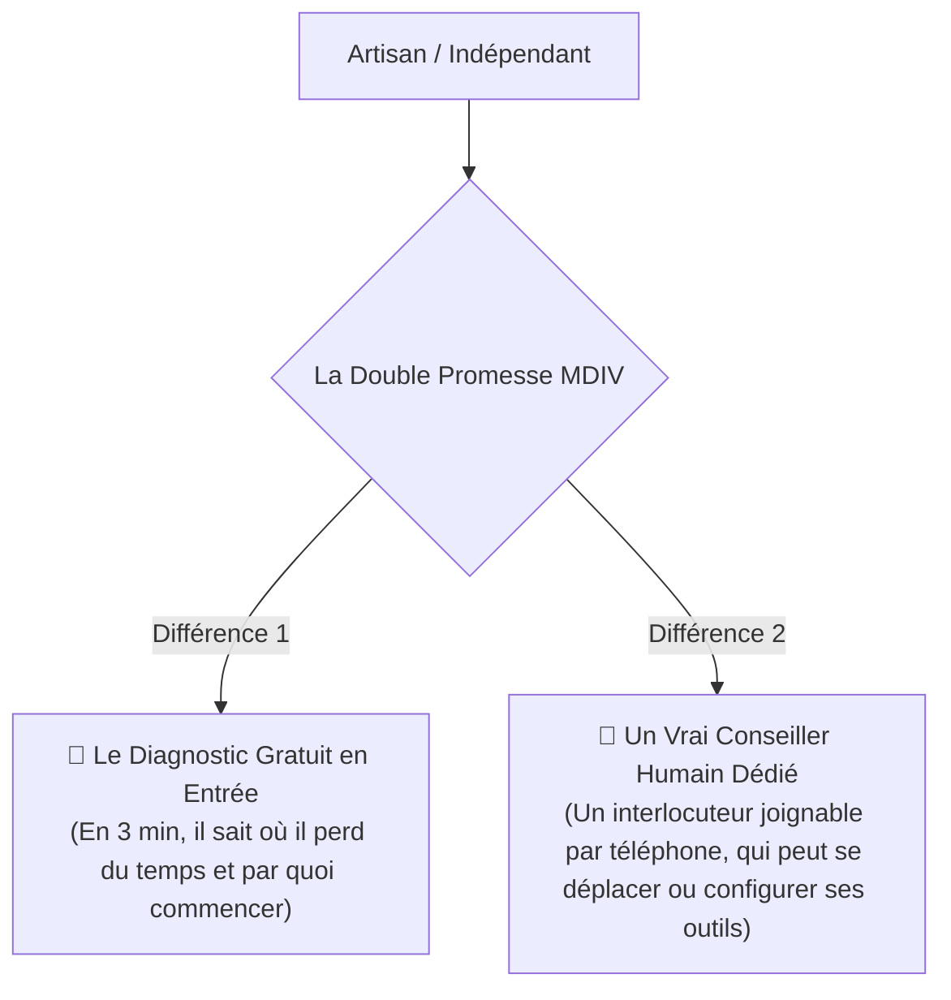
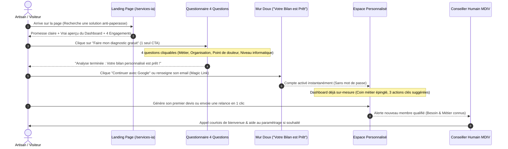
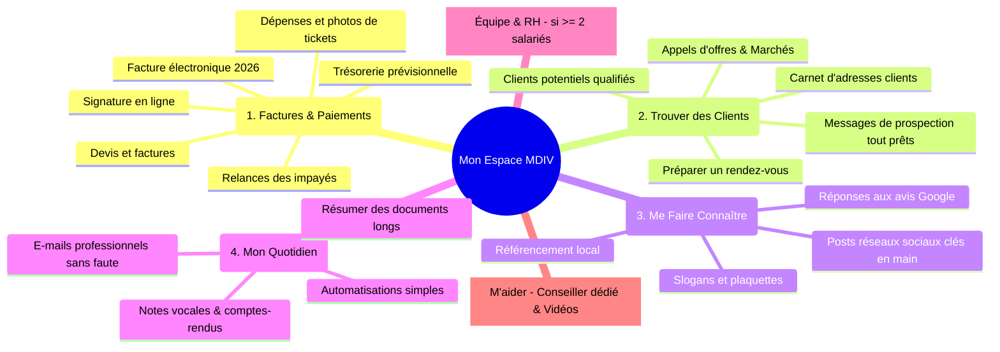
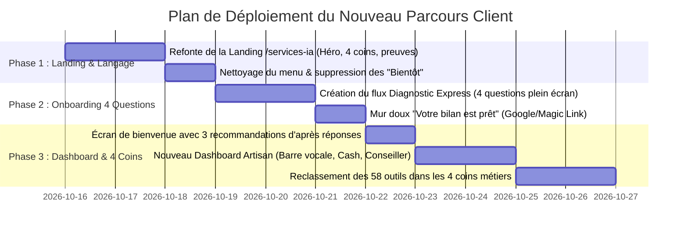

# Parcours Utilisateur & Nouvelle Expérience Client — SaaS MDIV Business

> **Document de cadrage stratégique et parcours UX complet**  
> *Inspiré du dossier d'audit MTB PROD (Octobre 2026) pour Eric Papain Mezatio.*  
> **Objectif** : Transformer la section `/services-ia` en un outil de gestion et de productivité évident, rassurant et ultra-simple pour les artisans, commerçants et dirigeants de TPE.

---

## 1. La Vision Stratégique : Vendre du Temps, Pas de la Technologie

### 1.1 Le Constat de Départ
L'ancienne version de la page `/services-ia` souffrait d'un syndrome fréquent dans les produits récents :
* **Un look de "modèle généré"** : Dégradés violets, badges pastels, terminologie d'ingénieurs ("Prompt", "Copilot", "Workflow", "Embeddings").
* **Une offre en vrac de 58 entrées** : Les mêmes besoins (devis, emails, réunions) étaient éparpillés dans 4 à 5 onglets différents, avec une vingtaine d'étiquettes "Arrive bientôt" qui dévaluaient le produit.
* **Le client cible était perdu** : Un artisan plombier ou un gérant de restaurant sur son smartphone ne savait ni par où commencer, ni sur quel bouton cliquer parmi 6 appels à l'action concurrents.

### 1.2 Les 6 Enseignements des Leaders (Pennylane, Abby, Indy, Axonaut)
1. **Personne n'achète "de l'IA", on achète du résultat** : L'artisan veut savoir que ses factures sont payées à l'heure et que ses devis sont envoyés en 2 minutes le soir dans sa camionnette. Le mot "IA" disparaît au profit des bénéfices.
2. **Un seul appel à l'action principal** : Partout sur le site, un seul bouton vertigineusement simple : `[ Faire mon diagnostic gratuit ]` (3 minutes · Gratuit · Sans carte bancaire).
3. **La preuve en 3 secondes** : Des engagements concrets visibles dès le haut de page (Sans engagement, Données sécurisées et privées, Conforme réforme Facture Électronique 2026, Vrai conseiller joignable au téléphone).
4. **4 coins métiers maximum** : 58 outils réduits en 4 univers évidents pour le quotidien d'une entreprise.
5. **L'auto-reconnaissance immédiate ("Pour qui ?")** : Bâtiment & Travaux, Métiers de bouche, Beauté & Bien-être, Automobile, Commerçants, Indépendants.
6. **Le produit affiché dès l'accueil** : Montrer de véritables captures du tableau de bord (montants, factures, boutons d'action), pas des illustrations abstraites.

### 1.3 Les Deux Piliers Différenciateurs de MDIV Business
Face aux géants établis, MDIV Business gagne sur deux points où les autres échouent :


---

## 2. Le Parcours Utilisateur de Bout en Bout (End-to-End User Journey)

L'idée maîtresse retenue : **Le questionnaire de diagnostic et l'inscription sont une seule et même étape**.  
L'artisan ne remplit pas un formulaire d'inscription aride (avec SIRET, mot de passe complexe ou CB). Il répond à 4 questions simples sur son métier. La création de compte intervient uniquement au moment où son bilan est prêt : **l'inscription est vécue comme une récompense, pas comme une barrière.**



---

## 3. Détail des 5 Étapes du Parcours Client

### Étape 1 : La Page d'Accueil `/services-ia` (Accroche & Rassurance)

#### Structure de l'écran :
* **En-tête épuré** :
  * Logo MDIV Business
  * Liens : *Comment ça marche*, *Les outils*, *Pour qui ?*, *Tarifs*, *Vos questions*
  * À droite : Lien *Se connecter* + Bouton d'action doré `[ Faire mon diagnostic gratuit ]`
* **Zone Héro (Au-dessus de la ligne de flottaison)** :
  * Badge rassurant : `Pour les artisans et les indépendants`
  * **Titre percutant** : **« Moins de paperasse. Plus de temps pour votre métier. »**
  * **Sous-titre** : *« Devis, factures, relances, nouveaux clients : un seul espace simple pour gérer votre entreprise, même depuis le chantier. Pas besoin d'être doué en informatique. »*
  * **Bouton principal unique** : `[ Faire mon diagnostic gratuit → ]`
  * Sous le bouton : `✓ 3 minutes · ✓ Gratuit · ✓ Sans carte bancaire`
  * **À droite du Héro** : Aperçu interactif du tableau de bord réel (ex: *Bonjour Julien, 4 280 € à encaisser, 1 150 € en retard, bouton "Relancer pour moi"*).
* **Bandeau des 4 engagements concrets** :
  1. 🛡️ **Prêt pour la facture électronique obligatoire** (Conformité 2026 garantie).
  2. 🔒 **Vos documents restent à vous** (Données privées, hébergées en France, aucun usage public).
  3. 📞 **Un vrai conseiller au bout du fil** (Disponible du lundi au vendredi, numéro non surtaxé).
  4. ⚡ **Sans engagement** (Vous arrêtez quand vous voulez en un clic).
* **Section « Comment ça marche ? » (3 étapes rassurantes)** :
  1. *Répondez à 4 questions* (Votre métier, votre façon de travailler, ce qui vous prend du temps).
  2. *Recevez votre bilan* (On vous montre où vous perdez des heures et ce qui peut être automatisé).
  3. *Utilisez ce qui vous sert* (Votre espace affiche seulement les outils utiles pour votre métier. Rien de compliqué).
* **Section « Tout ce qu'il faut, rangé en 4 coins »** (Onglets interactifs présentant les cas d'usage concrets avec devis de plombier, facture conforme, posts chantiers).
* **Section « Fait pour les gens de métier »** (Sélecteur par secteur : Bâtiment, Métiers de bouche, Beauté, Mécanique, Commerce, Conseil).
* **Section « Un conseiller qui connaît votre métier »** : Photo réelle d'un conseiller, prénom, téléphone direct, bouton `[ Être rappelé ]`.
* **Section Tarifs simplifiée** : *« Gratuit pour commencer. Pour aller plus loin : dès 12 € HT/mois. »*
* **FAQ de 5 questions fondamentales** (Ordinateur, Gratuité, Confidentialité, Réforme 2026, Résiliation).

---

### Étape 2 : Le Questionnaire de Diagnostic (4 Questions en Plein Écran)

Le questionnaire remplace l'interrogatoire administratif habituel.  
* **Format visuel** : 1 question par écran, cartes hautes et larges très faciles à cliquer sur mobile (hauteur minimum 44 px), barre de progression fluide, bouton `[ Passer cette question ]`.
* **Pas de questions indiscrètes** : Zéro demande de SIRET, zéro demande de chiffre d'affaires.

| Question | Choix Proposés (Cartes Cliquables) | Impact Immédiat sur l'Espace de l'Artisan |
| :--- | :--- | :--- |
| **Q1 : Comment travaillez-vous ?** | • Je me lance<br>• Je travaille seul<br>• On est entre 2 et 9<br>• On est 10 ou plus | Ajuste la formule tarifaire conseillée et affiche ou masque le module **« Équipe & RH »** (masqué pour les solos). |
| **Q2 : Quel est votre métier ?** | • Bâtiment & travaux<br>• Métiers de bouche<br>• Beauté & bien-être<br>• Auto & réparation<br>• Commerce<br>• Services & conseil<br>• Autre | Pré-remplit les modèles de devis, les unités de chiffrage (heures, m², forfaits) et le vocabulaire des documents. |
| **Q3 : Qu'est-ce qui vous prend le plus de temps ?** *(Choix multiples)* | • Devis et factures<br>• Clients qui ne paient pas (relances)<br>• Trouver de nouveaux clients<br>• Être visible sur internet<br>• E-mails et paperasse<br>• Facture électronique 2026 | **Épingle en premier le Coin Métier prioritaire** et définit les **3 actions de bienvenue** affichées sur l'écran d'accueil. |
| **Q4 : Et l'ordinateur, vous en êtes où ?** | • Je fais le minimum<br>• Je me débrouille<br>• Je suis à l'aise | Règle le niveau d'aide de l'interface : active l'aide vocale, les vidéos pas-à-pas et la proposition d'un appel téléphonique du conseiller. |

---

### Étape 3 : La Création de Compte (« Votre Bilan est Prêt »)

À l'issue de la 4ème question, une transition animée indique :  
**« Votre bilan personnalisé est prêt ! »**

* **Création sans friction** :
  * Bouton prioritaire : `[ Continuer avec Google ]` (Connexion en 1 clic).
  * Option alternative : `[ Recevoir mon lien par e-mail ]` (Magic link instantané sans aucun mot de passe à inventer ni à retenir).
* **Écran de Bienvenue Personnalisé** :  
  L'artisan arrive immédiatement sur l'écran :
  > **« Bienvenue, [Prénom]. »**  
  > *D'après vos réponses, voici par quoi commencer pour gagner du temps tout de suite :*
  > 1. `[ Faire votre premier devis ]` *(Modèle BTP pré-rempli, environ 2 minutes)*
  > 2. `[ Activer les relances automatiques ]` *(Pour que vos factures soient réglées sans conflit)*
  > 3. `[ Vérifier si vous êtes prêt pour la facture électronique 2026 ]`
  >
  > Bouton : `[ Entrer dans mon espace → ]`

---

### Étape 4 : Le Tableau de Bord Quotidien de l'Artisan

L'espace de travail est conçu comme un poste de pilotage épuré, pensé pour être utilisé aussi bien sur un PC de bureau que sur un smartphone entre deux chantiers.

```
+----------------------------------------------------------------------------------------------------+
| [Logo] MDIV Business   | 🔍 Que voulez-vous faire ? [🎙️ Micro] Ex: Faire un devis Mme Laurent   | 👤 Julien |
+------------------------+---------------------------------------------------------------------------+---------+
|                        |                                                                                     |
| 📌 MON ESPACE          |  Bonjour Julien                                                                     |
|   Ma checklist (2/5)   |  Voici où en est votre entreprise aujourd'hui :                                    |
|   Mes documents        |                                                                                     |
|                        |  +-------------------------------------------------------------------------------+  |
| 📂 MES OUTILS          |  | ℹ️ La facture électronique devient obligatoire. Vérifiez en 2 min : [Vérifier] |  |
|                        |  +-------------------------------------------------------------------------------+  |
| 💳 Factures & paie. ▼  |                                                                                     |
|   • Devis & factures   |  [ 📄 Faire un devis ]  [ 🧾 Faire une facture ]  [ 📸 Scanner un ticket ]  [ ✉️ Relancer ] |
|   • Relances impayés   |                                                                                     |
|   • Dépenses & tickets |  +---------------------------------------+  +------------------------------------+  |
|                        |  | MON ARGENT CE MOIS-CI                 |  | MES PROCHAINES ÉTAPES (2 sur 5)    |  |
| 👥 Trouver des clients |  | Déjà encaissé : 6 900 € (8 factures)  |  | ✓ Créer mon espace                 |  |
|                        |  | À encaisser   : 4 280 € (5 factures)  |  | ✓ Faire mon bilan                  |  |
| 📢 Me faire connaître  |  | EN RETARD     : 1 150 € (2 clients)   |  | ⭕ Ajouter mon logo & coordonnées  |  |
|                        |  |                                       |  | ⭕ Faire mon premier devis         |  |
| ⚡ Mon quotidien       |  |  👉 [ Les relancer pour moi (1 clic) ]|  | ⭕ Activer la facture électronique |  |
|                        |  +---------------------------------------+  +------------------------------------+  |
| ---------------------- |                                                                                     |
| 🤝 M'AIDER             |  +---------------------------------------+  +------------------------------------+  |
|   • Mon bilan          |  | MES DERNIERS DOCUMENTS     [Voir tout]|  | BESOIN D'UN COUP DE MAIN ?         |  |
|   • Vidéos d'aide      |  | FA-2026-029 | M. Petit   | 640 € |J+12|  | 👤 Thomas, votre conseiller dédié  |  |
|   • Mon conseiller     |  | DE-2026-014 | Laurent    |1850 € |Sign|  |    Du lundi au vendredi (9h-18h)   |  |
|                        |  | FA-2026-031 | SCI Tilleul|2360 € |Payé|  |                                    |  |
|                        |  | TICKET-042  | Point.P    | 312 € |Scan|  | [ 📞 Être rappelé ] [ 💬 Écrire ]  |  |
|                        |  +---------------------------------------+  +------------------------------------+  |
+----------------------------------------------------------------------------------------------------+
```

#### Éléments phares du tableau de bord :
1. **La barre d'action naturelle / vocale (« Que voulez-vous faire ? »)** :
   L'artisan clique sur le micro et dit : *« Rédige un devis pour changement de cumulus chez M. Martin »*. L'outil prépare le document instantanément sans forcer l'utilisateur à naviguer dans les sous-menus.
2. **Le bloc Trésorerie « Mon argent ce mois-ci »** :
   Affichage direct des factures en retard avec le bouton magique : `[ Les relancer pour moi ]`.
3. **Le widget permanent « Besoin d'un coup de main ? »** :
   Photo, nom et coordonnées directes de son conseiller attitré. Possibilité de demander à être rappelé dans les 15 minutes.

---

## 4. La Nouvelle Organisation des Services en 4 Coins Métier

Les **58 modules techniques précédents** sont regroupés, clarifiés et réorganisés en **4 coins métier évidents**. Aucun outil n'est supprimé : ils sont renommés avec le vocabulaire de l'artisan.



### Table de Correspondance Complète : Avant (Technique) vs Après (Métier)

| Ancien Nom Technique (Avant) | Nouveau Nom Métier (Après) | Coin Métier | Ce que ça fait concrètement pour l'artisan |
| :--- | :--- | :--- | :--- |
| `ServicesIAQuote` / Devis IA | **Devis et factures** | Factures & paiements | Un devis propre en 2 minutes depuis son téléphone, convertible en facture dès signature. |
| `ServicesIAInvoice` / Factur-X PDP | **Facture électronique 2026** | Factures & paiements | Certification légale et envoi sur le réseau officiel sans se soucier de la technique. |
| `ServicesIAFollowup` / Relance IA | **Relances clients** | Factures & paiements | Rappels automatiques et polis par email ou SMS dès qu'une facture dépasse l'échéance. |
| `ocr_vision_parse` / Dépenses | **Dépenses et tickets** | Factures & paiements | Une photo du reçu de carburant ou de matériaux range automatiquement le montant et la TVA. |
| `ServicesIALeads` / Leads B2B | **Clients potentiels** | Trouver des clients | Liste de contacts professionnels qualifiés autour de son secteur géographique. |
| `ServicesIAProspecting` / Cold email | **Messages tout prêts** | Trouver des clients | Modèles d'emails d'accroche commerciale personnalisés prêts à être expédiés. |
| `ServicesIAMeetingPrep` / Prépa RDV | **Préparer un rendez-vous** | Trouver des clients | Une fiche en 1 minute sur le prospect : ce qu'il attend, les questions à lui poser, les pièges à éviter. |
| `tenders_search` / Appels d'offres | **Appels d'offres & chantiers** | Trouver des clients | Alertes sur les marchés publics et chantiers locaux (mairies, écoles, bailleurs sociaux). |
| `ServicesIAContent` / Studio contenu | **Posts réseaux sociaux** | Me faire connaître | Des publications LinkedIn, Facebook ou Instagram rédigées à partir d'une simple photo de chantier. |
| *Nouveau module avis* | **Réponses aux avis Google** | Me faire connaître | Rédige des réponses élégantes et professionnelles aux avis clients déposés sur sa fiche Google. |
| `ServicesIAMeetings` / Comptes-rendus | **Réunions & chantiers** | Mon quotidien | Transforme un enregistrement audio ou des notes brutes en compte-rendu clair avec liste des tâches. |
| `ServicesIAEmail` / Assistant Email | **E-mails professionnels** | Mon quotidien | Rédige ou corrige un email délicat sans aucune faute d'orthographe ni tournure maladroite. |
| `ServicesIASummarizer` / Résumeur | **Résumer mes documents** | Mon quotidien | Résume en une demi-page un contrat de sous-traitance, un bail ou une notice technique de 40 pages. |
| Prestations d'audit & coaching | **Mon conseiller dédié** | M'aider | Accompagnement humain par un expert MDIV (audit sur mesure, configuration, formation sur place). |

---

## 5. Les Règles de Design & de Rédaction (Charte Expérience Client)

### 5.1 Bannir Définitivement le Vocabulaire Technique
| ❌ Ce qu'il ne faut JAMAIS écrire | ✅ Ce qu'on écrit à la place |
| :--- | :--- |
| *« Moteur d'IA générative multimodale »* | *« Vos devis rédigés pour vous »* |
| *« Pipeline multi-agents en cascade »* | *« Un contrôle automatique avant l'envoi »* |
| *« Générateur de leads B2B avec scoring »* | *« Trouver de nouveaux clients dans votre secteur »* |
| *« Traitement OCR des notes de frais »* | *« Prenez en photo vos tickets de caisse »* |
| *« Assistant Copilot de productivité »* | *« Votre secrétaire sur votre téléphone »* |
| *« Clique sur un onglet pour explorer »* | *(Supprimé : l'interface doit être évidente)* |

### 5.2 Accessibilité & Ergonomie pour Mobile de Chantier
* **Gros boutons tactiles** : Tous les boutons interactifs ont une hauteur minimale de **44 px** avec marges généreuses pour les doigts sur écran mobile.
* **Typographie claire et contrastée** : Textes principaux en taille généreuse (16px minimum pour le corps, 24px à 36px pour les titres), police hautement lisible (*Atkinson Hyperlegible* ou *Inter* calibrée).
* **Mode sombre et mode clair** : Contrastes forts (ratio WCAG AAA) pour une lisibilité parfaite en plein soleil sur un chantier.
* **Saisie vocale omniprésente** : Icône micro disponible sur tous les champs de texte pour dicter les descriptifs de devis, notes de réunion ou emails sans avoir à taper au clavier.

---

## 6. Plan de Mise en Œuvre dans le Code MDIV Business

Ce parcours s'appuie à 100% sur les moteurs d'IA et bases de données déjà développés dans le projet (`vite-dev-api.ts`, API PHP, MySQL / `dev_db.json`). Il s'agit d'une **refonte de la couche de présentation et du routage**.



### Fichiers Clés à Adapter :
1. [src/data/servicesIAData.ts](file:///c:/Users/mezat/Desktop/Famillle/Eric/Projet%20MDIV%20Business/Mdiv%20Business/Site%20web/MDIV_Business/src/data/servicesIAData.ts) :
   - Remplacer les 8 catégories abstraites par les **4 Coins Métier** (`factures-paiements`, `trouver-clients`, `me-faire-connaitre`, `mon-quotidien`).
   - Supprimer les étiquettes "Arrive bientôt" et fusionner les doublons gratuit/premium.
2. [src/pages/ServicesIA.tsx](file:///c:/Users/mezat/Desktop/Famillle/Eric/Projet%20MDIV%20Business/Mdiv%20Business/Site%20web/MDIV_Business/src/pages/ServicesIA.tsx) :
   - Remplacer le Héro actuel par la nouvelle accroche : *« Moins de paperasse. Plus de temps pour votre métier. »*.
   - Intégrer l'aperçu du vrai tableau de bord, les 4 engagements et les onglets par métier.
3. [src/pages/ServicesIADiagnostic.tsx](file:///c:/Users/mezat/Desktop/Famillle/Eric/Projet%20MDIV%20Business/Mdiv%20Business/Site%20web/MDIV_Business/src/pages/ServicesIADiagnostic.tsx) :
   - Transformer le questionnaire en **4 cartes cliquables simples** (Métier, Organisation, Point de douleur, Niveau informatique).
   - Déclencher le bilan et la création de compte fluide.
4. **Composant Tableau de Bord Artisan** (`src/components/artisan/ArtisanDashboard.tsx`) :
   - Mettre en place la barre vocale « Que voulez-vous faire ? ».
   - Afficher les cartes de trésorerie en retard avec le bouton `[ Les relancer pour moi ]`.
   - Afficher la carte permanente du conseiller dédié joignable par téléphone.
