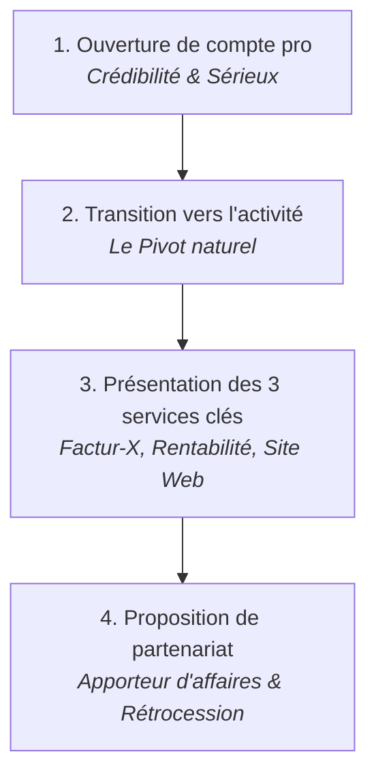

# Guide de Prospection & Partenariat Bancaire — Banque Populaire

> **Document stratégique :** Préparation de l'entretien avec le Directeur d'agence Banque Populaire pour l'ouverture de compte professionnel et la mise en place d'un partenariat d'apporteur d'affaires.

---

## 1. Contexte & Objectifs de l'appel

### Objectif A : Administratif (Indispensable)
- Ouvrir le compte bancaire professionnel de l'entreprise (auto-entrepreneur / TPE).
- Poser une posture de professionnel sérieux, carré, ambitieux et bien préparé.

### Objectif B : Commercial & Partenariat (Forte valeur)
- Présenter l'écosystème de services (**IT4WORK / MDIV Business**).
- Proposer au directeur de devenir **apporteur d'affaires / partenaire prescripteur** pour les clients de son agence (artisans, commerçants, indépendants, TPE).
- Mettre en place un système de commissionnement / rétrocession financière sur chaque client signé.

---

## 2. Psychologie du Directeur de Banque : Ce qu'il faut comprendre

Pour convaincre un banquier, il faut parler sa langue et répondre à ses angoisses :

| Ce qui intéresse le banquier | Ce qui fait peur au banquier |
| :--- | :--- |
| Des clients pros solvables qui remboursent leurs crédits sans incident. | Les entreprises qui travaillent à perte sans le savoir et finissent en défaut. |
| Moins de découverts sauvages et moins d'agios non autorisés à gérer. | Les propositions « sous la table » ou perçues comme de la corruption (Loi Sapin II / conformité). |
| Des clients qui encaissent leur argent vite et assainissent leur trésorerie. | L'angoisse de la réforme Factur-X 2026 pour ses TPE qui ne sont pas prêtes. |
| Fidéliser son portefeuille pro avec des solutions concrètes à forte valeur. | Un client auto-entrepreneur qui semble amateur ou désorganisé. |

> [!IMPORTANT]
> **Règle d'or de formulation :**  
> Ne jamais parler de « pourboire secret » ou « d'argent sous la table ». Formulez toujours cela comme une **« convention d'apporteur d'affaires »**, un **« partenariat de prescription »**, ou une **« rétrocession commerciale »**. S'il est ouvert à un cadre plus direct ou informel, c'est lui qui ouvrira la porte.

---

## 3. Traduction des Services : Du Jargon Tech au Langage "Banquier & Artisan"

Le terme « Data Scientist » ne veut rien dire pour un artisan ou un banquier local. Voici la grille de traduction exacte à employer :

| Jargon technique à bannir | Ce qu'on dit au banquier / prospect | Ce que ça résout concrètement |
| :--- | :--- | :--- |
| **Data Scientist / Data Analysis** | **Audit de rentabilité & Détection des fuites de marge** | Analyse les coûts réels, temps passés et factures pour identifier les chantiers rentables et ceux qui font perdre de l'argent. |
| **Machine Learning / Algorithmes** | **Activation prédictive du carnet clients** | Déclenche automatiquement les relances d'entretien, de contrôle ou de révision au bon moment (ex : révision annuelle chaudière, toiture). |
| **Refonte de site web** | **Vitrine moderne qui convertit les visites en appels et devis** | Remplace les vieux sites obsolètes par un site mobile rapide avec appel direct en 1 clic et formulaire de devis simple. |
| **Digitalisation des processus** | **Prise de rendez-vous & encaissement d'acomptes 24h/24** | Les clients réservent un créneau sans interrompre l'artisan sur le chantier et paient un acompte en ligne. |
| **Solution Facturation SaaS** | **Passage à la Facture Électronique 2026 & Relances polies** | Mise en conformité Factur-X / PPF immédiate et réduction de 10 à 15 jours des délais de paiement. |

---

## 4. Le Catalogue des Services à Forte Valeur Ajoutée

### Pôle 1 : La Gestion Quotidienne & Factur-X 2026 (SaaS IT4WORK)
- **Cible :** Tout artisan, indépendant, auto-entrepreneur.
- **Offre :** Devis en 2 minutes depuis smartphone, factures conformes DGFiP 2026, relances automatiques programmées et polies, scan OCR des tickets de dépenses.
- **Prix :** Gratuit au démarrage, puis à partir de **12 € HT/mois** sans engagement.

### Pôle 2 : L'Audit de Rentabilité & Sauvegarde de Trésorerie (Ex-Data Science)
- **Cible :** Les artisans/TPE qui font du volume mais ont toujours un compte bancaire à sec en fin de mois.
- **Offre :** Analyse complète des historiques de devis et factures. Détection des chantiers non rentables, ajustement de la grille tarifaire, identification des clients toxiques et prévisions d'encaissements.
- **Prix :** Prestation forfaitaire de **800 € à 1 800 € HT**.
- **Commission apporteur d'affaires :** **100 € à 250 €** pour le prescripteur.

### Pôle 3 : La Refonte de Site Web Orientée « Chiffre d'Affaires »
- **Cible :** Les pros qui ont un site vieux de 10 ans, invisible sur mobile, ou qui n'ont aucune visibilité locale.
- **Offre :** Site web moderne, ultra-rapide sur smartphone, fiche Google Maps optimisée (SEO local n°1 de leur ville), bouton d'appel direct, demande de devis en 3 clics et avis clients valorisés.
- **Prix :** Prestation clé en main de **1 500 € à 3 500 € HT**.
- **Commission apporteur d'affaires :** **150 € à 450 €** par dossier signé.

### Pôle 4 : La Digitalisation Complète & Prise de Rendez-vous 24h/24
- **Cible :** Les métiers de bouche, beauté/bien-être, auto/réparation, dépannage et services à domicile.
- **Offre :** Système de réservation en ligne, acompte par carte bancaire sécurisé, fiches clients intelligentes.
- **Prix :** De **1 200 € à 2 500 € HT**.
- **Commission apporteur d'affaires :** **120 € à 300 €**.

---

## 5. Script Téléphonique Mot à Mot pour l'Appel

### Étape 1 : Finaliser l'ouverture de compte
> **Vous :**  
> *« Bonjour Monsieur [Nom du directeur], merci beaucoup pour votre disponibilité. Comme convenu, j’ai préparé l’ensemble des pièces justificatives pour l’ouverture du compte professionnel de mon entreprise. Je tenais à m’adresser à la Banque Populaire car j’ai besoin d’une banque partenaire réactive, solide et ancrée dans le tissu économique local pour accompagner la croissance de mon activité. »*  
*(Laissez-le dérouler les formalités administratives habituelles).*

---

### Étape 2 : Le Pivot vers votre activité
> **Vous :**  
> *« Justement, Monsieur [Nom], au-delà de l'ouverture du compte, j'avais très envie d'échanger avec vous sur mon activité, parce qu'elle touche directement vos clients professionnels au quotidien.  
> 
> J'ai conçu et développé une solution technologique baptisée **IT4WORK**, spécialement taillée pour les artisans, indépendants et TPE locales. On les aide sur trois points où ils souffrent tous énormément :*
> 
> ***1. La conformité Factur-X et les impayés :***  
> *On leur permet d'émettre des factures 100 % conformes à la réforme électronique 2026 en 2 minutes depuis leur téléphone, et notre système relance automatiquement et poliment leurs clients en retard pour qu'ils soient payés 10 à 15 jours plus vite.*
> 
> ***2. L'audit de rentabilité réelle (ce que les grands groupes appellent la data science, mais adapté à l'artisan) :***  
> *Vous avez sûrement des clients pros qui travaillent 70 heures par semaine, font du volume, mais sont toujours dans le rouge en fin de mois. Moi, j'épluche leurs données de factures et de coûts pour leur montrer exactement quels chantiers leur rapportent une vraie marge, et où ils perdent de l'argent. En deux semaines, on stoppe les fuites de trésorerie.*
> 
> ***3. La refonte de leur site web pour générer du business :***  
> *Beaucoup de professionnels locaux ont un site web qui date de 10 ans, illisible sur mobile, qui ne leur apporte rien. Je leur construis une vitrine moderne, ultra-rapide, pensée pour convertir les visites locales en appels directs et en demandes de devis signés. »*

---

### Étape 3 : Toucher son intérêt de banquier
> **Vous :**  
> *« En tant que directeur d'agence, votre priorité absolue c'est d'avoir des clients professionnels en bonne santé, qui encaissent régulièrement, évitent les impayés et remboursent leurs crédits sans incident.  
> Quand un artisan passe par mes services, **sa trésorerie devient saine et prévisible, ce qui réduit immédiatement les risques de découvert non autorisé et de défaut chez vous.** »*

---

### Étape 4 : La proposition de « Deal » / Apporteur d'affaires
> **Vous :**  
> *« Vous avez dans votre portefeuille d'agence des dizaines de professionnels qui sont débordés par la paperasse, inquiets pour la réforme 2026, ou qui ont besoin de moderniser leur présence en ligne pour trouver des chantiers.  
> 
> J'aimerais qu'on mette en place une **vraie synergie locale** :  
> - Si vous ou vos conseillers identifiez un client professionnel qui galère avec ses devis, qui a besoin d'un audit de rentabilité ou d'une refonte de site web, vous lui recommandez mes services avec un avantage exclusif de votre part.  
> - Et de mon côté, **je prévois une convention d'apporteur d'affaires avec une commission de 10 à 15 % sur chaque dossier signé (ce qui représente 150 € à 450 € par client pour des missions de refonte web ou d'audit).**  
> 
> C'est du gagnant-gagnant : vos clients pros assainissent leur trésorerie, ils sont reconnaissants du conseil de la Banque Populaire, et chaque mise en relation est financièrement valorisée.  
> 
> Est-ce que c’est une démarche de collaboration qui pourrait vous intéresser pour votre agence ? »*

---

## 6. Traitement des Objections du Banquier

### Objection 1 : « En tant que banquier, la déontologie m'interdit de toucher des commissions personnelles »
> **Réponse prête :**  
> *« Je comprends et je respecte totalement votre cadre de déontologie. Dans ce cas, nous pouvons convertir cette rétrocession en avantage direct pour vos clients professionnels (par exemple : 2 à 3 mois d'abonnement offerts ou une remise exclusive de 15 % sur la refonte de leur site web "offerte par la Banque Populaire"). Cela renforce directement l'attachement de vos clients à votre agence. Et si votre groupe a un cadre conventionné de partenariat d'affaires inter-entreprises, nous nous y conformerons à 100 %. »*

### Objection 2 : « Nous avons déjà des partenaires ou des offres internes »
> **Réponse prête :**  
> *« C'est tout à fait normal pour les solutions génériques nationales. En revanche, ce que vos artisans apprécient avec moi, c'est l'ancrage local, la disponibilité directe au téléphone ou sur place, et la capacité à faire du sur-mesure (notamment sur l'audit de rentabilité et la refonte web). Vos offres internes peuvent tout à fait coexister, et je peux intervenir comme solution de proximité quand vos clients demandent un accompagnement humain réactif. »*

### Objection 3 : « Envoyez-moi un mail ou une brochure, je regarderai »
> **Réponse prête :**  
> *« C'est noté, je vous envoie dès aujourd'hui une présentation synthétique d'une page avec le lien vers la plateforme. Si vous êtes d'accord, je vous propose que l'on se cale un créneau de 10 minutes la semaine prochaine pour que je vous montre l'interface en direct ? Comme cela, vous aurez vu l'outil et vous saurez exactement à quel type de client le proposer. Quel jour vous conviendrait le mieux ? »*

---

## 7. Checklist Avant de Décrocher le Téléphone

- [ ] Avoir sous les yeux son numéro SIREN / avis de situation SIRENE.
- [ ] Avoir sa pièce d'identité et justificatif de domicile prêts à être envoyés.
- [ ] Avoir l'URL de la plateforme ouverte : `http://localhost:8080/services-ia` (ou le lien de production).
- [ ] Connaître ses chiffres clés par cœur :
  - Outil quotidien : à partir de **12 € HT/mois** sans engagement.
  - Refonte site web moderne : **1 500 € à 3 000 € HT**.
  - Audit de rentabilité / marge : **800 € à 1 500 € HT**.
  - Commission apporteur d'affaires : **10 à 15 %** par mission signée.
- [ ] Garder une posture d'égal à égal : vous ne quémandez pas une faveur, vous proposez un partenariat qui aide **ses** clients et sécurise son agence.
